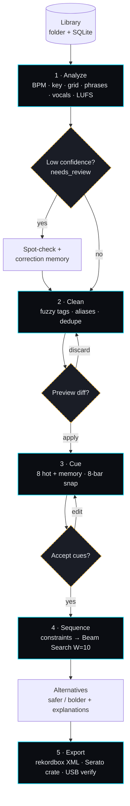
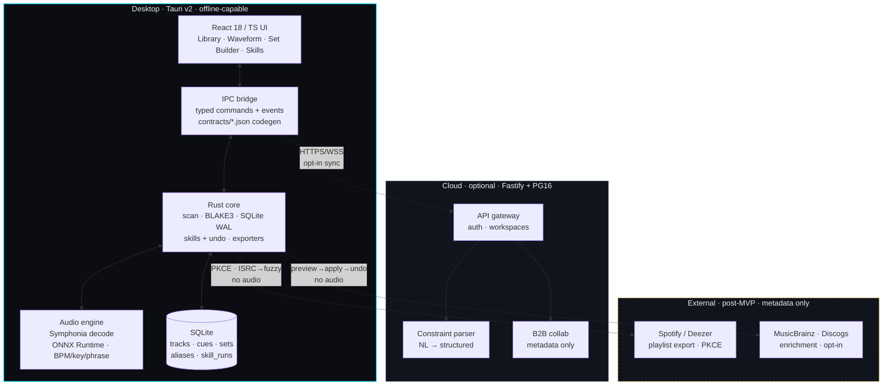

<p align="center">
  <a href="https://github.com/iDorgham/dj-assistant">
    
  </a>
</p>

<h1 align="center">DJ Assistant</h1>

<p align="center">
  <b>Turn a music library into a performance-ready DJ set.</b><br>
  Locally. In minutes. Without touching your files.
</p>

<p align="center">
  <a href="#status"></a>
  <a href="LICENSE"></a>
  
  
  <a href="CONTRIBUTING.md"></a>
  <br>
  
  
  
  
  
  
  
  
  
  
  <br>
  
  
  
  
  
  
</p>

<p align="center">
  <a href="#why">Why</a> &nbsp;·&nbsp;
  <a href="#screenshots">Screenshots</a> &nbsp;·&nbsp;
  <a href="#features">Features</a> &nbsp;·&nbsp;
  <a href="#how-it-works">How it works</a> &nbsp;·&nbsp;
  <a href="#architecture">Architecture</a> &nbsp;·&nbsp;
  <a href="#install">Install</a> &nbsp;·&nbsp;
  <a href="#quick-start">Develop</a> &nbsp;·&nbsp;
  <a href="#tech-stack">Stack</a> &nbsp;·&nbsp;
  <a href="#status">Status</a> &nbsp;·&nbsp;
  <a href="#documentation">Docs</a> &nbsp;·&nbsp;
  <a href="#contributing">Contributing</a>
</p>

---

<h3 align="center">
  <code>Analyze</code> → <code>Clean</code> → <code>Cue</code> → <code>Sequence</code> → <code>Export</code>
</h3>

<p align="center">
  <samp>Forty tracks. Under fifteen minutes. Entirely on your machine.</samp>
</p>

---

## Why

Working DJs spend 3–10 hours per week on preparation that is largely mechanical:
verifying metadata, detecting tempo and key, placing cue points, ordering tracks
so transitions hold, and producing exports that load reliably on club hardware.
For DJs preparing multiple sets per week — club, festival, mobile, and B2B —
this work scales linearly with every new batch of tracks.

The current workflow is fragmented:

- **Metadata is inconsistent.** The same producer appears as `Amelie Lens`,
  `AMELIE LENS`, `Amélie Lens`, or with `feat./ft./vs.` variants. Genre, key,
  and artwork fields are missing or contradictory across distributors and pools.
- **Musical attributes are missing or unreliable.** File tags carry incomplete
  BPM/key data with no confidence signal, no beat grid, and no phrase structure.
- **Cue placement does not scale.** Eight hot cues across 40 tracks is 320 manual
  decisions when done waveform by waveform.
- **Set sequencing carries live risk.** Tempo discontinuities, harmonic clashes,
  vocal overlaps, and energy drops are typically discovered during performance.
- **Exports fail at the worst point.** Incorrect USB filesystem/partition scheme,
  missing cues, or path-length issues surface on CDJs, not in the studio.

Existing solutions address one segment at a time — analysis, tag editing, or
export — and assume a clean library as input. Cloud-based analyzers require
uploading the full library and depend on connectivity. None provides a closed
loop from an unorganized folder to a verified, exportable set with reversible
operations throughout.

DJ Assistant is a desktop-first preparation accelerator designed to close that
loop within the workflow DJs already use:

1. **Analyze locally.** BPM, key (Camelot + classical), beat grid, phrase
   boundaries, vocal presence, and EBU R128 loudness are computed on-device via
   ONNX Runtime. Raw audio never leaves the machine; the core path works offline.
2. **Clean with control.** Fuzzy clustering normalizes artist/title variants with
   full preview, bulk apply, persistent aliases, and undo. Source audio files are
   never modified — all changes are database records and standard exports.
3. **Cue from structure.** Hot and memory cues are generated from detected
   phrases, snapped to 8-bar boundaries per genre template, and remain fully
   editable with visible AI provenance.
4. **Sequence deterministically.** DJs specify duration, tempo trajectory, key
   strategy, energy profile, and locks/exclusions. A Beam Search optimizer orders
   tracks by harmonic, tempo, and energy compatibility. Language models assist
   with constraint parsing and transition explanations only — they never determine
   final order.
5. **Export with verification.** rekordbox XML and Serato crates are generated
   deterministically, with USB media prepared to Pioneer-compatible standards
   (FAT32 + MBR default) and validated against CDJ-2000NXS2 / CDJ-3000 behavior.

The target outcome is a 40-track library analyzed, cleaned, cued, sequenced,
and exported in under 15 minutes, with zero source-file modification and every
bulk or automated action previewable and reversible.

| ✅ It is                                   | ❌ It is not                                        |
| ------------------------------------------ | --------------------------------------------------- |
| A local, on-device preparation accelerator | A live mixer, playback, or performance surface       |
| A companion to rekordbox / Serato / Traktor | A replacement for them or for CDJs                  |
| Structurally collaborative (B2B prep, P1)  | A social network, content calendar, or marketing tool |
| A scoped, reversible automation layer      | An autonomous agent taking irreversible actions      |
| Metadata + structure only                  | A downloader, or any piracy feature                  |

> Four principles we do not compromise on: **local-first**, **non-destructive**,
> **you stay in control**, and **transparent sequencing**.

## Screenshots

<p align="center">
  
  &nbsp;
  
</p>
<p align="center">
  <sub><b>Left:</b> Phase 0 library with live scan progress (94-track verified run). &nbsp; <b>Right:</b> instant, client-side search across title, artist, album, and path. Waveform, cue editor, and set builder follow in Phases 2–3.</sub>
</p>

## Features

<table>
  <tr>
    <td width="50%" valign="top">
      <h4>🎧 Local analysis</h4>
      BPM, key, beat grid, phrases, vocal presence, and EBU R128 loudness — all
      computed on-device through ONNX Runtime. Your audio never leaves the machine.
    </td>
    <td width="50%" valign="top">
      <h4>🎯 Intelligent cues</h4>
      Eight hot cues plus memory cues, snapped to 8-bar phrase boundaries and drawn
      from the track's actual structure. Every AI cue stays editable and marked.
    </td>
  </tr>
  <tr>
    <td width="50%" valign="top">
      <h4>🧹 Tag cleanup</h4>
      Cluster and normalise messy artist, title, and genre metadata with a
      <b>preview → apply → undo</b> flow. Aliases teach future imports.
    </td>
    <td width="50%" valign="top">
      <h4>🧬 Set building</h4>
      Constraint-driven sets that respect the Camelot wheel and an energy curve
      (tag + LUFS + slider). The LLM parses intent; a deterministic Beam Search
      decides order.
    </td>
  </tr>
  <tr>
    <td width="50%" valign="top">
      <h4>🤝 B2B collaboration (P1)</h4>
      Prepare a set with a partner in real time. Set structure and metadata are
      shared; <b>audio is never transferred</b>, and a sync check covers gig night.
    </td>
    <td width="50%" valign="top">
      <h4>📦 One-click export</h4>
      Rekordbox XML, Serato crates, CSV, and a Pioneer-tuned USB pack (FAT32+MBR
      default, P1 hardening) — generated deterministically and validated on real
      CDJs. Post-MVP <b>Spotify playlist export</b> publishes a set to your own
      account (metadata only).
    </td>
  </tr>
</table>

## How it works

Each stage is a **Skill** — a scoped, reversible unit with preview → apply → undo
backed by `skill_runs(before_state/after_state)`. Run the full chain or step
through one stage at a time. DJs review every automated decision.



Two intelligences, strict boundary: an LLM parses _intent_
("warm-up peaking near 128 BPM") and explains _results_. A deterministic
Beam Search decides _order_ from Camelot + tempo + energy scores — reproducible,
auditable, never hallucinated.

## Architecture

Privacy boundary first: decoding, inference, storage, and export all run on the
desktop. Only metadata and derived features sync — opt-in, never raw audio.



Contract drift fails CI; new settings require `settings.schema.json`
validation. See [API Contracts](./docs/architecture/API_CONTRACTS.md) and
[System Design](./docs/sdd/02-SYSTEM-DESIGN.md).

## Install

For DJs (pre-beta — builds from source until signed releases land):

| OS | Requirement | Notes |
|----|-------------|-------|
| Windows 10/11 64-bit | WebView2 (usually preinstalled), MSVC or GNU toolchain for source builds | See [Windows Build Runbook](./docs/engineering/WINDOWS_NATIVE_BUILD_RUNBOOK.md); GNU users run `pnpm ci:local:portable` |
| macOS 13+ (Apple Silicon + Intel) | Xcode CLT | CI builds `macos-latest`; no hands-on GUI test machine yet |
| Linux | WebKitGTK | Community-supported; core scan/analyze path is portable Rust |

1. **Get a build.** Until `release.yml` ships signed installers, build from source (next section) or take the CI artifact from `desktop-build.yml`.
2. **Models (optional for Phase 0).** Analysis models resolve via `DJ_ASSISTANT_MODELS_DIR` → `./models` → exe-adjacent `models/`. A 61-byte smoke graph (`fixtures/models/smoke_test.onnx`) verifies the loader; real ONNX weights land in Phase 1.
3. **First run.** Launch → pick a music folder → watch live scan progress → search the library. Data lives in local SQLite (WAL, FK on); artwork cached content-addressed under app data.
4. **Safety.** Source audio is never modified (hash-audited). USB formatting is a P1 advanced action: removable-only, no default selection, type-to-confirm, dry-run, MBR verify.

> No account, no upload, no telemetry by default. Opt-in providers (Spotify, enrichment) stay disabled until you enable them.

## Quick start

**For developers.** Prerequisites — Node ≥ 20, pnpm 10.14+, Rust 1.82+.

```bash
git clone https://github.com/iDorgham/dj-assistant.git
cd dj-assistant
pnpm install
pnpm dev:desktop        # desktop app (Tauri + Vite)
pnpm dev:api            # cloud API — optional
```

**Validate before you push.** The local CI mirrors the remote pipeline:

```bash
pnpm ci:local           # lint · typecheck · tests · rust fmt / clippy / test
pnpm ci:local:portable  # skips tests that need audio hardware / MSVC
```

The workspace holds three packages — `@dj-assistant/desktop`,
`@dj-assistant/api`, and `@dj-assistant/shared` — plus the Rust crates
`dj-assistant-core` and `dj-assistant-analysis`.

## Tech stack

| Layer            | Technology                                                             |
| ---------------- | ---------------------------------------------------------------------- |
| Desktop shell    | [Tauri](https://tauri.app/) v2                                          |
| Frontend         | [React](https://react.dev/) 18 · [TypeScript](https://www.typescriptlang.org/) 6 · [Vite](https://vite.dev/) 8 · [Tailwind](https://tailwindcss.com/) v4 |
| Local backend    | [Rust](https://www.rust-lang.org/) 1.82+ · [Symphonia](https://github.com/pdeljanov/Symphonia) · [ONNX Runtime](https://onnxruntime.ai/) · SQLite |
| Cloud API        | [Fastify](https://fastify.dev/) 5 (Node.js / TypeScript)                |
| Cloud data       | PostgreSQL 16 · [pgvector](https://github.com/pgvector/pgvector) · Redis · BullMQ |
| Models           | Local ONNX (beat, key, segmentation) · cloud LLM (constraint parsing)   |

## Status

**Phase 0 — Foundation complete; Phase 1 — Analysis in progress. Slim MVP per [audit](./docs/audit/AUDIT-SUMMARY.md): Import→Analyze→Cue→Export; USB/B2B/extra Skills are P1 (`TA.1–TA.14` in [Tasks](./docs/sdd/04-TASKS.md)).**

- [x] **Phase 0 · Foundation** — folder picker → recursive scan → BLAKE3
      fingerprinting → hash dedup → tag extraction → local SQLite → searchable
      library with live progress.
- [ ] **Phase 1 · Analysis** — local ONNX pipeline: BPM, key, beat grid, phrase
      segmentation, vocal presence, EBU R128 loudness, composite `analysis_version`.
      Golden 50-track fixtures + fixed bench spec (TA.6). _(in progress)_
- [ ] **Phase 2 · Library intelligence** — inspector, beatgrid editor, cue templates,
      tag cleanup preview→apply→undo + aliases, health score.
- [ ] **Phase 3 · Set builder & export** — locked scoring formula (TA.2), energy
      tag+LUFS+slider (TA.3), traffic-light + mix-out, versioning/diff, rekordbox /
      Serato / USB verify + set sheet, CDJ validation.
- [ ] **Phase 4 · Skills, cloud & B2B** — skills panel + `skill_runs` undo (TA.4),
      Gig Ready, collaboration, contract codegen + settings schema (TA.5/TA.7), beta.
- [ ] **Post-MVP · Discovery, enrichment & streaming export** — opt-in external
      similarity, tag/artwork lookup (preview→apply→undo), Beatport snapshots +
      release radar, multi-provider export (Spotify reference, Deezer second).
      Foundations already shipped (ADR-0007). Metadata only; no audio
      download/streaming/storage, no in-app playback.

CI workflows `pr-ci`, `main-ci`, `desktop-build`, and `nightly-audit` are active;
`release` and `codeql` remain templates. Branch protection on `main` is a
documented Phase 0 exception — see the
[workflow templates](./docs/devops/github-workflows/README.md#branch-protection--pending-plan-phase-0-exception-task-t0117).

## Documentation

Everything lives under [`docs/`](./docs/README.md). New here? Start with the
[Canonical Documentation](./docs/product/CANONICAL_DOCUMENTATION.md) — the single
source of truth — or the one-file
[Project Context](./docs/context/PROJECT_CONTEXT.md). Audit findings live in
[`docs/audit/`](./docs/audit/README.md) and are tracked as `TA.1–TA.14` in
[Tasks](./docs/sdd/04-TASKS.md).

<details>
<summary><b>Product</b> — spec, brief, glossary, milestone checklist</summary>

- [Canonical Documentation](./docs/product/CANONICAL_DOCUMENTATION.md)
- [Product Brief](./docs/product/PRODUCT_BRIEF.md)
- [Glossary](./docs/product/GLOSSARY.md)
- [Milestone Checklist](./docs/product/PO_MILESTONE_CHECKLIST.md)

</details>

<details>
<summary><b>Architecture</b> — system design, data model, contracts, models, skills</summary>

- [System Design](./docs/architecture/ARCHITECTURE.md)
- [Data Model](./docs/architecture/DATA_MODEL.md)
- [API Contracts](./docs/architecture/API_CONTRACTS.md)
- [Models](./docs/architecture/MODELS.md)
- [Skills System](./docs/architecture/SKILLS_SYSTEM.md)

</details>

<details>
<summary><b>Engineering</b> — development, standards, testing, security</summary>

- [Development](./docs/engineering/DEVELOPMENT.md)
- [Coding Standards](./docs/engineering/CODING_STANDARDS.md)
- [Testing & Security](./docs/engineering/TESTING_AND_SECURITY.md)
- [Security & Privacy](./docs/engineering/SECURITY_AND_PRIVACY.md)
- [Windows Build Runbook](./docs/engineering/WINDOWS_NATIVE_BUILD_RUNBOOK.md)
- [Phase 0 Acceptance Evidence](./docs/engineering/PHASE0_ACCEPTANCE_EVIDENCE.md)
- [Task List](./docs/engineering/DEVELOPMENT_TASK_LIST.md)

</details>

<details>
<summary><b>Process</b> — DevOps, CI/CD, AI automation, workflow templates</summary>

- [DevOps & CI/CD Plan](./docs/devops/DEVOPS_CICD_PLAN.md)
- [AI Development Automation](./docs/devops/AI_DEVELOPMENT_AUTOMATION_PLAN.md)
- [Pipeline Security](./docs/devops/CI_CD_PIPELINE_SECURITY.md)
- [Workflow Templates](./docs/devops/github-workflows/README.md)

</details>

<details>
<summary><b>Design</b> — UI/UX, wireframes, diagrams, and decision records</summary>

- [UI/UX Overview](./docs/ui-ux/README.md) · [UX Principles](./docs/ui-ux/UX_PRINCIPLES.md) · [Design System](./docs/ui-ux/DESIGN_SYSTEM.md)
- [Screens & Flows](./docs/ui-ux/SCREENS_AND_FLOWS.md) · [Wireframes](./docs/ui-ux/wireframes/README.md) · [Accessibility](./docs/ui-ux/ACCESSIBILITY.md)
- [Diagrams](./docs/diagrams/README.md) · [Entire-project overview](./docs/diagrams/00-ENTIRE-PROJECT-OVERVIEW.md)
- [Architecture Decision Records](./docs/ADR/README.md)

</details>

<details>
<summary><b>Spec-driven development</b> — spec → design → plan → tasks (incl. audit TA.x) → acceptance</summary>

- [Overview](./docs/sdd/README.md)
- [Specification](./docs/sdd/01-SPECIFICATION.md) — slim MVP: Import→Analyze→Cue→Export; USB/B2B/Skills→P1
- [System Design](./docs/sdd/02-SYSTEM-DESIGN.md)
- [Phases & Plan](./docs/sdd/03-PHASES-AND-PLAN.md)
- [Tasks](./docs/sdd/04-TASKS.md) — incl. audit-driven `TA.1–TA.14`
- [Acceptance](./docs/sdd/05-ACCEPTANCE.md) — golden fixtures + contract/settings gates

</details>

<details>
<summary><b>Audit</b> — specs / functions / settings review + improvements</summary>

- [Audit summary](./docs/audit/AUDIT-SUMMARY.md) — pros, cons, top fixes, proposals
- [Specs](./docs/audit/01-specs-audit.md) · [Functions](./docs/audit/02-functions-audit.md) · [Settings](./docs/audit/03-settings-audit.md)
- [Improvements](./docs/audit/04-improvements.md) · [Proposed specs & functions](./docs/audit/05-proposed-specs-functions.md)

</details>

## Contributing

Contributions are welcome — bugs, docs, tests, and features alike. Read the
[Contributing Guide](./CONTRIBUTING.md) first, and open an issue before large
changes so the direction is agreed up front.

Commits follow [Conventional Commits](https://www.conventionalcommits.org/).
Before opening a PR, run `pnpm ci:local`.

---

## Acknowledgments

Built on excellent open source: [Tauri](https://tauri.app/) ·
[Symphonia](https://github.com/pdeljanov/Symphonia) ·
[ONNX Runtime](https://onnxruntime.ai/) ·
[madmom](https://github.com/CPJKU/madmom) ·
[pgvector](https://github.com/pgvector/pgvector).

Part of this project is inspired by the signal-processing work of the madmom team,
and by the many DJs who shared how they actually prepare.

## License

[MIT](LICENSE) © 2026 iDorgham.

<br>

<p align="center">
  
</p>

<p align="center">
  <sub>Built for DJs who value preparation time.<br>
  Product decisions live in the <a href="./docs/product/CANONICAL_DOCUMENTATION.md">Canonical Documentation</a>.</sub>
</p>
