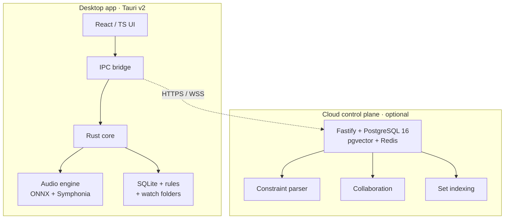

<p align="center">
  <picture>
    <source media="(prefers-color-scheme: dark)" srcset="https://raw.githubusercontent.com/dj-assistant/dj-assistant/main/assets/logo-dark.svg">
    <source media="(prefers-color-scheme: light)" srcset="https://raw.githubusercontent.com/dj-assistant/dj-assistant/main/assets/logo-light.svg">
    
  </picture>
</p>

<h1 align="center">DJ Assistant</h1>

<p align="center">
  Turn a music library into a performance-ready DJ set.<br>
  Locally. In minutes.
</p>

<p align="center">
  <a href="https://github.com/dj-assistant/dj-assistant/releases"></a>
  <a href="LICENSE"></a>
  
  
</p>

<p align="center">
  <a href="#how-it-works">How it works</a> &nbsp;·&nbsp;
  <a href="#architecture">Architecture</a> &nbsp;·&nbsp;
  <a href="#tech-stack">Stack</a> &nbsp;·&nbsp;
  <a href="#quick-start">Quick start</a> &nbsp;·&nbsp;
  <a href="#documentation">Docs</a> &nbsp;·&nbsp;
  <a href="#contributing">Contributing</a>
</p>

---

**Analyze → Clean → Cue → Sequence → Export.**

Forty tracks. Under fifteen minutes. Entirely on your machine.

---

## The idea

Working DJs lose hours to preparation that should not take hours. Tags arrive
inconsistent. Key and tempo are missing or wrong. Cues are placed one track at a
time. Sets get built by dragging files around until something fits.

DJ Assistant handles the busywork so you can focus on the set.

It is a **desktop-first preparation accelerator** — not a live mixer, not a
social network, not a downloader. It plugs into the workflow you already have
and exports to the software you already play on.

## Local by default

Your audio never leaves your computer.

Analysis runs on-device through ONNX Runtime. Source files are never modified.
Every automated action is scoped, previewable, and reversible. The cloud is
optional, and only ever used for collaboration and shared indexing.

> Four principles we do not compromise on: **local-first**, **non-destructive**,
> **you stay in control**, and **transparent sequencing**.

## How it works

```
  ┌──────────┐   ┌──────────┐   ┌──────────┐   ┌──────────┐   ┌──────────┐
  │ Analyze  │ → │  Clean   │ → │   Cue    │ → │ Sequence │ → │  Export  │
  └──────────┘   └──────────┘   └──────────┘   └──────────┘   └──────────┘
    BPM, key,      tags &         hot cues,      harmonic &      .nml,
    beat grid,     dedupe         loops          energy-aware    .crate,
    structure      (BLAKE3)                      Beam Search     USB
```

Each stage is a **Skill** — a small, reversible unit of automation with clear
inputs and outputs. You can run the whole chain, or step through it one piece at
a time.

Two kinds of intelligence do the heavy lifting. A language model interprets
*intent* — "warm-up that peaks near 128 BPM." A deterministic Beam Search engine
decides *order*, constrained by the Camelot wheel and an energy curve. Flexible
where it should be, reproducible where it matters.

## Architecture

A Tauri v2 desktop app with a Rust core. The cloud control plane is optional.



Everything performance-critical or privacy-sensitive lives on the desktop:
decoding, inference, storage, and filesystem watching. The front end talks to
the Rust core over a typed IPC bridge. Enable the cloud and you gain real-time
B2B collaboration and cross-set indexing; skip it and lose nothing from the core
preparation path.

## Tech stack

| Layer | Technology |
| --- | --- |
| Desktop shell | [Tauri](https://tauri.app/) v2 |
| Frontend | React 18 · TypeScript 5.6 · Tailwind · Zustand |
| Local backend | Rust 1.82+ · Symphonia · ONNX Runtime · SQLite |
| Cloud API | Fastify (Node.js / TypeScript) |
| Cloud data | PostgreSQL 16 · pgvector · Redis · BullMQ |
| Models | Local ONNX (beat, key, segmentation) · cloud LLM (constraints) |

## Quick start

**Prerequisites** — Node ≥ 20, pnpm 10.14+, Rust 1.82+. On Windows, see the
[Windows Build Runbook](./docs/engineering/WINDOWS_NATIVE_BUILD_RUNBOOK.md).

```bash
git clone https://github.com/dj-assistant/dj-assistant.git
cd dj-assistant
pnpm install
pnpm dev:desktop        # desktop app
pnpm dev:api            # cloud API (optional)
```

**Validate before you push.** The local CI mirrors the remote pipeline:

```bash
pnpm ci:local           # lint · typecheck · tests · rust fmt/clippy/test
pnpm ci:local:portable  # skips tests needing audio hardware
```

The workspace has three packages: `@dj-assistant/desktop`,
`@dj-assistant/api`, and `@dj-assistant/shared`.

## Documentation

Everything lives under [`docs/`](./docs/README.md). New here? Start with the
[Canonical Documentation](./docs/product/CANONICAL_DOCUMENTATION.md) — the
single source of truth.

**Product** — [Canonical spec](./docs/product/CANONICAL_DOCUMENTATION.md) ·
[Product brief](./docs/product/PRODUCT_BRIEF.md) ·
[Glossary](./docs/product/GLOSSARY.md) ·
[Milestone checklist](./docs/product/PO_MILESTONE_CHECKLIST.md)

**Architecture** — [System design](./docs/architecture/ARCHITECTURE.md) ·
[Data model](./docs/architecture/DATA_MODEL.md) ·
[API contracts](./docs/architecture/API_CONTRACTS.md) ·
[Models](./docs/architecture/MODELS.md) ·
[Skills](./docs/architecture/SKILLS_SYSTEM.md)

**Engineering** — [Development](./docs/engineering/DEVELOPMENT.md) ·
[Coding standards](./docs/engineering/CODING_STANDARDS.md) ·
[Testing & security](./docs/engineering/TESTING_AND_SECURITY.md) ·
[Security & privacy](./docs/engineering/SECURITY_AND_PRIVACY.md) ·
[Task list](./docs/engineering/DEVELOPMENT_TASK_LIST.md)

**Process** — [DevOps & CI/CD](./docs/devops/DEVOPS_CICD_PLAN.md) ·
[AI automation](./docs/devops/AI_DEVELOPMENT_AUTOMATION_PLAN.md) ·
[Pipeline security](./docs/devops/CI_CD_PIPELINE_SECURITY.md) ·
[Workflow templates](./docs/devops/github-workflows/README.md)

**Spec-driven development** — [Overview](./docs/sdd/README.md) ·
[Spec](./docs/sdd/01-SPECIFICATION.md) ·
[Design](./docs/sdd/02-SYSTEM-DESIGN.md) ·
[Plan](./docs/sdd/03-PHASES-AND-PLAN.md) ·
[Tasks](./docs/sdd/04-TASKS.md) ·
[Acceptance](./docs/sdd/05-ACCEPTANCE.md)

**Diagrams** — [Overview](./docs/diagrams/00-ENTIRE-PROJECT-OVERVIEW.md) ·
[All diagrams](./docs/diagrams/README.md) ·
[Decisions (ADR)](./docs/ADR/README.md)

## Status

Currently in **Phase 0 — Foundation**. Acceptance criteria are verified;
product-owner sign-off is pending.

**Working today:** native folder picker → recursive scan → BLAKE3
fingerprinting → hash dedup → tag extraction → local SQLite → searchable
library with live scan progress.

**Next:** Phase 1 — the local ONNX analysis pipeline (BPM, key, beat grid,
structural segmentation).

CI workflows `pr-ci`, `main-ci`, `desktop-build`, and `nightly-audit` are
active. `release` and `codeql` remain templates. Branch protection on `main` is
a documented Phase 0 exception — see the
[workflow templates](./docs/devops/github-workflows/README.md#branch-protection--pending-plan-phase-0-exception-task-t0117).

## Contributing

Contributions are welcome — bugs, docs, tests, and features alike. Read the
[Contributing Guide](./CONTRIBUTING.md) first, and open an issue before large
changes so the direction is agreed up front.

Commits follow [Conventional Commits](https://www.conventionalcommits.org/).
Before opening a PR, run `pnpm ci:local`.

---

## Acknowledgments

Built on excellent open source: [Tauri](https://tauri.app/) ·
[Symphonia](https://github.com/pdeljanov/Symphonia) ·
[ONNX Runtime](https://onnxruntime.ai/) ·
[madmom](https://github.com/CPJKU/madmom) ·
[pgvector](https://github.com/pgvector/pgvector).

Part of this project is inspired by the signal-processing work of the madmom
team, and by the many DJs who shared how they actually prepare.

## License

[MIT](LICENSE).

<br>

<p align="center">
  <sub>Built for DJs who value preparation time.<br>
  Product decisions live in the <a href="./docs/product/CANONICAL_DOCUMENTATION.md">Canonical Documentation</a>.</sub>
</p>
