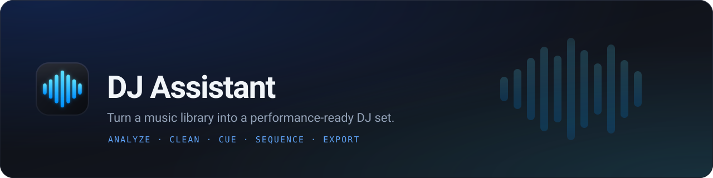
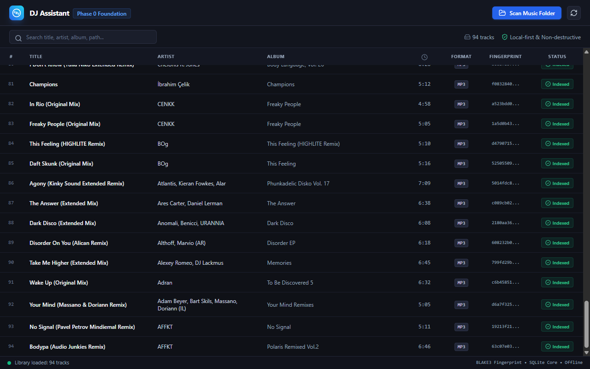
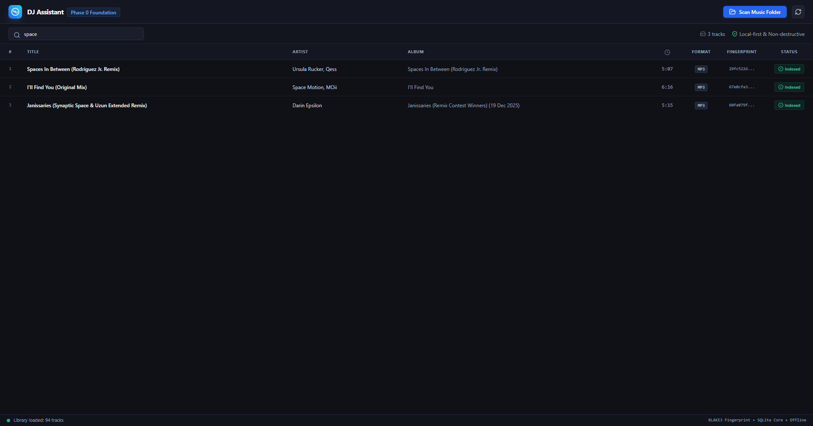
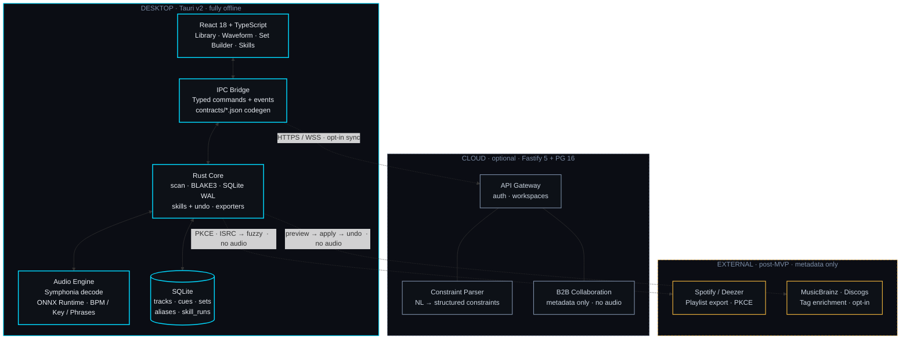
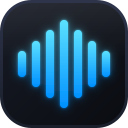

<p align="center">
  <a href="https://github.com/iDorgham/dj-assistant">
    
  </a>
</p>

<h1 align="center">DJ Assistant</h1>

<p align="center">
  <b>Turn a music library into a performance-ready DJ set.</b><br>
  Locally. In minutes. Without touching your files.
</p>

<p align="center">
  <a href="#status"></a>
  <a href="LICENSE"></a>
  
  
  <a href="CONTRIBUTING.md"></a>
</p>

<p align="center">
  
  
  
  
  
  
  
  
  
  
</p>

<p align="center">
  
  
  
  
  
  
</p>

<p align="center">
  <a href="#-the-problem">The Problem</a> &nbsp;·&nbsp;
  <a href="#-screenshots">Screenshots</a> &nbsp;·&nbsp;
  <a href="#-features">Features</a> &nbsp;·&nbsp;
  <a href="#-how-it-works">How It Works</a> &nbsp;·&nbsp;
  <a href="#-architecture">Architecture</a> &nbsp;·&nbsp;
  <a href="#-installation">Install</a> &nbsp;·&nbsp;
  <a href="#-developer-quick-start">Develop</a> &nbsp;·&nbsp;
  <a href="#-tech-stack">Stack</a> &nbsp;·&nbsp;
  <a href="#-roadmap--status">Roadmap</a> &nbsp;·&nbsp;
  <a href="#-documentation">Docs</a> &nbsp;·&nbsp;
  <a href="#-contributing">Contributing</a>
</p>

---

<h3 align="center">
  <code>Analyze</code> → <code>Clean</code> → <code>Cue</code> → <code>Sequence</code> → <code>Export</code>
</h3>

<p align="center">
  <samp>Forty tracks. Under fifteen minutes. Entirely on your machine.</samp>
</p>

---

## 🎯 The Problem

Working DJs spend **3–10 hours per week** on preparation that is almost entirely mechanical. Verifying metadata, detecting tempo and key, placing cue points, ordering tracks so transitions hold, producing exports that load reliably on club hardware — every batch of new tracks multiplies the workload linearly. For DJs managing club, festival, mobile, and B2B sets simultaneously, this adds up fast.

The existing workflow is fragmented across tools that solve only one piece of the puzzle:

**Inconsistent metadata** is perhaps the biggest silent tax. The same producer might be tagged as `Amelie Lens`, `AMELIE LENS`, `Amélie Lens`, or variations including `feat./ft./vs.` prefixes — all depending on which distributor or record pool the file came from. Genre, key, and artwork fields are frequently missing, empty, or flatly contradictory across sources.

**Unreliable audio analysis** compounds the problem. File tags carry BPM and key data with no confidence signal, no beat grid, and no phrase structure to anchor cue placement. You're expected to trust a number with no indication of how it was computed or whether it can be trusted.

**Cue placement doesn't scale.** Placing eight hot cues across 40 tracks means 320 individual, manual, waveform-by-waveform decisions — none informed by track structure, none reversible in bulk.

**Set sequencing carries live risk.** Tempo discontinuities, harmonic clashes, vocal overlaps, and energy crashes are typically discovered during the performance itself, not in the studio the night before.

**USB exports fail at the worst moment.** An incorrect filesystem or partition scheme, a missing cue, or a path-length edge case surfaces on the CDJs in the booth, not in the comfort of your studio.

Existing tools address each of these problems in isolation and assume a clean library as their starting point. Cloud-based analyzers require uploading your entire collection and break when connectivity is unreliable. None provides a closed loop — from an unorganized folder of new tracks to a verified, exportable set — with every step previewable and reversible.

**DJ Assistant closes that loop.**

1. **Analyze locally.** BPM, key (Camelot + classical notation), beat grid, phrase boundaries, vocal presence, and EBU R128 loudness are computed on-device via ONNX Runtime. Your raw audio never leaves the machine; the core analysis path is fully offline.
2. **Clean with control.** Fuzzy clustering detects and normalizes artist and title variants with a full preview before any change is applied. Persistent aliases teach future imports. Source audio files are never modified — every change is a database record, reversible at any time.
3. **Cue from structure.** Hot and memory cues are generated from detected phrase boundaries, snapped to 8-bar grid markers per genre template. Every AI-placed cue is editable, and every automated decision is marked with visible AI provenance.
4. **Sequence deterministically.** Specify your desired duration, tempo trajectory, key strategy, energy profile, locks, and exclusions. A Beam Search optimizer orders tracks by harmonic, tempo, and energy compatibility. Language models assist with constraint parsing and transition explanations only — they never determine the final order.
5. **Export with verification.** rekordbox XML and Serato crates are generated deterministically. USB media is prepared to Pioneer-compatible standards (FAT32 + MBR default) and validated against CDJ-2000NXS2 / CDJ-3000 behavior before you leave the studio.

The target: a 40-track library analyzed, cleaned, cued, sequenced, and exported in **under 15 minutes** — zero source-file modifications, every bulk or automated action previewable and reversible.

| ✅ It is                                     | ❌ It is not                                        |
| -------------------------------------------- | --------------------------------------------------- |
| A local, on-device preparation accelerator   | A live mixer, playback, or performance surface       |
| A companion to rekordbox / Serato / Traktor  | A replacement for them or for CDJs                  |
| Structurally collaborative (B2B prep, P1)    | A social network, content calendar, or marketing tool |
| A scoped, reversible automation layer        | An autonomous agent taking irreversible actions      |
| Metadata + structure only                    | A downloader, or any piracy feature                  |

> **Four principles, non-negotiable:** local-first · non-destructive · you stay in control · transparent sequencing.

---

## 📸 Screenshots

<p align="center">
  
  &nbsp;
  
</p>
<p align="center">
  <sub>
    <b>Left:</b> Phase 0 library view with live scan progress — verified run with 94 tracks.<br>
    <b>Right:</b> Instant, client-side search across title, artist, album, and file path.<br>
    Waveform editor, cue point UI, and set builder ship in Phases 2–3.
  </sub>
</p>

---

## ✨ Features

<table>
  <tr>
    <td width="50%" valign="top">
      <h4>Local On-Device Analysis</h4>
      BPM, key (Camelot + classical notation), beat grid, phrase boundaries, vocal presence detection, and EBU R128 loudness — all computed on your machine through ONNX Runtime. Your audio never leaves your studio, and the full analysis pipeline works completely offline.
    </td>
    <td width="50%" valign="top">
      <h4>Structure-Aware Cue Points</h4>
      Eight hot cues plus memory cues, automatically positioned at detected phrase boundaries and snapped to 8-bar grid markers per genre template. Every AI-placed cue is clearly marked, fully editable, and backed by provenance data so you know exactly why it landed where it did.
    </td>
  </tr>
  <tr>
    <td width="50%" valign="top">
      <h4>Intelligent Tag Cleanup</h4>
      Fuzzy clustering identifies and normalizes messy artist names, titles, and genre metadata across your entire library. Every change goes through a <b>preview → apply → undo</b> flow. Persistent aliases ensure the same variant never slips through again on future imports.
    </td>
    <td width="50%" valign="top">
      <h4>Constraint-Driven Set Building</h4>
      Describe the set you want in plain language — tempo arc, key strategy, energy profile, must-include tracks, hard exclusions. The LLM parses your intent into structured constraints; a deterministic Beam Search (width=10) decides the final order from Camelot + tempo + energy scores. Reproducible and auditable — never hallucinated.
    </td>
  </tr>
  <tr>
    <td width="50%" valign="top">
      <h4>B2B Collaboration (Phase 1)</h4>
      Prepare a set alongside a partner in real time. Set structure and metadata are shared live; <b>audio is never transferred between machines</b>. A sync check on gig night ensures both libraries agree before you walk into the booth.
    </td>
    <td width="50%" valign="top">
      <h4>Verified One-Click Export</h4>
      rekordbox XML, Serato crates, CSV, and a Pioneer-tuned USB pack (FAT32 + MBR default) — all generated deterministically and validated against real CDJ behavior. Post-MVP: <b>Spotify playlist export</b> publishes your set to your own account (metadata only, no audio streaming).
    </td>
  </tr>
</table>

---

## ⚙️ How It Works

Each stage of the preparation pipeline is a **Skill** — a scoped, reversible processing unit backed by `skill_runs` records with full `before_state / after_state` snapshots. Run the entire chain end-to-end or step through one stage at a time. Every automated decision is reviewable before it is committed.

```mermaid
flowchart LR
    Lib[("🗄 Library\nFolder · SQLite")]

    subgraph P1["  ① ANALYZE  "]
        Analyze["BPM · Key · Beat Grid\nPhrases · Vocals · LUFS"]
        ReviewA{{"Low confidence?"}}
        FixA["Spot-check &\nCorrection Memory"]
    end

    subgraph P2["  ② CLEAN  "]
        Clean["Fuzzy Tags · Aliases\nDedupe"]
        PreviewC{{"Preview diff?"}}
    end

    subgraph P3["  ③ CUE  "]
        Cue["8 Hot Cues · Memory\n8-bar Snap · AI Provenance"]
        ReviewC{{"Accept cues?"}}
    end

    subgraph P4["  ④ SEQUENCE  "]
        Seq["NL Constraints →\nBeam Search  W=10"]
        Alt["Safer / Bolder\nAlternatives"]
    end

    subgraph P5["  ⑤ EXPORT  "]
        Export["rekordbox XML\nSerato · USB Verify"]
    end

    Lib       --> Analyze
    Analyze   --> ReviewA
    ReviewA   -- "needs review" --> FixA
    FixA      --> Clean
    ReviewA   -- "confident"    --> Clean
    Clean     --> PreviewC
    PreviewC  -- "apply"        --> Cue
    PreviewC  -- "discard"      --> Clean
    Cue       --> ReviewC
    ReviewC   -- "edit"         --> Cue
    ReviewC   -- "accept"       --> Seq
    Seq       --> Alt
    Alt       --> Export

    classDef stage  fill:#0D1117,stroke:#00D9FF,stroke-width:2px,color:#E9EDF3,rx:6
    classDef gate   fill:#161B27,stroke:#F7B93E,stroke-width:2px,color:#F7B93E,stroke-dasharray:4 3
    classDef db     fill:#0D1117,stroke:#00D9FF,stroke-width:2px,color:#E9EDF3
    classDef sub    fill:#0B0D14,stroke:#1E2533,stroke-width:1px,color:#7C8DA6

    class Analyze,Clean,Cue,Seq,Export,Alt,FixA stage
    class ReviewA,PreviewC,ReviewC gate
    class Lib db
    class P1,P2,P3,P4,P5 sub
```



**Two intelligences, one strict boundary.** A language model parses natural-language intent ("warm-up set peaking near 128 BPM with a hard key lock") and explains the resulting sequence in plain language. A deterministic Beam Search makes all ordering decisions from Camelot compatibility, tempo delta, and energy scores — reproducible, auditable, never hallucinated, and independent of LLM availability.

---

## 🏗️ Architecture

Privacy is not a feature — it is the structural foundation. Audio decoding, model inference, data storage, and export all happen on your desktop. Only metadata and derived features ever touch the network, and only when you opt in.



The desktop shell is a **Tauri v2** application: a Rust core handles all performance-critical work (scanning, fingerprinting, audio analysis, export), while a React + TypeScript frontend communicates through a fully typed IPC bridge. The bridge contracts are code-generated — contract drift fails CI immediately. Cloud connectivity is optional and strictly additive; the app works completely without it.

See [API Contracts](./docs/architecture/API_CONTRACTS.md) and [System Design](./docs/sdd/02-SYSTEM-DESIGN.md) for the full picture.

---

## 📦 Installation

> Pre-beta: signed release installers are not yet available. Until `release.yml` ships, build from source or take a CI artifact from `desktop-build.yml`.

### Platform Requirements

| OS | Minimum | Notes |
|----|---------|-------|
| Windows 10/11 64-bit | WebView2 (typically pre-installed), MSVC or GNU toolchain | See the [Windows Build Runbook](./docs/engineering/WINDOWS_NATIVE_BUILD_RUNBOOK.md). GNU users run `pnpm ci:local:portable` |
| macOS 13+ (Apple Silicon + Intel) | Xcode Command Line Tools | CI builds `macos-latest`; no hands-on GUI test machine yet |
| Linux | WebKitGTK | Community-supported; core scan/analyze path is portable Rust |

### Setup Steps

1. **Get a build.** Take the CI artifact from `desktop-build.yml`, or build from source using the Quick Start below.
2. **Analysis models (optional for Phase 0).** Models resolve via `DJ_ASSISTANT_MODELS_DIR` → `./models` → the `models/` directory adjacent to the executable. A 61-byte smoke graph (`fixtures/models/smoke_test.onnx`) verifies the model loader; production ONNX weights land in Phase 1.
3. **First launch.** Open the app, pick a music folder, and watch the live scan progress. Your library is immediately searchable across title, artist, album, and file path. All data lives in a local SQLite database (WAL mode, foreign keys on); artwork is cached content-addressed under the OS app-data directory.
4. **USB formatting (Phase 1).** This is a deliberate advanced action: removable drives only, no default selection, type-to-confirm dialog, dry-run mode, and post-format MBR verification. It never runs without explicit intent.

> No account required. No upload required. No telemetry by default. Opt-in providers (Spotify, metadata enrichment) remain disabled until you explicitly enable them.

---

## 🚀 Developer Quick Start

**Prerequisites:** Node.js ≥ 20, pnpm 10.14+, Rust 1.82+

```bash
git clone https://github.com/iDorgham/dj-assistant.git
cd dj-assistant
pnpm install
pnpm dev:desktop        # Launch the desktop app (Tauri + Vite dev server)
pnpm dev:api            # Launch the cloud API — optional
```

### Run the Local CI

Before pushing, validate locally. The local CI pipeline mirrors what runs on GitHub Actions:

```bash
pnpm ci:local           # lint · typecheck · tests · rust fmt / clippy / test
pnpm ci:local:portable  # skips tests that require audio hardware or MSVC
```

### Workspace Structure

The monorepo contains three Node.js packages and two Rust crates:

| Package / Crate | Description |
|-----------------|-------------|
| `@dj-assistant/desktop` | Tauri + React + TypeScript frontend |
| `@dj-assistant/api` | Fastify cloud API (optional) |
| `@dj-assistant/shared` | Shared TypeScript types and utilities |
| `dj-assistant-core` | Rust core: scan, fingerprint, SQLite, skills, export |
| `dj-assistant-analysis` | Rust audio engine: Symphonia decode + ONNX inference |

---

## 🛠 Tech Stack

| Layer | Technology |
|-------|------------|
| Desktop shell | [Tauri](https://tauri.app/) v2 |
| Frontend | [React](https://react.dev/) 18 · [TypeScript](https://www.typescriptlang.org/) 6 · [Vite](https://vite.dev/) 8 · [Tailwind CSS](https://tailwindcss.com/) v4 |
| Local backend | [Rust](https://www.rust-lang.org/) 1.82+ · [Symphonia](https://github.com/pdeljanov/Symphonia) · [ONNX Runtime](https://onnxruntime.ai/) · SQLite |
| Cloud API | [Fastify](https://fastify.dev/) 5 (Node.js / TypeScript) |
| Cloud data | PostgreSQL 16 · [pgvector](https://github.com/pgvector/pgvector) · Redis · BullMQ |
| AI / Models | Local ONNX (beat detection, key estimation, phrase segmentation) · Cloud LLM (constraint parsing, natural-language explanations only) |

---

## 🗺 Roadmap & Status

**Phase 0 — Foundation is complete. Phase 1 — Analysis is in progress.** The slim MVP scope is Import → Analyze → Cue → Export; USB formatting, B2B collaboration, and advanced Skills land in Phase 1 (`TA.1–TA.14` tracked in [Tasks](./docs/sdd/04-TASKS.md)).

- [x] **Phase 0 · Foundation** — folder picker → recursive scan → BLAKE3 fingerprinting → hash deduplication → tag extraction → local SQLite → fully searchable library with live progress UI.
- [ ] **Phase 1 · Analysis** *(in progress)* — local ONNX pipeline: BPM, key, beat grid, phrase segmentation, vocal presence, EBU R128 loudness, composite `analysis_version`. Golden 50-track fixtures and a fixed benchmark spec (TA.6).
- [ ] **Phase 2 · Library Intelligence** — track inspector, beatgrid editor, cue point templates, tag cleanup (preview → apply → undo + persistent aliases), library health score.
- [ ] **Phase 3 · Set Builder & Export** — locked scoring formula (TA.2), energy tag + LUFS + slider (TA.3), traffic-light mix-out indicators, set versioning/diff, rekordbox / Serato / USB verify + printed set sheet, CDJ validation.
- [ ] **Phase 4 · Skills, Cloud & B2B** — skills panel + `skill_runs` undo (TA.4), Gig Ready flow, real-time B2B collaboration, contract codegen + settings schema validation (TA.5/TA.7), public beta.
- [ ] **Post-MVP · Discovery, Enrichment & Streaming Export** — opt-in external similarity search, tag/artwork lookup (preview → apply → undo), Beatport release radar, multi-provider export (Spotify reference playlist, Deezer). Metadata only; no audio download, in-app streaming, or storage.

CI workflows `pr-ci`, `main-ci`, `desktop-build`, and `nightly-audit` are active. `release` and `codeql` remain templates. Branch protection on `main` is a documented Phase 0 exception — see the [workflow templates docs](./docs/devops/github-workflows/README.md#branch-protection--pending-plan-phase-0-exception-task-t0117).

---

## 📚 Documentation

Everything lives under [`docs/`](./docs/README.md). New here? Start with the [Canonical Documentation](./docs/product/CANONICAL_DOCUMENTATION.md) — the single source of truth for product decisions — or the one-file [Project Context](./docs/context/PROJECT_CONTEXT.md) for a fast orientation. Audit findings are tracked as `TA.1–TA.14` in [Tasks](./docs/sdd/04-TASKS.md).

<details>
<summary><b>Product</b> — spec, brief, glossary, milestone checklist</summary>

- [Canonical Documentation](./docs/product/CANONICAL_DOCUMENTATION.md)
- [Product Brief](./docs/product/PRODUCT_BRIEF.md)
- [Glossary](./docs/product/GLOSSARY.md)
- [Milestone Checklist](./docs/product/PO_MILESTONE_CHECKLIST.md)

</details>

<details>
<summary><b>Architecture</b> — system design, data model, contracts, models, skills</summary>

- [System Design](./docs/architecture/ARCHITECTURE.md)
- [Data Model](./docs/architecture/DATA_MODEL.md)
- [API Contracts](./docs/architecture/API_CONTRACTS.md)
- [Models](./docs/architecture/MODELS.md)
- [Skills System](./docs/architecture/SKILLS_SYSTEM.md)

</details>

<details>
<summary><b>Engineering</b> — development, standards, testing, security</summary>

- [Development Guide](./docs/engineering/DEVELOPMENT.md)
- [Coding Standards](./docs/engineering/CODING_STANDARDS.md)
- [Testing & Security](./docs/engineering/TESTING_AND_SECURITY.md)
- [Security & Privacy](./docs/engineering/SECURITY_AND_PRIVACY.md)
- [Windows Build Runbook](./docs/engineering/WINDOWS_NATIVE_BUILD_RUNBOOK.md)
- [Phase 0 Acceptance Evidence](./docs/engineering/PHASE0_ACCEPTANCE_EVIDENCE.md)
- [Task List](./docs/engineering/DEVELOPMENT_TASK_LIST.md)

</details>

<details>
<summary><b>Process</b> — DevOps, CI/CD, AI automation, workflow templates</summary>

- [DevOps & CI/CD Plan](./docs/devops/DEVOPS_CICD_PLAN.md)
- [AI Development Automation](./docs/devops/AI_DEVELOPMENT_AUTOMATION_PLAN.md)
- [Pipeline Security](./docs/devops/CI_CD_PIPELINE_SECURITY.md)
- [Workflow Templates](./docs/devops/github-workflows/README.md)

</details>

<details>
<summary><b>Design</b> — UI/UX, wireframes, diagrams, and decision records</summary>

- [UI Specification (current)](./docs/ui/README.md) · [Design System](./docs/ui/01-DESIGN-SYSTEM.md) · [Shell & Navigation](./docs/ui/02-SHELL-AND-NAVIGATION.md) · [Player](./docs/ui/06-PLAYER.md)
- [Earlier UI/UX set](./docs/ui-ux/README.md) · [UX Principles](./docs/ui-ux/UX_PRINCIPLES.md) · [Screens & Flows](./docs/ui-ux/SCREENS_AND_FLOWS.md) · [Accessibility](./docs/ui-ux/ACCESSIBILITY.md) · [Wireframes](./docs/ui-ux/wireframes/README.md)
- [Diagrams](./docs/diagrams/README.md) · [Entire-project overview](./docs/diagrams/00-ENTIRE-PROJECT-OVERVIEW.md)
- [Architecture Decision Records](./docs/ADR/README.md)

</details>

<details>
<summary><b>Spec-driven development</b> — spec → design → plan → tasks (incl. audit TA.x) → acceptance</summary>

- [Overview](./docs/sdd/README.md)
- [Specification](./docs/sdd/01-SPECIFICATION.md) — slim MVP: Import → Analyze → Cue → Export; USB / B2B / Skills → P1
- [System Design](./docs/sdd/02-SYSTEM-DESIGN.md)
- [Phases & Plan](./docs/sdd/03-PHASES-AND-PLAN.md)
- [Tasks](./docs/sdd/04-TASKS.md) — includes audit-driven `TA.1–TA.14`
- [Acceptance](./docs/sdd/05-ACCEPTANCE.md) — golden fixtures + contract / settings gates

</details>

<details>
<summary><b>Audit</b> — specs / functions / settings review + improvement proposals</summary>

- [Audit Summary](./docs/audit/AUDIT-SUMMARY.md) — strengths, gaps, top fixes, proposals
- [Specs Audit](./docs/audit/01-specs-audit.md) · [Functions Audit](./docs/audit/02-functions-audit.md) · [Settings Audit](./docs/audit/03-settings-audit.md)
- [Improvements](./docs/audit/04-improvements.md) · [Proposed Specs & Functions](./docs/audit/05-proposed-specs-functions.md)

</details>

---

## 🤝 Contributing

Contributions are welcome — bug reports, documentation improvements, tests, and new features alike. Read the [Contributing Guide](./CONTRIBUTING.md) before opening a PR, and open an issue first for any significant change so the direction can be agreed on before work begins.

All commits follow [Conventional Commits](https://www.conventionalcommits.org/). Before opening a pull request, run `pnpm ci:local` to confirm everything passes locally.

---

## 🙏 Acknowledgments

Built on exceptional open-source foundations: [Tauri](https://tauri.app/) · [Symphonia](https://github.com/pdeljanov/Symphonia) · [ONNX Runtime](https://onnxruntime.ai/) · [madmom](https://github.com/CPJKU/madmom) · [pgvector](https://github.com/pgvector/pgvector).

Significant credit to the madmom signal-processing research team, and to the working DJs who generously shared the real details of how they prepare — this project is a direct response to those conversations.

## 📄 License

[MIT](LICENSE) © 2026 iDorgham.

<br>

<p align="center">
  
</p>

<p align="center">
  <sub>Built for DJs who value their preparation time.<br>
  Product decisions live in the <a href="./docs/product/CANONICAL_DOCUMENTATION.md">Canonical Documentation</a>.</sub>
</p>
