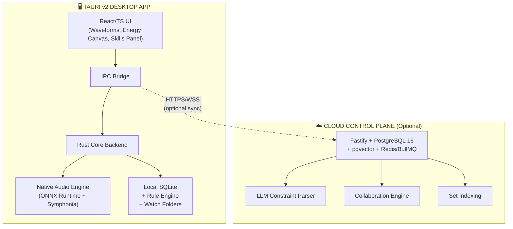
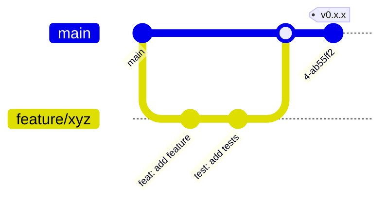

<p align="center">
  <picture>
    <source media="(prefers-color-scheme: dark)" srcset="https://raw.githubusercontent.com/dj-assistant/dj-assistant/main/assets/logo-dark.svg" width="200">
    <source media="(prefers-color-scheme: light)" srcset="https://raw.githubusercontent.com/dj-assistant/dj-assistant/main/assets/logo-light.svg" width="200">
    
  </picture>
</p>

<h1 align="center">DJ Assistant</h1>

<p align="center">
  <strong>The fastest way to turn a music library into a performance-ready DJ set.</strong>
</p>

<p align="center">
  <a href="#-features">Features</a> •
  <a href="#-architecture">Architecture</a> •
  <a href="#-tech-stack">Tech Stack</a> •
  <a href="#-quick-start">Quick Start</a> •
  <a href="#-documentation">Documentation</a> •
  <a href="#-project-status">Status</a> •
  <a href="#-contributing">Contributing</a>
</p>

<p align="center">
  <!-- Version -->
  <a href="https://github.com/dj-assistant/dj-assistant/releases">
    
  </a>
  <!-- License -->
  <a href="LICENSE">
    
  </a>
  <!-- Build Status (template - workflows not yet active) -->
  
  <!-- Platform -->
  
  <!-- Package Manager -->
  
  <!-- Rust -->
  
  <!-- Tauri -->
  
  <!-- React -->
  
  <!-- TypeScript -->
  
  <!-- Code Style -->
  
</p>

---

## 🎯 What is DJ Assistant?

**DJ Assistant** is a **desktop-first preparation accelerator** for professional DJs. It runs entirely on your machine — **no audio uploads, no cloud dependency for analysis**.

| Capability | Description |
|------------|-------------|
| 🔍 **Local Analysis** | BPM, key, beat grid, structural segmentation via ONNX models (madmom-style) |
| 🏷️ **Tag Cleaning** | Intelligent metadata normalization, deduplication (BLAKE3 fingerprinting) |
| 🎯 **Smart Cue Points** | AI-generated hot cues, memory cues, loop markers per track |
| 🎵 **Harmonic + Energy Sets** | Beam Search sequencing with Camelot wheel + energy curve constraints |
| 🤝 **B2B Collaboration** | Real-time co-editing, conflict-free set building with operational transforms |
| 📤 **Native Export** | Direct `.nml` (rekordbox) / `.crate` (Serato) / USB-ready folder structure |

> **Core Promise:** *Analyze → Clean → Cue → Sequence → Export* in **under 15 minutes** for 40+ tracks.

---

## 🏗️ Architecture



**Key Principles**
- **Local-first**: Audio never leaves the machine. Analysis runs via ONNX Runtime.
- **Hybrid intelligence**: LLM for constraint understanding + deterministic Beam Search for set sequencing.
- **Reversible by design**: Every Skill and bulk action is logged and undoable.
- **Non-destructive**: Source audio files are never modified.

---

## 🛠️ Tech Stack

| Layer | Technology | Version |
|-------|------------|---------|
| **Desktop Shell** | [Tauri](https://tauri.app/) | v2 |
| **Frontend** | React + TypeScript + Tailwind + Zustand/Jotai | 18 / 5.6 |
| **Backend (Local)** | Rust (notify, audiotags, Symphonia, ONNX Runtime, quick-xml, SQLite) | 1.82+ |
| **Cloud API** | Fastify (Node.js/TypeScript) | Latest |
| **Cloud Database** | PostgreSQL + pgvector | 16 |
| **Queue** | Redis + BullMQ | Latest |
| **Auth** | TBD (Clerk / Auth0 / custom JWT) | — |
| **Models** | Local ONNX (beat/key, segmentation) + Cloud LLM (constraint parsing) | — |

---

## 🚀 Quick Start

### Prerequisites
- **Node.js** ≥ 20 (managed via `volta` or `fnm`)
- **pnpm** 10.14+ (`corepack enable && corepack prepare pnpm@10.14.0 --activate`)
- **Rust** 1.82+ (`rustup default stable`)
- **Windows**: MSVC toolchain + [Windows Build Runbook](./docs/engineering/WINDOWS_NATIVE_BUILD_RUNBOOK.md) §1.1
- **macOS**: Xcode Command Line Tools

### Installation

```bash
# Clone the repository
git clone https://github.com/dj-assistant/dj-assistant.git
cd dj-assistant

# Install dependencies
pnpm install

# Run the desktop app (development)
pnpm dev:desktop

# Run the cloud API (development, optional)
pnpm dev:api
```

### Local CI Pipeline

```bash
# Full local validation (lint + typecheck + tests + Rust fmt/clippy/test)
pnpm ci:local

# Portable version (skips integration tests requiring audio hardware)
pnpm ci:local:portable
```

> **Note:** The repository uses a pnpm workspace with three packages:
> - `@dj-assistant/desktop` — Tauri desktop application
> - `@dj-assistant/api` — Cloud control plane (Fastify)
> - `@dj-assistant/shared` — Shared TypeScript types, schemas, utilities

---

## 📚 Documentation

All documentation lives under [`docs/`](./docs/README.md). Start at the **[Documentation Index](./docs/README.md)** or jump to a category below.

### 📦 Product
| Document | Description |
|----------|-------------|
| [Canonical Documentation](./docs/product/CANONICAL_DOCUMENTATION.md) | Single source of truth (product + technical) |
| [Product Brief](./docs/product/PRODUCT_BRIEF.md) | Vision, target user, scope |
| [PO Milestone Checklist](./docs/product/PO_MILESTONE_CHECKLIST.md) | Sign-off gates |
| [Glossary](./docs/product/GLOSSARY.md) | Product & technical term definitions |

### 🏛️ Architecture
| Document | Description |
|----------|-------------|
| [Architecture](./docs/architecture/ARCHITECTURE.md) | System design, components, data flows |
| [Data Model](./docs/architecture/DATA_MODEL.md) | Local SQLite + cloud PostgreSQL schemas |
| [API Contracts](./docs/architecture/API_CONTRACTS.md) | Tauri IPC + cloud HTTP contracts |
| [Models](./docs/architecture/MODELS.md) | ONNX analysis models, packaging, versioning |
| [Skills System](./docs/architecture/SKILLS_SYSTEM.md) | Scoped automation skills design |

### ⚙️ Engineering
| Document | Description |
|----------|-------------|
| [Development Guide](./docs/engineering/DEVELOPMENT.md) | Local setup, tooling, workflows |
| [Coding Standards](./docs/engineering/CODING_STANDARDS.md) | Style, conventions, PR rules |
| [Testing & Security Plan](./docs/engineering/TESTING_AND_SECURITY.md) | Test pyramid, security gates, PR checklist |
| [Security & Privacy](./docs/engineering/SECURITY_AND_PRIVACY.md) | Threat model, local-first guarantees |
| [Windows Build Runbook](./docs/engineering/WINDOWS_NATIVE_BUILD_RUNBOOK.md) | MSVC/GNU build troubleshooting |
| [Development Task List](./docs/engineering/DEVELOPMENT_TASK_LIST.md) | Phased actionable engineering checklist |
| [Phase 0 Acceptance Evidence](./docs/engineering/PHASE0_ACCEPTANCE_EVIDENCE.md) | How each P0.x criterion was verified |

### 🔄 DevOps & Process
| Document | Description |
|----------|-------------|
| [AI Development Automation Plan](./docs/devops/AI_DEVELOPMENT_AUTOMATION_PLAN.md) | Branches, PRs, review, fix, merge + gates |
| [DevOps & CI/CD Plan](./docs/devops/DEVOPS_CICD_PLAN.md) | Pipelines, environments, release, caching |
| [CI/CD Pipeline Security](./docs/devops/CI_CD_PIPELINE_SECURITY.md) | Actions pinning, secrets, fork safety, supply chain |
| [GitHub Workflow Templates](./docs/devops/github-workflows/README.md) | PR/main/release/audit/CodeQL workflows |

### 📐 Spec-Driven Development (SDD)
| Document | Description |
|----------|-------------|
| [00 — SDD Overview](./docs/sdd/README.md) | Methodology overview |
| [01 — Specification](./docs/sdd/01-SPECIFICATION.md) | Formal specification |
| [02 — System Design](./docs/sdd/02-SYSTEM-DESIGN.md) | System design document |
| [03 — Phases & Plan](./docs/sdd/03-PHASES-AND-PLAN.md) | Phased delivery plan |
| [04 — Task Breakdown](./docs/sdd/04-TASKS.md) | Granular task breakdown |
| [05 — Acceptance Criteria](./docs/sdd/05-ACCEPTANCE.md) | Acceptance criteria |

### 📊 Diagrams
| Diagram | Description |
|---------|-------------|
| [Entire Project Overview](./docs/diagrams/00-ENTIRE-PROJECT-OVERVIEW.md) | Complete system visualization |
| [System Architecture](./docs/diagrams/01-system-architecture.md) | Component topology |
| [Analysis Pipeline](./docs/diagrams/02-analysis-pipeline.md) | Audio analysis flow |
| [Set Builder Pipeline](./docs/diagrams/03-set-builder-pipeline.md) | Sequencing logic |
| [Skills System](./docs/diagrams/04-skills-system.md) | Automation skills |
| [Phases Roadmap](./docs/diagrams/05-phases-roadmap.md) | Delivery timeline |
| [Data Model](./docs/diagrams/06-data-model.md) | Entity relationships |
| [Workstreams](./docs/diagrams/07-workstreams.md) | Parallel workstreams |
| [Gig Ready Workflow](./docs/diagrams/08-gig-ready-workflow.md) | End-to-end user flow |
| [Cue Generation](./docs/diagrams/09-cue-generation.md) | Cue point logic |
| [Export Flow](./docs/diagrams/10-export-flow.md) | Export pipeline |
| [Component & IPC](./docs/diagrams/11-component-ipc.md) | IPC boundaries |
| [SDD Method](./docs/diagrams/12-sdd-method.md) | SDD process |
| [AI Dev Automation Workflow](./docs/diagrams/13-ai-dev-automation.md) | AI-assisted workflow |
| [Testing & Security Gates](./docs/diagrams/14-testing-security-gates.md) | Quality gates |
| [CI/CD Pipeline](./docs/diagrams/15-cicd-pipeline.md) | Pipeline visualization |

### 📝 Decisions & Contribution
| Document | Description |
|----------|-------------|
| [Architecture Decision Records](./docs/ADR/README.md) | Significant technical decisions (why) |
| [Contributing](./CONTRIBUTING.md) | How to contribute |

> **Note:** Source product artefacts (PRD, AI-native build plan, detailed build plan, build-plan diagrams, formal specification) are maintained externally and are **not** committed to this repository.

---

## 📈 Project Status

| Metric | Status |
|--------|--------|
| **Phase** | Phase 0 — Foundation (acceptance criteria verified; PO sign-off pending) |
| **Canonical Spec** | v1.1 (Approved) |
| **CI** | Templates ready — `pr-ci.yml`, `main-ci.yml`, `desktop-build.yml`, `nightly-audit.yml` in `.github/workflows/` |
| **Working Today** | Native folder picker → recursive scan → BLAKE3 fingerprinting → hash deduplication → tag metadata extraction → local SQLite storage → searchable library table with live scan progress |
| **Next Milestone** | Phase 1 — Local ONNX analysis pipeline (BPM, key, beat grid, structural segmentation) |

### CI/CD Pipeline (Template Status)

| Workflow | Status | Description |
|----------|--------|-------------|
| `pr-ci.yml` | ✅ Active | Required PR checks (lint, typecheck, test, Rust fmt/clippy/test) |
| `main-ci.yml` | ✅ Active | Validation on `main` + fans out to desktop build matrix |
| `desktop-build.yml` | ✅ Active | Reusable macOS + Windows desktop build (Tauri) |
| `nightly-audit.yml` | ✅ Active | Weekly security audits (JS advisories + RustSec) |
| `release.yml` | 📋 Template | Tagged desktop releases (needs code-signing secrets) |
| `codeql.yml` | 📋 Template | CodeQL SAST (reference only) |

> Branch protection on `main` is a **documented Phase 0 exception** (requires GitHub Pro on private repos). See [GitHub Workflow Templates](./docs/devops/github-workflows/README.md#branch-protection--pending-plan-phase-0-exception-task-t0117) for planned required checks.

---

## 👨‍💻 Quick Links for New Engineers

1. 📖 Read the [Canonical Documentation](./docs/product/CANONICAL_DOCUMENTATION.md) (especially **§3 Modules** and **§4 Architecture**)
2. 🏛️ Read [Architecture](./docs/architecture/ARCHITECTURE.md)
3. ⚙️ Follow [Development Guide](./docs/engineering/DEVELOPMENT.md) to set up the environment
4. ✨ Review [Coding Standards](./docs/engineering/CODING_STANDARDS.md) before writing code
5. 🧠 Understand the [Skills System](./docs/architecture/SKILLS_SYSTEM.md) — it is a **core product differentiator**

---

## 🤝 Contributing

We welcome contributions! Please see our [Contributing Guide](./CONTRIBUTING.md) for details on:
- Code of Conduct
- Development workflow
- Pull request process
- Coding standards
- Testing requirements

### Development Workflow Summary



---

## 📄 License

This project is licensed under the **MIT License** — see the [LICENSE](LICENSE) file for details.

---

## 🙏 Acknowledgments

- [Tauri](https://tauri.app/) — Secure, lightweight desktop framework
- [Symphonia](https://github.com/pdeljanov/Symphonia) — Pure Rust audio decoding
- [ONNX Runtime](https://onnxruntime.ai/) — Cross-platform ML inference
- [madmom](https://github.com/CPJKU/madmom) — Audio signal processing inspiration
- [pgvector](https://github.com/pgvector/pgvector) — Vector similarity in PostgreSQL

---

<p align="center">
  <sub>Built with ❤️ for DJs who value preparation time.<br>
  This repository is the engineering home for DJ Assistant.<br>
  Product decisions live in the <a href="./docs/product/CANONICAL_DOCUMENTATION.md">Canonical Documentation</a>.</sub>
</p>