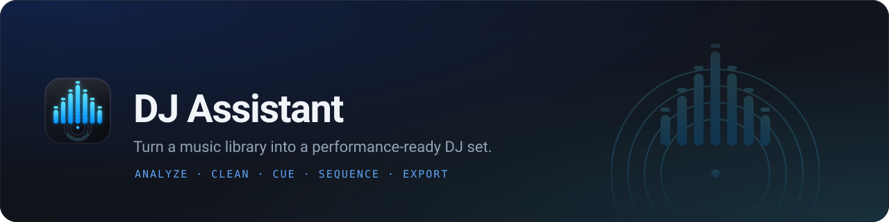
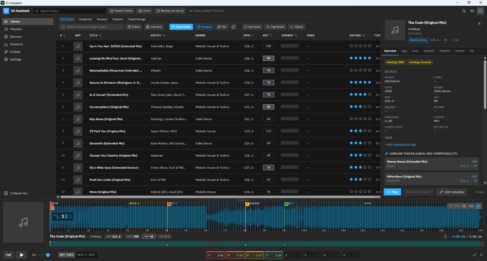
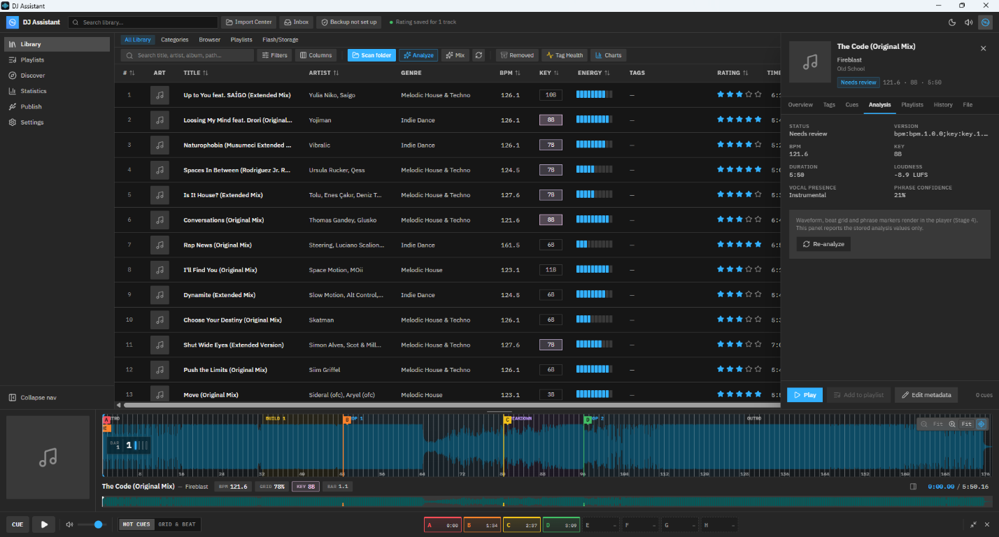
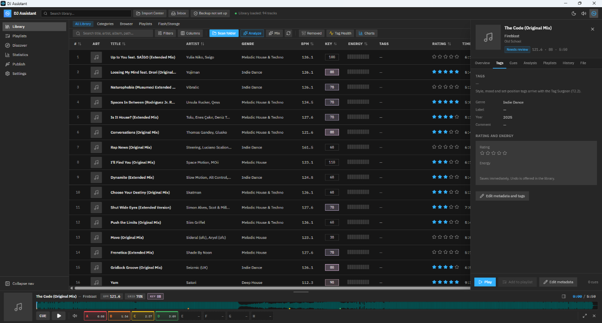
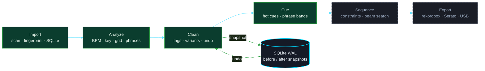
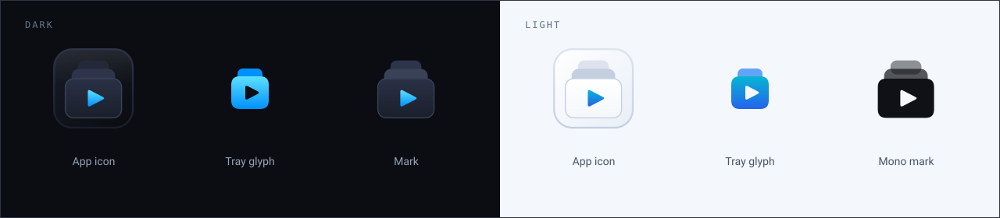

<p align="center">
  <a href="https://github.com/iDorgham/dj-assistant">
    
  </a>
</p>

<h1 align="center">DJ Assistant</h1>

<p align="center">
  <b>Your library in. A set out. Nothing leaves your machine.</b>
</p>

<p align="center">
  Local-first DJ preparation for Windows, macOS and Linux — import, analyze, clean,<br>
  cue and preview without uploading a track or ever modifying a source file.
</p>

<p align="center">
  <a href="https://github.com/iDorgham/dj-assistant/actions/workflows/main-ci.yml"></a>
  <a href="https://github.com/iDorgham/dj-assistant/actions/workflows/desktop-build.yml"></a>
  <a href="#roadmap"></a>
  <a href="#development"></a>
  <a href="LICENSE"></a>
  
</p>

<p align="center">
  
  
  
  
  
  
  
  
</p>

<p align="center">
  <a href="#overview">Overview</a> &nbsp;·&nbsp;
  <a href="#screenshots">Screenshots</a> &nbsp;·&nbsp;
  <a href="#quick-start">Quick start</a> &nbsp;·&nbsp;
  <a href="#features">Features</a> &nbsp;·&nbsp;
  <a href="#how-it-works">How it works</a> &nbsp;·&nbsp;
  <a href="#development">Develop</a> &nbsp;·&nbsp;
  <a href="#roadmap">Roadmap</a> &nbsp;·&nbsp;
  <a href="#documentation">Docs</a>
</p>

---

## Overview

DJ Assistant is a desktop preparation tool for DJs. Point it at a folder of tracks
and it builds a searchable local library, analyzes every track on-device (BPM, beat
grid, key, phrase structure, vocal presence, loudness), and gives you a professional
preview player to review the results — waveforms, phrase bands, beat grids and hot
cues included. Metadata cleanup is reversible by design: every write records a
before/after snapshot and offers Undo, and a read-only Tag Surgeon report surfaces
spelling variants across your tags before you change anything.

**Who it is for.** Working DJs who prep on a laptop before a gig: crate diggers who
want harmonic and energy-aware suggestions, and anyone tired of tag spelling
variants (`Deep House`, `deep-house`, `DeepHouse`) splitting their library in three.

**What it is not.** A live mixer. It does not replace rekordbox, Serato, Traktor or
CDJs, and it never writes to your audio files. Set sequencing and hardware export
are on the [roadmap](#roadmap), not in today's build.

**Why local-first.** Your library is your livelihood. Analysis runs in Rust on your
CPU, the library lives in a local SQLite database, and the only network feature is
opt-in metadata enrichment that sends text queries — never audio. No account, no
upload, no telemetry by default.

## Screenshots

Captured from the running desktop app (dark theme, 94-track library).

<p align="center">
  
</p>
<p align="center">
  <sub>The library, the shared Track panel and the prep player — phrase-marked dual waveform, hot cues A–D, <code>GRID 78%</code> confidence chip and Camelot key.</sub>
</p>

<p align="center">
  
  &nbsp;
  
</p>
<p align="center">
  <sub>Left: the Analysis tab — status, pipeline version, BPM, key, loudness, vocal presence and phrase confidence with one-click re-analysis. Right: the Tags tab — metadata fields plus rating/energy editing, saved immediately and undoable from the library.</sub>
</p>

## Quick start

> No signed installers yet. Build from source, or take a CI artifact from the
> [`desktop-build`](https://github.com/iDorgham/dj-assistant/actions/workflows/desktop-build.yml) workflow.

### Requirements

| Requirement | Notes |
| --- | --- |
| Node.js 20.19+ or 22.12+ (22 LTS recommended) | Vite 8 and the workspace tooling |
| pnpm 10.14+ | `corepack enable` provisions the pinned version |
| Rust stable (1.82+) | Tauri shell, audio engine and analyzers |
| Windows 10/11 | WebView2 runtime; MSVC or GNU toolchain — see the [Windows build runbook](./docs/engineering/WINDOWS_NATIVE_BUILD_RUNBOOK.md) |
| macOS 13+ | Xcode Command Line Tools |
| Linux | WebKitGTK 4.1 and ALSA development headers (`libasound2-dev` on Debian/Ubuntu) for native audio |
| Optional: ONNX Runtime + models | Model-backed inference only; the deterministic analyzers run without them |

### Build and run

```bash
git clone https://github.com/iDorgham/dj-assistant.git
cd dj-assistant
corepack enable            # provisions pnpm 10.14
pnpm install
pnpm --filter @dj-assistant/desktop tauri build
# installer/bundle: apps/desktop/src-tauri/target/release/bundle/
```

For development with hot reload, run the real desktop shell:

```bash
pnpm --filter @dj-assistant/desktop tauri dev
```

> `pnpm dev:desktop` starts only the Vite front end with mock data — useful for UI
> work, but it does not exercise the native IPC. Use `tauri dev` for the real app.

### First launch

1. Open **Import Center** and pick a music folder. Scanning, fingerprinting and search start immediately; embedded artwork is cached as it scans.
2. Press **Analyze** to run the on-device queue. Progress streams per track; results land in SQLite and the Track panel's Analysis tab.
3. Click a row to inspect it, hover-play its artwork (or press Play) to load the preview player.

### Where your data lives

| Item | Location |
| --- | --- |
| Library database | OS app-data dir, e.g. `%APPDATA%\com.djassistant.desktop\dj_assistant.db` on Windows (SQLite, WAL) |
| Artwork + waveform peak caches | Content-addressed files beside the database |
| Analysis models (optional) | `DJ_ASSISTANT_MODELS_DIR` → `./models` → `models/` next to the executable |
| QA database override | `DJ_ASSISTANT_DB_PATH` points the app at a fixture database |

## Features

### Library and import

- **Folder scan with BLAKE3 fingerprinting** — duplicates are detected at scan time; re-scans never double-import a track.
- **Embedded tag reading** — ID3 / FLAC metadata including embedded cover art, cached content-addressed in the OS app-data directory.
- **Instant search and real filters** — free text across title, artist, album, path, comment and tags; BPM range, Camelot key, genre, rating, energy, analysis status and a harmonic "compatible only" filter, all server-side with bound parameters.
- **A table that scales** — 23 configurable columns (visibility, width, order, persisted per view) over a virtualized body verified on a 30,000-track fixture; sortable headers with NULLs-last ordering.
- **Library sources** — All Library, Categories (genre chips) and Browser (folder tree with library-wide counts); soft remove with Undo.

### On-device analysis

- **BPM + beat grid, key (Camelot and classical), phrase structure, vocal presence and EBU R128 loudness** — deterministic DSP analyzers in Rust, fully offline, with ONNX Runtime activation seams reserved for model-backed inference.
- **Honest confidence** — low-confidence results are flagged `needs_review`; the player shows the beat grid's own confidence as a `GRID nn%` chip.
- **Version-stamped results** — every analysis carries a composite pipeline version; re-analysis runs only when the version changes or you force it, with per-track and overall progress events.

### Metadata care, reversible by design

- **Single and bulk metadata editing** with a preview diff, mixed-field seeding for selections, and writes that touch only the fields you changed.
- **Undo everywhere** — ratings, energy, tags, comments and bulk edits snapshot the previous state; Undo restores it and skips tracks that changed since.
- **Tag Surgeon report** — read-only fuzzy clustering over case, spacing, accents, punctuation and prefix variants, with representative spellings, track counts and advisory "possibly related" edges. No apply-shaped control until the preview/apply slices land.
- **Tag Health modal (opt-in online)** — provider picker, live lookup, per-track before → after diffs with tier badges, checkbox selection, bulk apply with confirmation and per-run Undo; a Tag Health Score grades title/artist/album/ISRC/artwork/genre/year/BPM/key gaps. Artwork upgrade fills empty slots only.

### Professional preview player (single deck, prep-only)

- **Native audio playback** — Symphonia decode through cpal, with seek, volume and position polling; local files only.
- **Dual-layer waveform** — zoomed detail viewport plus full-track overview minimap, each with its own decoded peak resolution cached per content hash; phrase bands, beat/bar lines and cue markers on top.
- **Hot cues A–H, beat jump, zoom/follow playhead**, Full and Mini dock modes, and a keyboard map for transport and cues.
- **Mix suggestions dock** — ranked candidates from harmonic distance, BPM and energy deltas with reason chips; Preview loads a candidate, Replace swaps it into your selection in place.

### Privacy and safety

- **No account, no upload, no telemetry by default.** The only network feature is opt-in tag/artwork enrichment, and it sends metadata queries — never audio.
- **Source files are never modified.** All edits live in the local SQLite database (WAL mode) or supported sidecars.
- **Optional cloud API** — a separate Fastify service exists for future collaboration; the desktop app is fully functional without it.

## How it works

Every track flows through the same pipeline. Solid stages ship today; dashed
stages are planned. Each shipped stage is a scoped, reversible operation with a
recorded snapshot — run the whole chain or step through it one stage at a time.



- **Import** walks your folders, fingerprints content with BLAKE3 (not filenames),
  reads embedded tags and artwork, and upserts into SQLite. Re-scans are cheap and
  never duplicate a track.
- **Analyze** decodes audio with Symphonia and runs deterministic DSP: tempo and
  beat grid, musical key, phrase boundaries, vocal presence and integrated
  loudness. Results are stamped with a composite pipeline version so improved
  analyzers re-run only what is stale.
- **Clean** is where metadata care lives: edits, bulk operations, the Tag Surgeon
  variant report and opt-in enrichment. Every write snapshots the previous row
  state first — the green loop in the diagram is the Undo path, and it refuses to
  restore a track that changed since the snapshot.
- **Cue** reviews analysis in the player: phrase-band waveforms, beat grids with
  their own confidence, hot cues A–H and beat jump.
- **Sequence** (planned) scores and orders a set under harmonic, BPM and energy
  constraints with beam search.
- **Export** (planned) verifies the set against rekordbox / Serato / USB targets.

Soft-deleted tracks stay recoverable: library-wide reads filter them out, but
per-track detail reads do not, so a hidden row can still be revealed and undone.

## Brand and icons

The mark is **The Stack**: three rounded library tiles rising in perspective with
a play triangle on the front — a crate of tracks, ready to play. It reads as
"music library" and "press play" at once, and the triangle stays legible down to
16 px. The same geometry ships in four cuts: the full app tile in dark and light,
a tile-free mark, a monochrome knockout cut, and a simplified two-layer tray
glyph whose play triangle is transparent so any taskbar colour shows through.

<p align="center">
  
</p>
<p align="center">
  <sub>Dark and light cuts of the app icon, the OS-theme-aware tray glyph and the mark. The app tile is inset with a soft squircle so it sits natively in the macOS Dock and reads correctly on Windows 11. The tray swaps between the two glyphs when the OS theme changes; left-click shows the window, right-click opens a Show/Quit menu.</sub>
</p>

All artwork lives in [`assets/`](./assets/README.md) as editable SVG sources —
palette, geometry, rasterising pipeline and wiring are documented there. The
app icon set under `apps/desktop/src-tauri/icons/` is generated from
`assets/logo.svg` via `scripts/make_icon.py` + `tauri icon`; never hand-edit the
generated PNG/ICO/ICNS files.

## Development

| Task | Command |
| --- | --- |
| Desktop app (native shell) | `pnpm --filter @dj-assistant/desktop tauri dev` |
| Front end only (mock data) | `pnpm dev:desktop` |
| Optional cloud API | `pnpm dev:api` |
| Lint · typecheck | `pnpm lint` · `pnpm typecheck` |
| JavaScript tests (all packages) | `pnpm test` |
| Rust format · clippy · tests | `pnpm rust:fmt` · `pnpm rust:clippy` · `pnpm rust:test` |
| Rust tests without ONNX/Tauri harness | `pnpm rust:test:portable` |
| Full local gate | `pnpm ci:local` (`pnpm ci:local:portable` without the Tauri harness) |

Test suites behind the badge (394 passing, 1 skipped):

| Suite | Tests | Runner |
| --- | --- | --- |
| Desktop UI/helpers | 287 | `node --test` |
| Shared contracts | 23 | `node --test` |
| Agent tooling | 73 (1 skipped) | `node --test` |
| Repository tooling | 10 | `node --test` |
| Cloud API | 2 | `node --test` |
| Rust crates + SQL schema contracts | see `pnpm rust:test` | `cargo test` |

Conventions: Prettier (100 columns, double quotes), ESLint, `clippy -D warnings`,
Conventional Commits. SQLite changes go through migrations; Tauri commands keep the
`Result<T, String>` boundary and propagate errors.

### Project layout

```text
apps/desktop        React 19 + Vite front end and the Tauri v2 Rust shell
apps/api            Optional Fastify 5 cloud service (not required by the desktop app)
crates/core         Library database, scanner, fingerprinting, metadata, reversible writes
crates/analysis     Audio decode, BPM/key/phrase/vocal/loudness analyzers, waveform peaks
packages/shared     TypeScript contracts shared by desktop and API
tests/schema        SQL contract tests executed against the migrated schema
docs/               Product spec, plan, architecture, UI spec, SDD set, evidence
scripts/            Workspace tooling (fixtures, hashes, agent routing, icons)
fixtures/audio      Curated audio fixtures with recorded hashes (never modified)
```

### Tech stack

| Layer | Technology |
| --- | --- |
| Desktop | Tauri 2 · Rust · React 19 · TypeScript 6 · Vite 8 · Tailwind CSS 4 |
| Audio and analysis | Symphonia · cpal · ebur128 · ONNX Runtime (optional) · SQLite |
| Cloud (optional) | Fastify 5 · PostgreSQL 16 · Redis · BullMQ |
| Tooling | pnpm 10 · Node.js test runner · ESLint · Prettier · cargo |

## Roadmap

**Phase 0 complete · Phase 1 implemented · Phase 2 in progress.**

- [x] **Phase 0 — Foundation** — folder scan, BLAKE3 fingerprinting, deduplication, embedded tags and artwork, searchable local library.
- [x] **Phase 1 — Analysis engine** — on-device BPM, key, beat grid, phrases, vocal presence and loudness; job queue, progress IPC, persistence, needs-review classification, version-stamped re-analysis and a golden-fixture harness.
- [ ] **Phase 2 — Library intelligence and tag cleanup** — six-view shell, filters, virtualized library, shared Track panel, reversible metadata care, Tag Surgeon report, Tag Health enrichment and the dual-waveform preview player ship; cue generation, Tag Surgeon apply/aliases and the remaining QA gates are open.
- [ ] **Phase 3 — Set builder and export** — set scoring and sequencing, mix-out indicators, set versioning, rekordbox / Serato / USB verification.
- [ ] **Phase 4 — Skills, cloud and B2B** — skills panel, Gig Ready flow, optional collaboration and public beta.

Task-level detail and QA records live in [Tasks](./docs/sdd/04-TASKS.md) and
[Acceptance](./docs/sdd/05-ACCEPTANCE.md); captured running-window evidence is in
[`docs/evidence/`](./docs/evidence/).

## Documentation

| Document | What it covers |
| --- | --- |
| [Canonical Documentation](./docs/product/CANONICAL_DOCUMENTATION.md) | Product and technical source of truth |
| [Approved v1 plan](./docs/plan/README.md) | Locked product shape, UI rules, delivery stages |
| [Architecture](./docs/architecture/ARCHITECTURE.md) | Components, data flows, boundaries |
| [UI specification](./docs/ui/README.md) | Design system, shell, views, player |
| [Development guide](./docs/engineering/DEVELOPMENT.md) | Local setup, tooling, workflows |
| [Project context](./docs/context/PROJECT_CONTEXT.md) | One-file orientation for humans and agents |

Everything else — audits, ADRs, diagrams, DevOps, evidence — is indexed in [`docs/`](./docs/README.md).

## Contributing

Contributions are welcome. Read [CONTRIBUTING.md](./CONTRIBUTING.md), open an issue
for significant changes, and run `pnpm ci:local` before opening a pull request.
Commits follow [Conventional Commits](https://www.conventionalcommits.org/).

## License

[MIT](./LICENSE) © 2026 iDorgham.

Built on [Tauri](https://tauri.app/), [Symphonia](https://github.com/pdeljanov/Symphonia),
[ONNX Runtime](https://onnxruntime.ai/) and the [madmom](https://github.com/CPJKU/madmom) research.