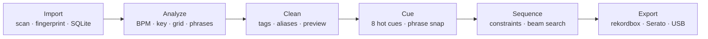

<p align="center">
  <a href="https://github.com/iDorgham/dj-assistant">
    
  </a>
</p>

<h1 align="center">DJ Assistant</h1>

<p align="center">
  <b>Your library in. A set out. Nothing leaves your machine.</b>
</p>

<p align="center">
  Local-first DJ preparation for Windows, macOS and Linux — analyze, clean, cue,<br>
  sequence and export without uploading a track or changing a source file.
</p>

<p align="center">
  <a href="#status"></a>
  <a href="LICENSE"></a>
  
  
</p>

<p align="center">
  
  
  
  
  
  
  
  
  
  
</p>

<p align="center">
  <a href="#what-it-does">What it does</a> &nbsp;·&nbsp;
  <a href="#features">Features</a> &nbsp;·&nbsp;
  <a href="#installation">Install</a> &nbsp;·&nbsp;
  <a href="#development">Develop</a> &nbsp;·&nbsp;
  <a href="#status">Status</a> &nbsp;·&nbsp;
  <a href="#documentation">Docs</a>
</p>

---

## What it does

DJ Assistant takes a folder of tracks and turns it into a performance-ready set. It scans and fingerprints your library, analyzes BPM, key, beat grid, phrases and loudness on-device, cleans inconsistent tags behind a preview → apply → undo gate, places cues on phrase boundaries, and sequences the set deterministically. Then it exports rekordbox XML, Serato crates or a Pioneer-ready USB pack — with the audio never leaving your machine and the source files never modified.

It is a preparation tool, not a live mixer: it does not replace rekordbox, Serato, Traktor or CDJs.

**Local-first · non-destructive · you stay in control · transparent sequencing.**



Each stage is a scoped, reversible skill with a recorded before/after snapshot. Run the whole chain or step through it one stage at a time — nothing is committed until you accept it.

## Features

- **On-device analysis** — BPM, key (Camelot and classical), beat grid, phrases, vocal presence and EBU R128 loudness through ONNX Runtime. Fully offline.
- **Safe tag cleanup** — fuzzy clustering finds artist and title variants; every change is previewed, applied and undoable, and persistent aliases teach future imports.
- **Cues from structure** — eight hot cues plus memory cues on detected phrase boundaries, snapped to 8-bar markers. Every automated cue is editable and marked with its provenance.
- **Deterministic set building** — describe the set in plain language; a beam search decides the order from harmonic, tempo and energy scores. Reproducible and auditable, never hallucinated.
- **Verified export** — rekordbox XML, Serato crates, CSV and a Pioneer-tuned USB pack (FAT32 + MBR) validated against CDJ behavior.
- **Planned next** — B2B preparation (metadata only), Spotify reference playlists and opt-in tag enrichment. Audio is never uploaded or transferred.

## Screenshots

<p align="center">
  
  &nbsp;
  
</p>
<p align="center">
  <sub>Library scan and instant search, verified on a 94-track run. Track panel and player views are in progress.</sub>
</p>

## Installation

> No signed installers yet. Build from source, or take a CI artifact from the `desktop-build` workflow.

### Requirements

| Requirement | Notes |
| --- | --- |
| Node.js 20+ and pnpm 10.14+ | Front end and workspace tooling |
| Rust 1.82+ | Tauri shell and audio engine |
| Windows 10/11 | WebView2 plus MSVC or GNU toolchain — see the [Windows build runbook](./docs/engineering/WINDOWS_NATIVE_BUILD_RUNBOOK.md) |
| macOS 13+ | Xcode Command Line Tools |
| Linux | WebKitGTK |

### Build and run

```bash
git clone https://github.com/iDorgham/dj-assistant.git
cd dj-assistant
pnpm install
pnpm --filter @dj-assistant/desktop tauri build   # installer in apps/desktop/src-tauri/target/release/bundle/
```

For development with hot reload, run the real desktop app:

```bash
pnpm --filter @dj-assistant/desktop tauri dev
```

`pnpm dev:desktop` starts only the Vite front end with mock data — use the command above to exercise the native IPC.

### First launch

1. Pick a music folder. Scanning, fingerprinting and search start immediately.
2. Library data lives in local SQLite (WAL mode); artwork is cached in the OS app-data directory.
3. Analysis models are optional for now and resolve via `DJ_ASSISTANT_MODELS_DIR` → `./models` → `models/` next to the executable.

No account, no upload, no telemetry by default.

## Development

| Task | Command |
| --- | --- |
| Desktop app (native) | `pnpm --filter @dj-assistant/desktop tauri dev` |
| Optional cloud API | `pnpm dev:api` |
| Lint · typecheck · test | `pnpm lint` · `pnpm typecheck` · `pnpm test` |
| Rust format · clippy · tests | `pnpm rust:fmt` · `pnpm rust:clippy` · `pnpm rust:test` |
| Full local gate | `pnpm ci:local` (`pnpm ci:local:portable` without the Tauri harness) |

## Tech stack

| Layer | Technology |
| --- | --- |
| Desktop | Tauri 2 · Rust · React 19 · TypeScript 6 · Vite 8 · Tailwind CSS 4 |
| Audio and analysis | Symphonia · ONNX Runtime · SQLite |
| Cloud (optional) | Fastify 5 · PostgreSQL 16 · Redis · BullMQ |
| Tooling | pnpm 10 · Node.js test runner · ESLint · Prettier · cargo |

## Status

**Phase 0 complete · Phase 1 implemented (verification pending) · Phase 2 in progress.**

- [x] **Phase 0 — Foundation** — folder scan, BLAKE3 fingerprinting, deduplication, tags, searchable local library.
- [ ] **Phase 1 — Analysis** — local BPM, key, grid, phrase and loudness analyzers; model wiring and acceptance pending.
- [ ] **Phase 2 — Library Intelligence** — six-tab shell, filters, shared Track panel and a 30,000-track virtualized library shipped; inspector, beatgrid editor, cue templates and tag cleanup remain.
- [ ] **Phase 3 — Set builder and export** — scoring, mix-out indicators, set versioning, rekordbox / Serato / USB verification.
- [ ] **Phase 4 — Skills, cloud and B2B** — skills panel with undo, Gig Ready flow, optional collaboration and public beta.

Task-level detail lives in [Tasks](./docs/sdd/04-TASKS.md).

## Documentation

| Document | What it covers |
| --- | --- |
| [Canonical Documentation](./docs/product/CANONICAL_DOCUMENTATION.md) | Product and technical source of truth |
| [Approved v1 plan](./docs/plan/README.md) | Locked product shape, UI rules, delivery stages |
| [Architecture](./docs/architecture/ARCHITECTURE.md) | Components, data flows, boundaries |
| [UI specification](./docs/ui/README.md) | Design system, shell, views, player |
| [Project context](./docs/context/PROJECT_CONTEXT.md) | One-file orientation for humans and agents |

Everything else — audits, ADRs, diagrams, DevOps, evidence — is indexed in [`docs/`](./docs/README.md).

## Contributing

Contributions are welcome. Read [CONTRIBUTING.md](./CONTRIBUTING.md), open an issue for significant changes, and run `pnpm ci:local` before opening a pull request. Commits follow [Conventional Commits](https://www.conventionalcommits.org/).

## License

[MIT](./LICENSE) © 2026 iDorgham.

Built on [Tauri](https://tauri.app/), [Symphonia](https://github.com/pdeljanov/Symphonia), [ONNX Runtime](https://onnxruntime.ai/) and the [madmom](https://github.com/CPJKU/madmom) research.
