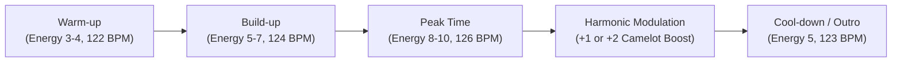

# DJ Assistant - Professional DJ Requirements & Engineering Roadmap
**Technical Specifications for Transforming DJ Assistant into a Pro-Grade DJ Preparation Suite**

**Audience:** Core Rust & Frontend Engineers, Audio DSP Engineers, Product Owners  
**Target Product:** DJ Assistant (`D:\Work\AI\Projects\DJ Assistant`)  
**Status:** External input — unverified against this repository's code  
**Location:** `docs/audit/` (repository-local copy; the original lives under `D:\Work\AI\Projects\factory`)

---

> **External input.** This document was supplied from outside this repository and has **not** been verified against the shipped code. The audit index (`docs/audit/README.md`) does not index it, and `06` §6, item 5 records it as open to error. The one exception is its §2.1 claim about compilation errors in `commands.rs`/`scanner.rs`: that was checked against the code on 2026-11-08 and is **stale** — see the RESOLVED note in §2.1. Every other claim here still needs verification before anyone acts on it.

---

## 1. Executive Mission

DJ Assistant must transition from a functional prototype with simulated previewing into a **mission-critical preparation suite** for professional club, festival, and mobile DJs. A professional DJ cannot afford guesswork. Every waveform peak must be real, every cue point must translate accurately to Pioneer CDJs and Serato, and playback must deliver bit-perfect audio through club-standard audio interfaces.

---

## 2. Immediate Codebase Fixes (Blockers)

### 2.1 Compilation Errors in `commands.rs` and `scanner.rs` — **RESOLVED**

> This section described the state of the external input when it was written. It is
> retained for history, but the blocker it names no longer exists: migration 007's
> `label` / `tags` / `year` fields are present at every `TrackSummary` construction
> site. `map_track_summary_at` (`commands.rs:243-270`) reads them — `row.get(base + 7)`
> and `row.get(base + 8)` at `252-253` — and the custom tags are filled by the grouped
> `load_tags` query (`commands.rs:178`), while `scanner.rs:147-175` populates them
> (`label: None`, `year: meta.year.map(...)`, `tags: Vec::new()`). Do not apply the
> snippet below — it predates the fix.

**Issue (historical):** `TrackSummary` struct in `apps/desktop/src-tauri/src/models.rs` was updated in migration 007 with three new fields (`label: Option<String>`, `tags: Vec<String>`, `year: Option<i64>`). The constructor call sites in `commands.rs` and `scanner.rs` were not updated, breaking `cargo check` and `tauri dev`.

**Required Edit (historical — already applied):**
In `apps/desktop/src-tauri/src/commands.rs` and `scanner.rs`:
```rust
// In get_track and scanner summary mapping:
TrackSummary {
    id: row.get(0)?,
    file_path: row.get(1)?,
    file_hash: row.get(2)?,
    title: row.get(3)?,
    artist: row.get(4)?,
    album: row.get(5)?,
    genre: row.get(6)?,
    label: row.get(7)?,       // <-- Add label
    year: row.get(8)?,        // <-- Add year
    bpm: row.get(9)?,
    key_camelot: row.get(10)?,
    key_classical: row.get(11)?,
    duration_ms: row.get(12)?,
    format: row.get(13)?,
    analysis_status: row.get(14)?,
    user_rating: row.get(15)?,
    energy: row.get(16)?,
    comments: row.get(17)?,
    tags: Vec::new(),          // <-- Filled from the grouped load_tags() map, not inline
    artwork_hash: row.get(18)?,
    created_at: row.get(19)?,
    updated_at: row.get(20)?,
}
```

The real tag read is `load_tags(conn, track_ids: &[String]) -> HashMap<String, Vec<String>>`
(`commands.rs:178`): a join would duplicate a track per tag, so the tags come from a
second grouped query and are merged into each summary by id.

---

## 3. Audio Engine Overhaul: From Simulation to Reality

### 3.1 The Problem
`apps/desktop/src/lib/audio-engine.ts` currently runs a synthetic metronome generator using Web Audio oscillators. It does not play the user's music files.

### 3.2 Required Architecture
Professional DJs need:
1. **True Audio Decoding & Streaming**: High-resolution playback supporting FLAC, WAV (up to 24-bit / 96kHz), AIFF, MP3 (CBR/VBR), AAC/M4A, and OGG/Opus.
2. **Low-Latency Subsystem**: Sub-10ms buffer latency for responsive cue triggering and scrubbing.
3. **Headphone Split-Cue Routing**: The ability to send the preview player output to a specific audio output device (e.g., Channels 3 & 4 of an audio interface or a USB DJ controller) without interrupting system audio.

### 3.3 Implementation Plan
- **Backend (Rust / Tauri)**:
  - Register a Tauri asset protocol (`audio://`) that securely streams audio bytes from local paths with HTTP range requests (supporting instant seek without decoding the full file into memory).
  - Alternatively, integrate `cpal` + `rodio` in Rust with an IPC command `play_track(path, start_ms)` that allows hardware audio device selection (ASIO on Windows, CoreAudio on macOS).
- **Frontend (`audio-engine.ts`)**:
  - Replace oscillator synthesis with an `HTMLAudioElement` or Web Audio `MediaElementAudioSourceNode` connected to the streaming protocol.
  - Implement dynamic pitch control (`preservesPitch: false` for vinyl-style pitch shifting, `preservesPitch: true` for key-locked master tempo).
  - Add audio output device selection via `setSinkId()` (Web Audio standard) so DJs can route pre-listening to their headphone output.

---

## 4. 3-Band Spectral Waveform Engine (Pioneer / Denon Standard)

### 4.1 The Problem
`apps/desktop/src/lib/waveform-generator.ts` uses an LCG pseudo-random number generator to simulate waveform peaks. Professional DJs read waveforms visually to know:
- Where the bass drops (High Blue).
- Where the vocal or synth leads reside (Amber / Orange).
- Where hi-hats, crashes, and noise sweeps occur (White / Cyan).

### 4.2 Required Architecture
Implement a genuine **3-Band Spectral Peak Extractor** in `crates/analysis`:
1. **Filter Bank**:
   - **Low Band**: Low-pass filter at 250 Hz (kicks, sub-bass, 808s).
   - **Mid Band**: Band-pass filter between 250 Hz and 4,000 Hz (vocals, snares, synths, pianos).
   - **High Band**: High-pass filter above 4,000 Hz (hi-hats, cymbals, air, percussion).
2. **Peak Decimation**:
   - Compute RMS and peak amplitude for each band in 10ms–20ms windows.
   - Output an array of normalized `[low, mid, high]` triplets (16,000 bins per track).
3. **Storage**:
   - Store the compressed waveform peak binary in `~/.dj-assistant/cache/waveforms/{file_hash}.bin` or as a BLOB in SQLite.
4. **Rendering (`DetailedWaveform.tsx`)**:
   - Render stacked or composite RGB waveform channels onto an HTML5 Canvas using GPU acceleration (`OffscreenCanvas` or 2D context with composite blending).

---

## 5. Professional Cue & Elastic Beatgrid Engine

### 5.1 Color-Coded Hot Cue Standards
Professional DJs adhere to strict muscle-memory color coding across club gear:

| Slot | Letter | Standard Name | Recommended Color | Hex Code | DJ Function |
| :---: | :---: | :--- | :--- | :---: | :--- |
| **1** | **A** | Cue 1 / Mix-In | **Green** | `#00E676` | First audible downbeat or intro mix point |
| **2** | **B** | Vocal In / Verse | **Cyan / Light Blue**| `#00E5FF` | Point where vocals start (prevent vocal clash) |
| **3** | **C** | Build-Up | **Yellow** | `#FFEA00` | Energy ramp-up before the drop |
| **4** | **D** | Drop 1 / Main Peak | **Red** | `#FF1744` | Main bassline and kick drop |
| **5** | **E** | Breakdown / Pause | **Purple** | `#D500F9` | Drum pause, melodic breakdown |
| **6** | **F** | Drop 2 | **Deep Orange** | `#FF3D00` | Secondary or climax drop |
| **7** | **G** | Mix-Out Point | **Blue** | `#2979FF` | Outro beat mixing window |
| **8** | **H** | Loop / Safety | **Magenta / Pink** | `#F50057` | Active 8-bar loop or emergency outro |

### 5.2 Memory Cues vs Hot Cues
- **Hot Cues (1–8)**: Trigger instant jump-and-play during performance.
- **Memory Cues (Up to 10)**: Non-interrupting navigation markers used on Pioneer CDJs with countdown displays (e.g., "16 bars to Drop", "32 bars to Mix-Out").
- *Action*: Add support for `MemoryCue` alongside `HotCue` in the data model.

### 5.3 Elastic Beatgrids (Multi-Tempo Warping)
- Current fixed BPM assumption fails on 70s disco, funk, classic house, and organic live-drum recordings.
- Implement **tempo markers** (grid anchors):
  - Downbeat snap (Beat 1.1 marker).
  - Ability to add a tempo anchor at bar X with microsecond nudging (+/- 1ms) to keep drifting tracks in tight sync without audible flanging.

---

## 6. Hardware & Software Export Engine (Phase 3 Delivery)

Professional DJs do not play sets inside DJ Assistant; they play on club hardware. Export is the ultimate deliverable.

### 6.1 Pioneer Rekordbox XML v5 / v6
- **Format**: Standard `DJ_PLAYLISTS` XML document with DTD validation.
- **Nodes**:
  - `<COLLECTION Entries="N">`: Lists all tracks with exact audio path, bit depth, sample rate, key, BPM, and volume gain.
  - `<POSITION_MARK>`: Contains Hot Cues (`Num="0".."7"`) and Memory Cues (`Num="-1"`), timestamp in seconds, and Pioneer color code integers.
  - `<TEMPO>`: Beatgrid start position (`Inizio`) and BPM.
  - `<PLAYLISTS>`: Folder tree and playlists maintaining custom track order.

### 6.2 Pioneer CDJ Direct USB Export (DeviceSQL / PDB)
- Professional touring DJs plug FAT32/exFAT USB flash drives directly into Pioneer CDJ-3000 / CDJ-2000NXS2 players.
- Provide direct USB export producing the standard Pioneer folder hierarchy:
  ```text
  /PIONEER/
    rekordbox/
      export.pdb       <-- Binary SQLite/DeviceSQL database of tracks and playlists
      ANLZ0000.DAT     <-- High-resolution waveform & beatgrid stream
      ANLZ0000.EXT     <-- Extended cue points and loop data
    Contents/
      ArtistName/
        AlbumName/
          Track.wav    <-- Audio files
  ```

### 6.3 Serato DJ Pro (.crate & GEOB Tags)
- **Serato Crates**: Binary struct files written to `_Serato_/Subcrates/SetName.crate`.
- **Serato Beatgrid & Cues**: Written into the audio file's ID3 `GEOB` frame with tag header `Serato Markers2` (contains base64-encoded cue point colors, locked beatgrids, and loop lengths).

### 6.4 Traktor Pro 4 (NML Export)
- Native XML-based collection and playlist format (`collection.nml`) containing `<COLLECTION>`, `<ENTRY>`, and `<CUE_V2>` elements.

### 6.5 Denon Engine DJ (Engine OS)
- SQLite database (`m.db`) formatted for Denon SC6000 Prime and Prime 4 standalone players.

---

## 7. Harmonic Journey Set Builder

### 7.1 Beyond Basic BPM/Key Sorting
Amateurs simply sort by BPM ascending. Professional set construction involves **energy arcs and emotional tension/release**:



### 7.2 Harmonic Mixing Rules to Code
Implement constraint algorithms based on the **Camelot Wheel**:
1. **Flat Blend** (Same Key, e.g., 8A -> 8A): Perfect tonal alignment.
2. **Energy Step-Up (+1 Key, e.g., 8A -> 9A)**: Natural upward energy lift.
3. **Energy Boost (+2 Keys, e.g., 8A -> 10A)**: Noticeable crowd wake-up lift.
4. **Mood Shift (Relative Major/Minor, e.g., 8A -> 8B)**: Shifts from dark/driving (A minor) to uplifting/melodic (C major).
5. **Semi-tone Modulation (+7 Keys)**: Dramatic energy explosion.
6. **Clash Warning**: Flag transitions of 3 or more Camelot positions that create dissonant frequencies in the mix zone.

### 7.3 Transition Cue Pairing
The set builder must check whether Track A's **Mix-Out Cue** aligns with Track B's **Mix-In Cue** without vocal clash:
- `TrackA.MixOut.Vocal = false` AND `TrackB.MixIn.Vocal = false` -> **Green (Safe)**.
- Both contain vocals during the 32-bar mix window -> **Red (Vocal Clash Warning)**.

---

## 8. Professional Gig-Ready Auditor

Before heading to the club, the DJ clicks **Audit for Gig**. The tool runs an exhaustive pre-flight verification:
1. **Audio Integrity Check**:
   - Scans for MP3 transcodes (fake 320kbps that are actually upscaled 128kbps, via high-frequency spectral cutoff inspection).
   - Flags files with True-Peak Clipping (> +0.1 dBFS) which will distort on large club sound systems.
2. **Missing Files & Path Relinking**:
   - Checks that all tracks in the planned set physically exist on disk.
   - Provides an auto-relink wizard if paths shifted.
3. **USB Health & Format Check**:
   - Detects connected USB drives.
   - Verifies FAT32 or exFAT file system format and MBR partition table (CDJs cannot read GUID Partition Tables [GPT] on older firmware).
   - Benchmarks write speed to prevent slow-write buffer underruns during live play.
