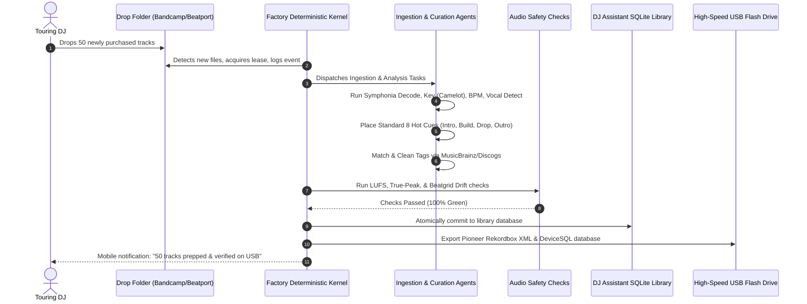

# Factory - AI Automation Engine for Professional DJ Ecosystem
**Specification & Architecture for Equipping Factory with Audio DSP Verification, DJ Protocols, and Autonomous Vault Pipelines**

**Audience:** Factory Core Architects, AI Workflow Engineers, Audio Systems Developers  
**Target Product:** Factory (`D:\Work\AI\Projects\factory`)  
**Status:** Canonical Engineering Specification  
**Location:** `docs/audits/` (mirrored in `factory` and `DJ Assistant`)

---

## 1. Executive Vision

Factory is a deterministic kernel designed to turn a high-level goal into verified, reviewable, mergeable software by orchestrating untrusted coding agents. 

To power the next generation of **professional DJ software, music tools, and automated library curation**, Factory must evolve beyond generic text-based code linting (`flake8`, `pytest`). Audio engineering and DJ hardware environments have stringent physics-bound invariants:
- An AI agent refactoring an audio filter must not introduce phase cancellation or DC offset.
- An AI agent generating Rekordbox XML or Serato crates must not produce malformed XML or corrupt binary structs that lock up a CDJ-3000 in the middle of a live set.
- An AI agent adjusting tempo grids must not drift off-tempo across a 7-minute extended mix.

This specification details how to augment Factory to make it the **ultimate AI engineering engine for DJ tools and automated music operations**.

---

## 2. Why Generic Coding Factories Fail on Audio & DJ Software

When generic AI agents touch audio codebases, subtle catastrophic regressions occur that standard test suites miss:
1. **Perceptual Audio Degradation**: The code compiles and tests pass, but audio output clips above 0 dBFS, loses low-end punch due to phase cancellation, or introduces micro-clicks at buffer boundaries.
2. **Schema Drift on Binary DJ Hardware**: Pioneer CDJ firmware enforces rigid proprietary constraints (e.g., exact XML DTD syntax, maximum cue point string lengths, strict character encodings). If an agent alters a field name or encoding, the USB fails to load on hardware.
3. **Floating-Point Non-Determinism**: Minor floating-point rounding errors in beatgrid calculation can accumulate over 300 bars, throwing the downbeat off by 50 milliseconds (causing audible trainwrecking during auto-sync).

---

## 3. Specialized DJ & Audio Check Runners for Factory

Factory's check runner (`kernel/src/factory_kernel/checks.py`) must be extended with specialized, non-bypassable verification runners:

### 3.1 Audio DSP & Perceptual Check Runner (`checks/audio_dsp.py`)
Runs automated regression tests on audio output using **golden audio fixtures**:
- **Bit-Exact Roundtrip**: Verifies that decoding, analyzing, and writing metadata does not alter a single audio sample.
- **EBU R128 LUFS Metering Check**: Asserts that loudness calculations match standard ITU-R BS.1770-4 benchmarks within +/- 0.1 LUFS.
- **Spectral Difference Analysis (FFT)**: Computes the spectral delta between clean and processed audio to ensure no unintended high-frequency roll-off or harmonic distortion.
- **True-Peak & Inter-Sample Peak (ISP) Check**: Verifies that normalizers never exceed -0.5 dBTP.

### 3.2 Rekordbox XML & DTD Schema Validator (`checks/rekordbox_dtd.py`)
Validates generated Pioneer Rekordbox XML exports against the official Pioneer DTD schema:
```python
import xmlschema
from lxml import etree

def verify_rekordbox_xml(xml_path: str, dtd_path: str) -> bool:
    """Rejects any agent-generated Rekordbox export with invalid structure."""
    dtd = etree.DTD(open(dtd_path))
    tree = etree.parse(xml_path)
    if not dtd.validate(tree):
        raise ValueError(f"Rekordbox XML validation failed: {dtd.error_log.filter_from_errors()}")
    return True
```

### 3.3 Serato Crate & GEOB Binary Inspector (`checks/serato_binary.py`)
Inspects generated `.crate` files and ID3 `GEOB` frames:
- Verifies binary struct packing (big-endian integers, null-terminated UTF-16 strings).
- Ensures `Serato Markers2` base64 payloads decode cleanly without buffer overrun risks.

### 3.4 Beatgrid Drift & Jitter Test (`checks/beatgrid_drift.py`)
Evaluates the BPM and beatgrid accuracy against synthetic click tracks with exact known tempo:
- Maximum allowed drift across a 10-minute track: `< 2.0 milliseconds`.
- Jitter on transient onset: `< 1.0 millisecond`.

---

## 4. Hardware Protocol & Loopback Testing Harness

To test DJ Assistant's hardware connectivity, Factory should provide simulated protocol runners:
1. **Virtual MIDI 1.0 / 2.0 Loopback**:
   - Tests that cue button presses, jog wheel rotations, and pitch fader movements trigger the correct IPC events in under 5ms.
2. **Pioneer Pro DJ Link Packet Listener Mock**:
   - Sends and receives UDP broadcast packets mimicking CDJ-3000 / DJM-900NXS2 players on ports 50000–50002.
   - Allows agents to safely develop live "Now Playing" broadcast integrations and stage visual synchronizers without needing physical CDJs in the development room.

---

## 5. Autonomous "DJ Vault" Pipeline: Nightly Music Ops

Beyond developing software, Factory's deterministic engine can be run as an **autonomous music preparation pipeline** for working DJs.

### 5.1 The Workflow


### 5.2 Key Invariants Enforced by Factory
- **No Overwrite Guarantee**: Source files are never modified in place.
- **Budget Protection**: External enrichment API queries (Discogs, Last.fm) are strictly throttled against a predefined rate and cost budget.
- **Audit Ledger**: A permanent record in `events.jsonl` tracks every cue point placed, every tag modified, and every audio check verified.

---

## 6. Specialized Agent Roles & Skills for Audio & DJ Engineering

To equip Factory's coding agents with domain expertise, define four specialized subagent roles in `roles/`:

### 6.1 `Audio-DSP-Specialist`
- **Focus**: Rust, Symphonia, WebAudio, FFT algorithms, EBU R128 loudness, filter topologies.
- **System Prompt**: Enforces audio fidelity invariants: bit-depth preservation, zero-clipping headroom, cache-aligned SIMD vectorization.

### 6.2 `DJ-Hardware-Protocol-Architect`
- **Focus**: Pioneer Rekordbox XML, DeviceSQL (PDB), Serato Crate structures, Traktor NML, MIDI/HID protocol mapping.
- **System Prompt**: Deep understanding of CDJ memory limits, FAT32/exFAT partition constraints, and Pioneer byte-order formats.

### 6.3 `Harmonic-Journey-Specialist`
- **Focus**: Music theory, Camelot Wheel algorithms, energy curve design, transition risk analysis, vocal clash prevention.
- **System Prompt**: Champions dancefloor psychology, ensuring set-building algorithms create musical progression rather than mechanical BPM ladders.

### 6.4 `DJ-QA-Gatekeeper`
- **Focus**: Regression test authoring, golden fixture maintenance, club environment stress testing (e.g., simulating 10,000-track libraries on slow USB 2.0 drives).

---

## 7. Implementation Roadmap for Factory

| Milestone | Deliverable | Priority | Target Outcome |
| :---: | :--- | :---: | :--- |
| **F-DJ.1** | Add Audio DSP check runner (`checks/audio_dsp.py`) with LUFS & bit-exact checks | High | Prevents audio regressions during AI refactoring |
| **F-DJ.2** | Add Rekordbox XML DTD & Serato Crate validation checks | High | Guarantees hardware-safe export files |
| **F-DJ.3** | Create `roles/audio-dsp-specialist.md` and `roles/dj-hardware-architect.md` | Medium | Guides coding agents with professional DJ standards |
| **F-DJ.4** | Implement the Autonomous DJ Vault Pipeline template | Medium | Enables automated nightly library prep for working DJs |
| **F-DJ.5** | Virtual MIDI & Pioneer Pro DJ Link packet mocks | Future | Enables hardware-in-the-loop agent testing |
