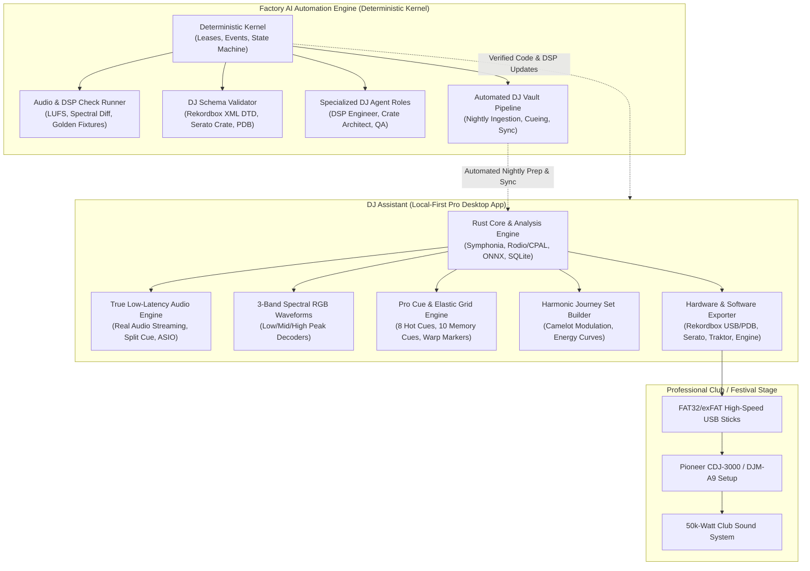

# Professional DJ System Audit & Architecture Synthesis
**Comprehensive Evaluation of DJ Assistant (Desktop App) & Factory (AI Automation Engine)**

**Date:** November 2026  
**Audience:** Lead Architect, Product Owner, Core Engineering, Professional DJ End-Users  
**Status:** External input — unverified against this repository's code  
**Location:** `docs/audit/` (repository-local copy; the original lives under `D:\Work\AI\Projects\factory`)

---

> **External input.** This document was supplied from outside this repository and has **not** been verified against the shipped code. The audit index (`docs/audit/README.md`) does not index it, and `06` §6, item 5 records it as open to error. Its action-plan references point at repository-local files in this directory, not at a `docs/audits/` path. The one checked exception is §3.3 item 6: the compilation-breakage claim was verified against the code on 2026-11-08 and is marked **Resolved** there.

---

## 1. Executive Summary

Professional DJs (club residents, touring festival headliners, wedding/mobile professionals, and radio broadcasters) live in a high-stakes, zero-failure operating environment. In a live club environment with 2,000 people and a 50,000-watt sound system, a software freeze, distorted audio output, misaligned beatgrid, or corrupted USB stick results in immediate performance catastrophe.

This audit evaluates two distinct but deeply synergistic projects in the workspace:
1. **DJ Assistant** (`D:\Work\AI\Projects\DJ Assistant`): A local-first desktop application (Rust + Tauri + React 19 + SQLite + ONNX) engineered to turn a messy audio library into a performance-ready DJ set without uploading audio to the cloud.
2. **Factory** (`D:\Work\AI\Projects\factory`): A deterministic, event-sourced AI software factory kernel that orchestrates untrusted coding agents to build, verify, and maintain software through cryptographic proofs, strict budgets, and gated checks.

### The Core Finding
- **DJ Assistant** has built a stellar foundation in local analysis (Rust + Symphonia + ONNX), non-destructive SQLite metadata handling, and modern UI architecture. However, it currently has **critical gaps that prevent it from being used by professional touring DJs**: the preview player generates synthetic 808 metronome clicks instead of playing the real audio; waveforms are pseudo-random curves rather than 3-band spectral decodes; cue points lack standard club color protocols and dynamic tempo warping; and hardware export to Pioneer CDJ (Rekordbox DeviceSQL/PDB) and Serato Crates is currently stubbed out.
- **Factory** has developed an exceptional deterministic kernel for managing untrusted AI coding agents (fenced leases, atomic writes, tamper-evident hash-chained events, process-tree cancellation). However, it is currently **blind to audio, DSP, and DJ hardware constraints**: its check runners only evaluate standard Python/CLI text linters, and it lacks audio perceptual verification (spectral difference, LUFS normalization, phase alignment) and DJ hardware protocol validation.
- **The Synergistic Opportunity**: By equipping **Factory** with DJ-specific evaluation runners and audio domain skills, Factory can become the automated engine that builds, tests, and certifies DJ Assistant—and can run autonomous, overnight "DJ Vault" ingestion pipelines that automatically prepare, tag, cue, and export weekly music crates for touring DJs.

---

## 2. The Professional DJ Standard: What Defines "Pro"?

To evaluate whether a tool meets professional DJ standards, we must measure against the gear and workflows found in real-world booths:

| Capability | Amateur / Bedroom DJ Standard | Professional / Touring DJ Standard |
| :--- | :--- | :--- |
| **Primary Booth Hardware** | Laptop controller (USB MIDI/HID) | Standalone Pioneer CDJ-3000 / CDJ-2000NXS2, DJM-900NXS2 / A9 / V10, Denon SC6000 Prime, Allen & Heath Xone:96 |
| **Media Delivery** | Laptop running Serato/VirtualDJ screen | Dual mirrored FAT32/exFAT USB 3.2 drives or SD cards directly inserted into CDJs (DeviceSQL/PDB) |
| **Audio Fidelity** | 128kbps - 320kbps MP3 / YouTube rips | Uncompressed WAV / AIFF (24-bit / 44.1–96kHz) or lossless FLAC, strictly checked for true-peak clipping (> 0 dBFS) |
| **Beatgrids** | Simple static BPM grid | Multi-tempo elastic beatgrids with transient snap (accommodating live drummers, 70s funk/disco, tempo transitions) |
| **Cue Systems** | 1–3 arbitrary cue points | 8 color-coded Hot Cues + 10 Memory Cues adhering to standard club conventions (Intro, Build, Drop, Vocal In, Break, Mix-Out) |
| **Waveform Visualization** | Single-color mono amplitude bar | High-resolution 3-Band RGB waveform (Low/Bass = Deep Blue, Mid/Vocals = Amber/Orange, High/Hats = Crisp White) |
| **Harmonic Mixing** | Basic Camelot key display | Full Camelot Wheel navigation, energy boost transitions (+1 / +2), modal interchange, and key clash warnings |
| **Auditioning & Pre-Listening** | Laptop speakers or basic stereo out | Split Cue / Dual-Deck pre-listening with dedicated ASIO/CoreAudio headphone cue routing |
| **Failure Tolerance** | Minor app crash can be restarted | **Zero tolerance.** A corrupted file or crashed USB in a CDJ can shut down a festival stage |

---

## 3. Deep-Dive Audit: DJ Assistant

### 3.1 Architecture Overview
- **Backend Core**: Rust (`crates/core` and `crates/analysis`) powered by Symphonia for audio decoding, ONNX Runtime for machine learning embeddings, rusqlite for local database management, and BLAKE3 for content-addressable file hashing.
- **Desktop Host**: Tauri 2 with strict permissions, capability sandboxing, and custom IPC commands.
- **Frontend**: React 19, TypeScript, Vite 8, Tailwind CSS 4, Lucide icons, and custom canvas-based waveform renderers.

### 3.2 Pros (Current Strengths)
1. **Local-First & Non-Destructive Ethos**: Never modifies original audio files. All metadata, tags, cues, and analysis results live in a fast local SQLite database with write-ahead logging (WAL).
2. **Rich Rust Audio Analysis Pipeline**:
   - `crates/analysis/src/bpm.rs`: Beatgrid and onset detection.
   - `crates/analysis/src/key.rs`: Classical and Camelot key recognition.
   - `crates/analysis/src/loudness.rs`: EBU R128 integrated LUFS calculation.
   - `crates/analysis/src/vocal.rs`: Vocal presence profiling using spectral analysis.
   - `crates/analysis/src/phrase.rs`: Multi-scale structure analysis (Intro, Verse, Build, Drop, Outro).
3. **Comprehensive Tag Health & Multi-Source Enrichment**:
   - Built-in provider registry supporting MusicBrainz, iTunes, Deezer, Discogs, and Last.fm.
   - Visual Tag Health Score, gap detection, and offline similarity scoring.
4. **Modern, Responsive Desktop Shell**:
   - High-contrast, dark-mode-first aesthetic adhering to IBM Carbon and club-booth lighting ergonomics.
   - Responsive dockable preview player (Mini dock, Full view, Hidden) with keyboard shortcuts.

### 3.3 Cons & Critical Deficiencies for Professional DJs
1. **The Synthetic Playback Illusion (Showstopper)**:
   - In `apps/desktop/src/lib/audio-engine.ts`, the audio player **does not play the actual track audio**. Instead, it uses a synthetic metronome click generator (`synthesizeBeat`) producing an 808 kick, snare, and hi-hat alongside a `positionMs` timer.
   - *Impact*: A professional DJ cannot evaluate vocal clashes, check breakdown phrasing, or audition subtle basslines using a synthetic metronome. Real audio streaming is an absolute prerequisite.
2. **Pseudo-Random Waveform Generation**:
   - In `apps/desktop/src/lib/waveform-generator.ts`, peaks are generated via a deterministic pseudo-random number generator (`createPrng`) rather than extracted from the decoded audio file.
   - *Impact*: The waveform does not reflect the actual music dynamics. DJs rely on waveforms to anticipate drops, silence, and vocal entries.
3. **Unimplemented Hardware Export (Phase 3 Gap)**:
   - Export to Pioneer Rekordbox XML, direct CDJ USB export (DeviceSQL/PDB), Serato .crate files, Traktor NML, and Engine DJ are marked as "arrives in Phase 3" and remain unimplemented in code.
   - *Impact*: DJs cannot move their prepped sets to USB sticks or DJ software.
4. **Static Beatgrids Only**:
   - The analysis engine assumes a single, fixed BPM across the entire file. It lacks elastic/warp markers for tracks with live instrumentation or drifting tempos.
5. **No Split-Cue / Multi-Channel Audio Routing**:
   - Web Audio output is hardcoded to the system default stereo output. Professional DJs require multi-channel interface selection (Channel 1/2 for Master, Channel 3/4 for Headphones).
6. ~~**Compilation Breakages**~~ — **Resolved.** The migration 001/007 `label`, `tags`, and `year` fields are present at every `TrackSummary` construction site: `map_track_summary_at` (`commands.rs:244-271`) reads `label` / `year` (`row.get(base + 7)` / `row.get(base + 8)` at `253-254`), with custom tags loaded by the grouped query in `load_tags` (`commands.rs:191`); `scanner.rs:147-175` populates them (`label: None`, `year: meta.year.map(...)`, `tags: Vec::new()`). This item was carried over from an earlier state of the external input and is retained here only so the audit does not ask engineers to fix code that is already present.

---

## 4. Deep-Dive Audit: Factory (AI Software Engine)

### 4.1 Architecture Overview
- **Deterministic Kernel**: Python 3.11+ kernel enforcing strict invariants: state is a fold over append-only `events.jsonl` with cryptographic previous-hash verification.
- **Process Isolation & Safety**: Subprocess sandboxing, token-fenced leases, atomic fsync writes, process-tree termination (`cancel.py`), and budget tracking.
- **Multi-Agent Adapters**: Orchestrates external coding agents (`cli-agent`, LLMs via Anthropic, OpenAI, Kilo) while keeping them untrusted.

### 4.2 Pros (Current Strengths)
1. **Unforgiving Determinism**: Agents cannot fake test results, delete failing checks, or hide errors.
2. **Process Tree Cancellation**: Pressing Stop terminates entire process trees (Windows `taskkill /T /F`, POSIX process groups), eliminating rogue zombie processes.
3. **Budget and Metering Controls**: Enforces dollar/token caps at stage boundaries, preventing catastrophic billing surprises.
4. **Tamper-Evident History**: Cryptographically chained event log ensures 100% auditability.

### 4.3 Cons & Blindspots When Applied to DJ Tech
1. **No Audio or Perceptual Quality Check Runners**:
   - Factory check runners only know standard exit-code test suites (`pytest`, `flake8`).
   - If an agent modifies an audio DSP algorithm (e.g., loudness normalization, key detection, time-stretching), Factory cannot test whether the output audio has phase distortion, clipping, or degraded LUFS compliance.
2. **No Hardware Protocol or Binary Verification**:
   - Lacks verification runners for binary file formats (FAT32 filesystem layout, Rekordbox PDB databases, Serato GEOB ID3 chunks, MIDI 1.0/2.0 messages).
3. **Agent Domain Ignorance**:
   - Factory coding agents do not have built-in skills or system prompts covering DJ culture, harmonic mixing theory, club audio limits, or CDJ hardware quirks.
4. **Heavy Binary Worktree Overhead**:
   - Git worktrees created per job can choke if large uncompressed audio fixtures (WAV/AIFF) or ONNX model binaries are copied repeatedly.

---

## 5. Unified System Architecture: Factory + DJ Assistant

The diagram below illustrates how Factory's deterministic engine and DJ Assistant's local runtime combine into a complete, end-to-end professional DJ ecosystem:

---

## 6. Comprehensive Scorecard

| Area | Feature / Capability | DJ Assistant Current | Factory Current | Professional Target |
| :--- | :--- | :---: | :---: | :---: |
| **Audio Core** | Real track audio playback | ? (Synthetic metronome) | N/A | ? Bit-perfect streaming |
| **Audio Core** | Low-latency audio / ASIO support | ? (WebAudio stereo) | N/A | ? Sub-10ms ASIO/CoreAudio |
| **Audio Core** | Multi-channel Split Cue routing | ? (None) | N/A | ? Master + Headphone split |
| **Visuals** | 3-band spectral RGB waveform | ? (PRNG simulated) | N/A | ? Real decoded RGB peaks |
| **Cues & Grids**| 8 Color Hot Cues + Memory Cues | ?? (Basic, unlinked) | N/A | ? Standard club conventions |
| **Cues & Grids**| Dynamic / Elastic tempo grids | ? (Fixed BPM only) | N/A | ? Multi-tempo warp markers |
| **Export** | Pioneer Rekordbox XML v5/v6 | ? (Stubbed) | ? (No DTD check) | ? Fully certified XML |
| **Export** | Direct CDJ USB (DeviceSQL/PDB) | ? (Stubbed) | N/A | ? Direct FAT32 export |
| **Export** | Serato .crate & GEOB markers | ? (Stubbed) | N/A | ? Native Serato tags |
| **AI Engine** | Deterministic process control | N/A | ? (Kernel enforced) | ? 100% auditable |
| **AI Engine** | Audio DSP regression testing | N/A | ? (Text/CLI only) | ? Audio fixture suite |
| **AI Engine** | DJ schema validation runner | N/A | ? (JSON schema only)| ? XML/PDB/Crate checks |
| **AI Engine** | Automated crate curation | N/A | ? (General code only)| ? Overnight DJ Vault |

---

## 7. Master Action Plan

To elevate this ecosystem to professional DJ readiness, development must proceed across two synchronized tracks:

1. **Track A: DJ Assistant Production Hardening** (Detailed in [DJ_ASSISTANT_PRO_REQUIREMENTS.md](./DJ_ASSISTANT_PRO_REQUIREMENTS.md))
   - Fix Rust compile blockers in `commands.rs`.
   - Implement true audio decoding and streaming playback using Symphonia and Tauri asset streaming.
   - Build 3-band spectral peak extraction in Rust and feed it directly into the canvas waveform renderer.
   - Implement the complete Phase 3 export engine (Rekordbox XML and Serato Crate).
   - Build the Harmonic Journey set planning algorithm.

2. **Track B: Factory AI Engine Audio Specialization** (Detailed in [FACTORY_AI_FOR_DJ_ECOSYSTEM.md](./FACTORY_AI_FOR_DJ_ECOSYSTEM.md))
   - Create specialized audio test check runners (EBU R128 LUFS verification, spectral consistency checks).
   - Add XML DTD validation checks for Rekordbox and schema tests for Serato crates.
   - Introduce DJ domain skills, system prompts, and memory ledgers into Factory's adapter context.
   - Deploy the autonomous "DJ Vault & Curation" pipeline template.
