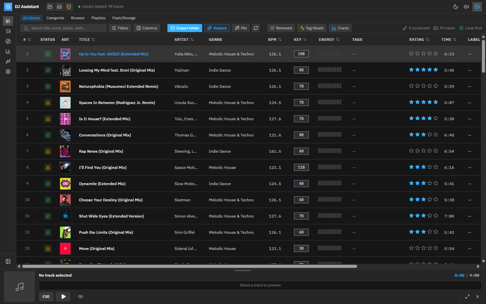

# UI/UX and UI-spec audit — 2026-11-22

**Scope:** the running desktop app (Library, Track panel, player Mini/Full, row
context menu, Filters, Tag Health, Import Center, Inbox, Playlists, Discover,
Settings) and the UI specification set in [`docs/ui-ux/`](../ui-ux/README.md).
**Build:** branch `docs/qa-scripted-fixture-2026-11-22` (`c1f4ec2d`), `pnpm tauri dev`
against the live 94-track library (24 analysed). Nothing was written to the
library: the review only selected rows, opened panels and menus, and loaded one
track into the player without playing it.
**Method:** the real WebView2 window, driven over the DevTools port
(`WEBVIEW2_ADDITIONAL_BROWSER_ARGUMENTS=--remote-debugging-port=9222`) with
`scripts/qa/fixture-run/cdp.cjs`; screenshots at 1440×900 and 1024×720. A
browser tab on `:1420` was used only for the accessibility tree (it runs on mock
data). Desktop computer-use was not available in this session, so native menus
and OS dialogs were not exercised.
**Outcome:** 29 findings. The work they turn into is planned in
[`plans/ui-simplification-2026-11.md`](../plans/ui-simplification-2026-11.md)
and tracked as **TU.1–TU.16** in [`sdd/04-TASKS.md`](../sdd/04-TASKS.md).

Severity: **P0** misleading or broken (fix first) · **P1** clutter or duplication
that costs every session · **P2** polish.

---

## 1. Verdict

The app has a solid core — the virtualized table, key pills, rating, the shared
Track panel and a real dual-waveform player all work against real data. What
hurts it is **accumulation**: every feature added its own button in the Library
toolbar, its own entry in the context menu, and often its own panel. The result:

- The same "find tracks that mix well with this one" feature is reachable from
  **four** places with **three** icons, and two of them are disabled.
- **Four of six** primary tabs, plus the header's Import Center, open a
  "Planned view" placeholder, while the working import lives in the Library
  toolbar under a different name.
- The Library toolbar holds **11 controls** (the 10 listed in U-06 plus the search
  field's clear button) **and 3 status readouts** in one row; it
  wraps at 1024 px and is clipped at 1440 px as soon as the Track panel opens.
- Rows are **48 px** tall where the design system specifies 28–32 px, so only 13
  of 94 tracks fit on a 900 px screen.

The fix is mostly subtraction. Section 4 gives the target layout.



---

## 2. Findings

### A. Duplicated AI and assist controls

| ID | Sev | Finding | Evidence | Recommendation |
|----|-----|---------|----------|----------------|
| U-01 | P1 | **Mix suggestions exist four times.** Toolbar `Mix` (Wand icon) opens the Mix Suggestions dock; the Track panel Overview has "Similar tracks (local mix-compatibility)" (Sparkles icon); the row menu has "Mix suggestions…" (disabled) and "Find smaller / similar tracks online…" (disabled). The dock and the panel call the same `findSimilarTracks`. The dock is also hidden behind the Track panel when both are open. | [03](assets/2026-11-22-ui/03-panel-overview.png), [06](assets/2026-11-22-ui/06-context-menu.png), `MixSuggestionsDock.tsx`, `track-panel/OverviewTab.tsx` | **One surface:** a "Mix" section in the Track panel (its own tab, with the add-to-selection actions the dock has today). Remove the toolbar `Mix` button and the dock. The row menu keeps one enabled item, "Show mix suggestions", that opens the panel on that tab. The online variant appears only once a provider ships. |
| U-02 | P1 | **One icon, three meanings.** `Sparkles` marks Analyze (toolbar), Similar tracks (panel) and, per [09-COMPONENTS](../ui-ux/09-COMPONENTS.md), Skills. `Wand2` marks Mix. Users cannot tell "the app computed this" from "the app suggests this". | `App.tsx` toolbar, `OverviewTab.tsx` | Reserve `Sparkles` for **suggestions only** (mix suggestions, later Skills), always paired with a "Suggested" label and a confidence value, as the v1 plan's "Why / Confidence" rule asks. Analyze uses `AudioWaveform`; drop `Wand2`. |
| U-03 | P1 | **Analyze has three entry points** with different behaviour: toolbar (whole library, enabled), row menu (single track, disabled), Settings → "Analysis queue → Open". | [01](assets/2026-11-22-ui/01-library.png), [06](assets/2026-11-22-ui/06-context-menu.png), [Settings](assets/2026-11-22-ui/10-Settings.png) | Analysis is a background job, not a toolbar verb. Show a status chip only when work exists ("12 to analyse · Analyse"), make the row-menu "Re-analyse" work or hide it, and remove the Settings link. |
| U-04 | P1 | **Tag cleanup is split across four places:** the Tag Health modal (toolbar), "Fix tags" (row menu), the Tag Surgeon dialog, and the planned Library › Maintain workspace. The Tag Health score is dominated by ISRC ("94 of 94 tracks have gaps"), which no DJ fixes by hand. | [14](assets/2026-11-22-ui/14-tag-health.png) | Move Tag Health into **Library › Maintain** (the locked IA home), drop ISRC from the default score, and feed real gaps into the Inbox (see U-21). |
| U-05 | P2 | **Charts** (Beatport Top 100 snapshots) sits in the Library toolbar. | [01](assets/2026-11-22-ui/01-library.png) | Charts are discovery: move to **Discover**. |

### B. Simplify the interface

| ID | Sev | Finding | Evidence | Recommendation |
|----|-----|---------|----------|----------------|
| U-06 | P1 | **Library toolbar overload:** Search, Filters, Columns, Import folder, Analyze, Mix, Refresh, Removed, Tag Health, Charts + "0 connected · 94 tracks · Local-first". Labels wrap to two lines at 1024 px; with the Track panel open at 1440 px, Charts is cut off. | [02](assets/2026-11-22-ui/02-selected.png), [15](assets/2026-11-22-ui/15-1024.png) | Target toolbar (§4): **Search · Filters · View** on the left, **Import** on the right, everything else in a `⋯` overflow. Move the counts to a table footer ("94 tracks · N need review"). The toolbar must collapse into the overflow instead of wrapping or clipping. |
| U-07 | P0 | **Four import entry points, three names, one of them fake.** Header "Import Center" opens a *Planned view* placeholder; the toolbar "Import folder" does the real scan; the empty state says "Scan folder"; Settings has "Import Center → Open". | [11](assets/2026-11-22-ui/11-import-center.png) | One verb, **Import**. Until Stage 3 ships, the header Import button runs the working folder scan; the placeholder page goes. Keep its accessible name when it gains a text label. |
| U-08 | P1 | **Global controls duplicated:** theme (header + Settings), mute (header + player), hide player (header + player ✕ + Settings), collapse nav (rail + Settings). | [01](assets/2026-11-22-ui/01-library.png), [Settings](assets/2026-11-22-ui/10-Settings.png) | Keep each control where it acts: mute and hide in the player, collapse on the rail, theme in Settings (and the command palette). The header keeps search, Import, Inbox and Backup only. |
| U-09 | P1 | **Three "edit" buttons in one Track panel:** "Edit metadata and tags" in the Tags tab, the same text as a link in Overview, and "Edit metadata" in the footer. "Add to playlist" is shown disabled. | [02](assets/2026-11-22-ui/02-selected.png), [03](assets/2026-11-22-ui/03-panel-overview.png) | One **Edit** action in the panel footer. Hide "Add to playlist" until Playlists exists. |
| U-10 | P1 | **Row context menu carries 7 disabled items and the whole column picker** (20+ checkboxes), so it is taller than the window and scrolls. | [06](assets/2026-11-22-ui/06-context-menu.png) | Show only actions that work (the "no fake controls" rule). The column picker belongs to the header right-click and the View button, not to a row. |
| U-11 | P1 | **Placeholder tabs.** Playlists, Discover, Statistics and Publish are "Planned view" pages; their sub-tabs do not match the locked IA (Playlists shows "Playlist Tracks · Set Score · **Set Check**"; Discover shows "Recommendations · Free downloads · Watchlist" instead of For You · Free Downloads · Sources · Watchlist). | [Playlists](assets/2026-11-22-ui/10-Playlists.png) | The IA is locked, so the tabs stay. Dim them in the rail with a "Coming later" tooltip, drop the fake sub-tabs, and align sub-tab names with [information-architecture.md](../product/information-architecture.md) when each stage ships. |
| U-12 | P1 | **Developer language in the product:** "The Stage 1 shell…", "Themes use the shared Carbon token set", "arrive in Stage 5", "Tag Surgeon (T2.2)", a `docs/plans/v1/README.md` path in Settings, "version-aware" in tooltips. | [Settings](assets/2026-11-22-ui/10-Settings.png), [02](assets/2026-11-22-ui/02-selected.png) | Rewrite against [copy-and-microcopy](../ui-ux/guidelines/copy-and-microcopy.md): no stage numbers, task IDs, file paths or token names in the UI. |

### C. Layout flexibility

| ID | Sev | Finding | Evidence | Recommendation |
|----|-----|---------|----------|----------------|
| U-13 | P1 | **Rows are 48 px; the spec says 28–32 px (Compact).** Only 13 rows fit at 900 px. The artwork column drives the height. Checklist Phase A "DensityProvider" is still open. | [01](assets/2026-11-22-ui/01-library.png), [01-DESIGN-SYSTEM §10](../ui-ux/01-DESIGN-SYSTEM.md) | Ship the density setting from [14-LIBRARY-TABLE-UPGRADES §2](../ui-ux/14-LIBRARY-TABLE-UPGRADES.md): Compact 32 (default, small art) · Comfortable 40 · Artwork 48. |
| U-14 | P1 | **Columns do not adapt.** At 1440 px Label is clipped and the table scrolls sideways; at 1024 px Rating and Time are off-screen while Title keeps ~280 px and Artist is truncated to "Yulia Niko, …". | [01](assets/2026-11-22-ui/01-library.png), [15](assets/2026-11-22-ui/15-1024.png) | Title and Artist share the flexible width (min 160 / 120); low-priority columns (Label, Year, Tags, Energy) auto-hide below set widths and say so in the View menu; # / Status / Title stay sticky on horizontal scroll. |
| U-15 | P1 | **No splitters.** The Track panel has a fixed width, there is no drag handle, and opening it clips the toolbar. Checklist Phase B "Splitters + persistence" is unchecked. | [02](assets/2026-11-22-ui/02-selected.png) | Splitters for left rail, Track panel and player height with min/max and persisted sizes, as [12-WIREFRAMES-AND-FLEXIBILITY](../ui-ux/12-WIREFRAMES-AND-FLEXIBILITY.md) specifies. Defer named workspaces (U-28). |
| U-16 | P2 | **Full player wastes space:** the left half of the detail waveform is empty black at the start of a track, the artwork tile takes ~170 px, and four empty hot-cue pads (E–H) take the same width as set ones. | [08](assets/2026-11-22-ui/08-player-full.png) | Shade the pre-roll instead of leaving it black, cap artwork at the waveform height, collapse empty pads into one "+ Cue" slot. Mini mode is fine as is. |
| U-17 | P2 | **Filters are an overlay with an Apply button,** covering the column they filter. "Compatible only" also appears in Settings with different wording (Strict/Wide). | [13](assets/2026-11-22-ui/13-filters.png) | Live filtering in a docked pane or popover, plus removable filter chips above the table. One home for the compatibility mode: the filter (Settings keeps only the default). |

### D. Icons, status and visibility

| ID | Sev | Finding | Evidence | Recommendation |
|----|-----|---------|----------|----------------|
| U-18 | P1 | **The header icons (folder, inbox, shield) have no labels,** and when one opens a page the nav rail loses its active state, so nothing on screen says where you are. | [11](assets/2026-11-22-ui/11-import-center.png), [12](assets/2026-11-22-ui/12-inbox.png) | Text labels from 1280 px ("Import", "Inbox", "Backup"), a count badge on Inbox, and a visible active state on whichever page is open. |
| U-19 | P1 | **Icon colour is decorative:** Tag Health yellow, Charts blue, Backup shield yellow, Local-first green, Removed grey. The design system says icons are `text.secondary` and `accent` when active; colour is for status. | [01](assets/2026-11-22-ui/01-library.png), [01-DESIGN-SYSTEM §8](../ui-ux/01-DESIGN-SYSTEM.md) | Neutral icons; colour only for state (warning, error, success, active). |
| U-20 | P2 | **Primary nav is an icon-only rail by default** and two glyphs are ambiguous (the Library "books" and the Publish glyph). (The five PNGs that sat untracked in `docs/ui/` are the brand-mark inspiration of memory decision D-020, not a nav set; they mix filled and outline styles.) | rail in every screenshot; [reference icons](../ui-ux/reference/icons/) | Stay on Lucide outline (the one-pack rule): `library`, `list-music`, `compass`, `bar-chart-3`, `hard-drive-upload` (Publish), `settings`. Active = accent pill + 2 px bar. Do not bring a filled family into the rail; the brand mark (D-020) stays the only filled glyph. |
| U-21 | P0 | **Status contradicts the Inbox.** About a third of the rows show a yellow warning in Status, yet the Inbox says "Inbox is clear — nothing is waiting". The Status column has no legend. | [01](assets/2026-11-22-ui/01-library.png), [12](assets/2026-11-22-ui/12-inbox.png) | Inbox › Needs Attention lists what the Status column flags (count badge in the header); Status icons get a hover label and a one-click "N need review" filter chip. |
| U-22 | P1 | **Energy shows ten empty grey bars for every track** when there is no energy value — it reads as broken data. Tags shows "—" in the same situation. | [01](assets/2026-11-22-ui/01-library.png) | Show "—" for missing energy; hide the column by default until energy has a source (TA.3). |
| U-23 | P2 | **Key pills switch between outlined and filled** with no visible explanation (the filled ones are harmonic matches for the loaded track). | [07](assets/2026-11-22-ui/07-player-loaded.png) | Tooltip "Compatible with the loaded track (8B)" and a legend entry in the View menu. |
| U-24 | P0 | **Fake duration:** with no track loaded the player reads "0:00 / 4:00"; the "4:00" is a placeholder. | [01](assets/2026-11-22-ui/01-library.png) | Show "–:–" until a track is loaded (the "no fabricated data" rule in [06-PLAYER](../ui-ux/06-PLAYER.md)). |
| U-25 | P1 | **Three highlight styles compete:** the selected row (grey fill + white outline), the loaded track (blue title, blue row number) and keyboard focus. In [07](assets/2026-11-22-ui/07-player-loaded.png) row 5 is selected, row 2 is loaded and row 1's title is still blue. | [07](assets/2026-11-22-ui/07-player-loaded.png) | Loaded = accent play glyph in the # column; selected = row fill; focus = outline. One meaning each. |

### E. Specs and documentation

| ID | Sev | Finding | Recommendation |
|----|-----|---------|----------------|
| U-26 | P1 | **Four documents claimed UI authority:** the numbered set (`docs/ui/`, canonical per AGENTS.md), the v1.9 narrative (called "master" by the UI README and the Phase 2 plan), the locked v1 guidelines (`docs/plan/05-design-system/`) and the superseded Phase 0 set (`docs/ui-ux/`). | Resolved in this pass by location (all under `docs/ui-ux/`); precedence is now stated in the [UI README](../ui-ux/README.md): guidelines (rules) → numbered spec → reference narrative → archive. |
| U-27 | P2 | [11-IMPLEMENTATION-CHECKLIST](../ui-ux/11-IMPLEMENTATION-CHECKLIST.md) still carries Phase E/F (superseded views) and has no item for any of the findings above. | Remove E/F; add a "Simplification" phase that points at TU.1–TU.16. |
| U-28 | P2 | [02-SHELL-AND-NAVIGATION](../ui-ux/02-SHELL-AND-NAVIGATION.md) specifies a full menu bar, an options bar with three contexts and named workspaces. None ship, and for a single-window prep tool they add surface without a user need. | Descope named workspaces and the custom menu bar from v1; keep splitters with persisted sizes (U-15). Record it as a plan decision. |
| U-29 | P2 | The spec does not define the overflow behaviour of toolbars or a responsive column policy, which is why U-06 and U-14 happened. | Add both rules to [03-LIBRARY-VIEW](../ui-ux/03-LIBRARY-VIEW.md) when TU.6/TU.9 land. |

---

## 3. What works and should stay

- Virtualized table with stable scrolling on 94 and 30,000 tracks.
- Key pills with Camelot/Open Key notation and the harmonic-compatibility colouring.
- Rating stars that save immediately with an Undo toast.
- The Track panel as **the** place for one track (it only needs fewer buttons).
- The Mini player: artwork, BPM/key chips, overview waveform and hot cues in ~100 px.
- Honest empty states (the Inbox and placeholder pages say what they are).

---

## 4. Target layout (Library)

```text
┌────────────────────────────────────────────────────────────────────────────┐
│ ◉ DJ Assistant   [ Search library…            ]   Import   Inbox 3   Backup ●│
├────┬───────────────────────────────────────────────────────────┬───────────┤
│ ▤  │ All · Categories · Browser · Playlists · Storage           │ TRACK     │
│ ♫  │ [Search in view…] [Filters ▾] [View ▾]        [⋯]          │ panel     │
│ ◎  │ chips: BPM 120–128 ✕   Needs review ✕                      │ Overview  │
│ ▥  │ #  ●  Art  Title ▸        Artist     BPM  Key  ★  Time     │ Tags      │
│ ⇪  │ 32 px rows (Compact) …                                     │ Cues      │
│ ⚙  │                                                            │ Mix ✦     │
│    │ 94 tracks · N need review · N analysed                     │ [Edit]    │
├────┴──────────────────────────── ⇕ splitter ───────────────────┴───────────┤
│ Mini player: art · title · BPM · Key · overview waveform · cues · ▶ CUE    │
└────────────────────────────────────────────────────────────────────────────┘
⋯ overflow = Refresh · Removed tracks · Analyse library · Tag health (until Maintain)
✦ = the only place suggestions appear, with Why / Confidence
```

Rules behind it:

1. **One home per feature.** If a control exists in two places, delete one.
2. **Toolbars overflow, never wrap or clip.**
3. **No disabled placeholders** in menus and toolbars; unbuilt features are absent.
4. **Colour is state, not decoration.**
5. **Suggestions are marked** (✦ + "Suggested" + confidence); computed facts are not.

---

## 5. Finding → task map

| Task | Findings | Priority |
|------|----------|----------|
| TU.1 Honest numbers: no fake duration, "—" for missing energy | U-22, U-24 | P0 |
| TU.2 Inbox reflects Needs Attention; Status legend + filter chip | U-21 | P0 |
| TU.3 One Import entry point; accessible name | U-07 | P0 |
| TU.4 Mix suggestions: one surface in the Track panel | U-01 | P1 |
| TU.5 Icon semantics: Sparkles = suggestions only; neutral icon colour | U-02, U-19 | P1 |
| TU.6 Library toolbar: Search · Filters · View · Import + overflow; counts to footer | U-03, U-05, U-06 | P1 |
| TU.7 Remove duplicated global controls from the header | U-08 | P1 |
| TU.8 Track panel: one Edit action, no disabled actions | U-09 | P1 |
| TU.9 Row context menu: working actions only, no column picker | U-10 | P1 |
| TU.10 Density setting (Compact default) | U-13 | P1 |
| TU.11 Responsive columns + sticky Title | U-14 | P1 |
| TU.12 Splitters with persisted sizes | U-15 | P1 |
| TU.13 Header labels, active state, Inbox badge; nav icon set | U-18, U-20 | P1 |
| TU.14 Product copy pass (no stage numbers, IDs, paths) | U-11, U-12 | P1 |
| TU.15 Tag Health → Library › Maintain; Charts → Discover | U-04, U-05 | P2 |
| TU.16 Player and filter polish; highlight states; key legend | U-16, U-17, U-23, U-25 | P2 |

Spec work (U-26 – U-29) is folded into TU.6, TU.11 and TU.12 and into the
checklist update in the [UI simplification plan](../plans/ui-simplification-2026-11.md).

## 6. Not covered

- Native OS menus, file dialogs and drag-and-drop from Explorer (no desktop
  computer-use in this session).
- Light theme and Windows high-contrast mode.
- Audio playback itself (nothing was played).
- Screen-reader output beyond the accessibility-tree names checked in the browser tab.
