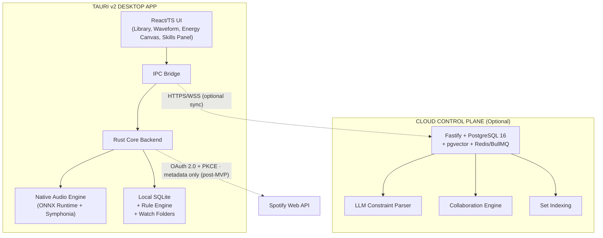

# DJ Assistant — Project Context

**Document type:** Consolidated application, plan, and progress reference
**Status:** Living — snapshot as of 2026-10-24 (approved v1 plan mirrored; Stage 1 shell + Slice 3A merged via PR #53; player presentations merged via PR #54; shared Track panel merged via PR #55; audit TA.1–TA.14 integrated; T2.1.2 filters reflected)
**Audience:** Engineers, product, AI agents, and anyone who needs the full picture in one place
**Source of truth:** [`docs/product/CANONICAL_DOCUMENTATION.md`](../product/CANONICAL_DOCUMENTATION.md) (product + technical) and [`docs/sdd/`](../sdd/README.md) (plan, tasks, acceptance). Audit findings live in [`docs/audit/`](../audit/README.md) and are tracked as `TA.x` tasks in [`docs/sdd/04-TASKS.md`](../sdd/04-TASKS.md).

> This document is a single-file digest of the entire project. It exists so a new
> contributor or an AI agent can understand **what DJ Assistant is, how it is
> built, what the plan is, and exactly how far development has progressed** without
> first reading two dozen separate documents. Where a topic has a canonical home,
> this file links to it rather than replacing it.

## 0. Current planning baseline — 2026-10-24

- **The approved v1 plan is mirrored at [`docs/plan/`](../plan/README.md).** It
  contains 30 documents and 52 locked decisions (`D-001–D-052`). Those IDs are
  scoped to the plan tree; they are separate from the repository memory ledger
  (`docs/ai/memory/decisions.md`, D-001–D-014).
- **Product shape is locked:** six tabs — Library, Playlists, Discover,
  Statistics, Publish, Settings. Maintain lives inside Library; Set Score lives
  inside Playlists; Import is a top-bar Import Center; Inbox combines Needs
  Attention and Updates.
- **UI/UX rules are locked** in
  [`docs/plan/05-design-system/ui-ux-guidelines.md`](../plan/05-design-system/ui-ux-guidelines.md):
  dense but calm, dark-first with a light theme, no dashboard, no fake data,
  explicit empty/error/loading states, WCAG 2.2 AA, keyboard reachability,
  reduced motion, and no color-only meaning. The shipped token set remains
  [`docs/ui/01-DESIGN-SYSTEM.md`](../ui/01-DESIGN-SYSTEM.md).
- **The data and safety model is locked:** one library in v1, database-first
  metadata, hybrid tags, numeric energy, watch folders default to Inbox review,
  quarantine before purge, explicit playlist save, and no silent destructive
  actions.
- **Sync and backup are locked:** Pull → Review → Maintain → Push; rekordbox
  first, Traktor second; Library wins editorial metadata, DJ app wins cues and
  beat grids; backups include audio; Google Drive is the only v1 cloud target;
  restore merge is per-field and bulk merge is blocked.
- **The v1 non-goals** include Lexicon compatibility, synthetic audio, multiple
  libraries, a dashboard, playlist-scoped statistics, WMA/DRM audio, full USB
  library export, and scraping music catalogs.
- **Slice 3A is merged.** Tags and comment editing landed in PR #53 (squash
  `03991d3c`, 2026-10-23); the annotated tag `slice-3a-code-complete` still
  peels to `ec2b191f`. The tag set is snapshotted transactionally; undo skips a
  track changed since the snapshot. Automated checks pass; manual
  running-window QA is still pending, so T2.1.7 and T2.1.13 remain unticked.
- **The Stage 1 shell is shipped** on `main` via PR #53: six primary tabs,
  typed view registry, top-bar library search/Import Center/Inbox/backup status,
  persistent player dock, Settings skeleton, error boundary and redacted
  renderer logging. PR #54 (squash `5e7334eb`) rebuilt the dock to the
  three-presentation model (Mini / Full / Player view; Extended retired), with
  BPM fine-tune and the dock-height snap. Native acceptance QA is pending,
  including the 30,000-track fixture check. The top-bar search is labeled
  “Search library” until Stage 2 adds playlist/tag-wide global search. See
  [`docs/plan/06-delivery/implementation-slices.md`](../plan/06-delivery/implementation-slices.md).
- **The shared Track panel is merged** on `main` via PR #55 (squash
  `83831774`, 2026-10-24). One panel serves the library and every later entry
  point: seven tabs (Overview, Tags, Cues, Analysis, Playlists, History, File),
  a WAI-ARIA tablist with persisted tab, inspected-vs-playing separation, and a
  deferred panel open so double-click playback stays instant. Cues are
  read-only in this slice; the footer Play, Add to playlist (disabled until
  Stage 5) and Edit metadata actions are in place. Keyboard access and focus
  restore are covered by tests; manual running-window QA is pending.
- **Discussion and decision rationale** lives in
  [`docs/plan/06-delivery/discussions.md`](../plan/06-delivery/discussions.md),
  including rejected alternatives and non-blocking open items.
- **The factory repository is a separate workstream** and must not be mixed into
  DJ Assistant delivery.

---

## 1. One-line Summary

**DJ Assistant is the fastest way to turn a music library into a performance-ready DJ set.**

It is a **desktop-first preparation accelerator** for professional DJs. It scans a
local music library, analyzes tracks on-device (BPM, key, beat grid, phrases,
vocal presence, loudness), generates intelligent cue points, cleans messy metadata,
builds constraint-driven harmonic and energy-aware sets, supports collaborative B2B
preparation, and exports directly into the DJ software the artist already performs
with — targeting **Analyze → Clean → Cue → Sequence → Export in under 15 minutes
for 40+ tracks**.

---

## 2. What It Is and What It Is Not

### 2.1 What it is

A desktop-first prep layer that runs advanced audio analysis **locally on the
user's machine**, then turns that data into action: cues, cleaned tags, ready
sets, and exports. It works alongside rekordbox, Serato, Traktor, and CDJs — it
does not replace them.

### 2.2 Explicit non-goals (do not build)

- Live performance / audio playback / mixing engine
- A replacement for rekordbox / Serato / Traktor / CDJs as the performance surface
- A social network, content calendar, or marketing suite
- A Spotify / Apple Music / YouTube / SoundCloud **audio** downloader, ripper, or any piracy feature (publishing a **metadata-only** playlist to the DJ's own streaming account is allowed — see Spotify Playlist Export, §4/§23)
- An autonomous agent that takes irreversible actions without confirmation
- A career OS, label management, or demo-submission tool
- Cloud analysis of raw audio (audio must stay local)

### 2.3 Target users

- Working club and festival DJs preparing multiple sets per week
- Mobile and wedding DJs who need fast, reliable prep
- Rising DJs who want pro-level prep without years of manual tagging
- Content creators who need clean, exportable set structures
- DJs who perform B2B and need a clean way to prepare together

### 2.4 Killer use case

> "I just downloaded 40 new tracks. I have a gig tomorrow (and a B2B the day
> after). I need to clean the messy artist names, know which tracks work
> together, where the drops are, what key they're in, set cue points, build a set
> with my partner, and export everything so we can just load and play. I don't
> have three hours to do this manually."

---

## 3. Core Promise and Success Metrics

**Core promise:** Analyze locally → clean tags → generate cues → build harmonic,
energy-aware sets → collaborate on B2B → export to rekordbox / Serato, in **about
15 minutes for 40+ tracks**.

| Success metric (MVP) | Target direction |
|----------------------|------------------|
| Time to prep ~40 tracks (analyze → cues → basic set → export) | Toward ≤ 15 minutes |
| Cue placement acceptance rate | > 90% in closed beta |
| Source-file corruption | Zero, across all testing |
| Tag cleanup clustering accuracy | > 95% on agreed beta libraries |
| Analysis usable without heavy manual fix | High first-pass usefulness; overrides allowed |
| Export loads in target DJ software | Primary formats work on real hardware |
| Working DJs report time savings | "This saved me hours" |

---

## 4. Product Scope by Priority

> Slim MVP per audit (`docs/audit/AUDIT-SUMMARY.md`, TA.1): MVP gates on **Import → Analyze → Cue → Export** only. USB-format, B2B collab, and extra Skills are P1.

### P0 — Must have for MVP (slimmed)

- Local library import, folder watching, hashing, and dedup
- Local audio analysis (BPM, key, beat grid, phrases, vocal presence, loudness)
- Intelligent cue point generation (8 hot cues + memory cues)
- Smart Tag Cleanup (fuzzy artist clustering, aliases, bulk apply + undo)
- Constraint-driven Set Builder with Beam Search sequencing
- Energy-aware set construction + basic templates (energy = user tag + LUFS proxy + 0–10 slider; never blocks build)
- Export to rekordbox XML and Serato `.crate`
- Offline-capable core workflow
- Basic Skills framework (Cue Master + Tag Surgeon first; remainder P1)
- Prep Auditor / Library Health basics

### P1 — Should have (MVP or immediately after)

- Professional USB media format tool (FAT32+MBR default; exFAT gated; rescan + type-to-confirm + dry-run + MBR verify) — moved from P0 per audit
- B2B shared sets (metadata-only) — moved from P0 per audit
- Remaining Skills (Set Architect, Energy Cartographer, Harmonic Scout, Missing Track Hunter beyond basics)
- Gig Ready one-click workflow
- Lock & Fill
- Set Templates
- Transition explanations
- Waveform visualization with cue markers
- Settings S-1–S-7: Profiles, Preview gain/keymap, Library locations+ignore+relink, Model manager, Privacy center, USB policy, Telemetry off-default
- Functions F-1–F-10: smart playlists/history, relink, beatgrid editor, cue templates, harmonic traffic-light + mix-out + vocal warning, set versioning/diff, USB verify + set sheet, Prep Auditor queue, waveform, bulk tag preview+undo

### P2 — Later

- Advanced vector search (CLAP embeddings)
- Richer collaboration presence
- Additional export formats (Traktor, VirtualDJ)
- **Spotify Playlist Export** — publish a set to the DJ's own Spotify account as a real playlist, metadata only (OAuth 2.0 + PKCE on desktop; ISRC-first matching; no audio leaves the device). Spotify is the reference implementation of a generic provider contract; Deezer planned second.
- **Discovery (foundations shipped)** — local similar-track scoring, Tag Health gap detection, per-store buy-links and the provider registry are implemented and visible in the library UI (no network). Post-MVP: opt-in external similarity, Beatport Top 100 / Hype snapshots + release radar (data integrations — no public catalog API).
- **Enrichment (planned, opt-in)** — online tag/artwork lookup (MusicBrainz, iTunes, Deezer, Discogs, AcoustID) via preview → apply → undo; DB fields only, never source files.
- Preference model ("DJ Brain") personalization depth

---

## 5. Core Modules

| Module | Purpose | Key capabilities |
|--------|---------|------------------|
| **Library** | Import, organize, search, manage tracks | Folder scanning, watch folders, metadata extraction, BLAKE3 dedup, bulk editing, ratings/tags/comments, Smart Tag Cleanup, version detection, artist graph. **Discovery foundations (shipped):** local similar-track scoring with reason chips, Tag Health gap detection + score, per-store buy-links (Beatport, Traxsource, Juno, Bandcamp, Discogs), provider registry + capabilities — all offline except explicit lookups. **Live (shipped, opt-in):** MusicBrainz / iTunes / Deezer / Discogs / Last.fm lookup with preview → apply → undo review, artwork into empty slots, read-only Deezer catalog matching, chart snapshots with taste filtering |
| **Analysis** | Extract musical attributes locally | BPM, key (Camelot + classical), beat grid, phrase boundaries (8/16/32 bar), vocal presence/density, loudness (EBU R128), spectral brightness, structural markers, phrase confidence, safe mix-out window |
| **Cue Points** | Generate + export meaningful cues | One-click 8 hot cues + memory cues, genre-aware templates, waveform editor, color-coded sections, export to rekordbox / Serato / Traktor / VirtualDJ / `.cue` |
| **Set Builder** | Build energy-mapped, harmonically compatible sets | Target duration, start/peak/close BPM, energy curve, genre/mood filters, locks/excludes, re-order, transition explanations, alternatives, Set Templates, Lock & Fill, transition risk score, "safer / more adventurous" |
| **Search** | Natural language + structured discovery | "dark emotional tracks around 126 BPM"; hybrid structured filters + full-text + vector (CLAP 512-dim) + personalized re-ranking. Similar-tracks drawer is the shipped local discovery surface (external sources post-MVP, opt-in) |
| **Export** | Bridge to existing DJ software | rekordbox XML, Serato `.crate`, CSV, cue export, export presets, dual-crate export for B2B, and post-MVP **Spotify Playlist Export** (metadata-only, to the DJ's own account; reference implementation of a generic provider contract — Deezer second). Per-track store buy-links are shipped (links only, no audio) |
| **Desktop Companion** | Local file access, analysis, export, cache | Tauri v2 shell, folder watching, BLAKE3 hashing, metadata, ONNX analysis, SQLite, local rule engine, offline mode |
| **DJ Brain** | Personalized preference + behavioral model | Structured prefs, behavioral events, inferred patterns; fully inspectable/deletable; never infers emotion or private habits |
| **Collaboration (B2B)** | Shared set prep without audio transfer | Shared workspaces, track contribution (references only), real-time co-editing, roles, dual-crate export, USB Pack Generator, pre-gig sync check, change log with diff |
| **Automation & Skills** | Scoped, reversible automation | Rule-based workflows, conditional automations, scoped Skills with enable/disable/kill-switch |

### 5.1 Reliability honesty

BPM and beat grid are highly reliable. Key is reasonably reliable. **Energy, mood,
danceability, and "groove" are deliberately not auto-scored as ground truth** —
energy is user tag + LUFS proxy + manual 0–10 slider (per TA.3); missing ML mood never blocks `build_set`.

---

## 6. Design Principles (Non-Negotiables)

1. **Local-first** — Core prep works offline; raw audio is not uploaded by default.
2. **Non-destructive** — Source audio files are never modified. Outputs are sidecars, exports, or local DB records.
3. **DJ in control** — Skills are scoped and reversible; every bulk/AI mutation is previewable and undoable; no silent irreversible changes.
4. **Hybrid intelligence** — Natural language (LLM) understands *intent*; deterministic **Beam Search** decides *order*.

These are constraints, not aspirations. Any feature that would violate them is
expected to be redesigned rather than shipped.

---

## 7. Architecture

### 7.1 High-level shape

A **Tauri v2** desktop application (Rust core + React/TypeScript UI) with an
**optional** cloud control plane (Fastify + PostgreSQL + pgvector + Redis).



`Spotify["Spotify Web API"]` is the reference implementation of the generic
provider registry (`StreamingProvider`: spotify → deezer → apple_music →
youtube_music → soundcloud → tidal; `StoreProvider`: beatport → traxsource →
juno_download → bandcamp → discogs). Store buy-links are shipped as pure URLs;
charts/radar and online enrichment are post-MVP data integrations (ADR-0007).

### 7.2 Component responsibilities

**Desktop (Tauri v2)**

- **React UI** — waveform, energy canvas, set builder, skills panel, library browser, tag cleanup UI
- **Rust Core** — folder watching, hashing, metadata, analysis orchestration, local SQLite, rule engine, export generation
- **Native Audio Engine** — Symphonia decode + ONNX inference (BPM/key/phrases/vocals/loudness)
- **Local SQLite** — tracks, analysis results, cue points, skill history, preferences, aliases
- **IPC Layer** — typed JSON commands + events
- **Streaming Export (post-MVP)** — Spotify playlist publishing: OAuth 2.0 + PKCE, ISRC-first matching with a review queue, tokens in the OS keychain; sends metadata and search queries only, never audio. Spotify is the reference implementation of the generic provider contract (Deezer second); in-app playback stays out of scope for every provider.
- **Discovery foundations (shipped, offline)** — local similar-track scoring, Tag Health gap detection, per-store buy-links, provider registry. Post-MVP online tracks (external similarity, enrichment lookup, charts/radar) are opt-in per provider.

**Cloud control plane (optional)**

- API gateway (Fastify): auth, rate limiting, routing
- Constraint parser: NL → structured set constraints
- Set builder service: validate/assist Beam Search
- Collaboration service: shared sets, presence, conflict resolution (no audio)
- Search/embeddings: pgvector similarity search
- Task queue: background jobs

> **Critical:** The cloud **never receives raw audio**. Only derived features,
> metadata, and set structures are synced, with explicit user consent.

### 7.3 Data boundaries

| Data type | Local only | Optional cloud sync | Never leaves device |
|-----------|:---------:|:-------------------:|:-------------------:|
| Raw audio files | ✓ | ✗ | ✓ |
| Waveform peaks / analysis cache | ✓ | ✗ | ✓ |
| BPM, key, cues, tags | ✓ | ✓ (opt-in) | — |
| Set structures | ✓ | ✓ (collaboration) | — |
| User preferences / skill history | ✓ | ✓ | — |
| Embeddings (CLAP) | ✓ | ✓ (search) | — |

### 7.4 Key design decisions

| Decision | Choice | Rationale |
|----------|--------|-----------|
| Desktop framework | Tauri v2 | Smaller, safer, native performance vs Electron |
| Analysis runtime | ONNX Runtime in Rust | Offline, fast, no Python dependency |
| Sequencing | Beam Search (not LLM) | Deterministic, optimizable, no hallucination |
| Local DB | SQLite | Simple, reliable, offline-first |
| Cloud API | Fastify (TypeScript) | Fast, good DX, shared language with frontend |
| Cloud DB | PostgreSQL 16 + pgvector | Mature + vector search |
| Automation model | Scoped Skills | Controllable, reversible, auditable |

---

## 8. Hybrid Intelligence Boundary

```
User Intent
    │
    ▼
[LLM Constraint Extractor]   ← only place an LLM shapes structure
    │
    ▼
[Candidate Filter + Scoring Matrix]   ← deterministic
    │
    ▼
[Beam Search Sequencer]      ← deterministic optimization (width W = 10)
    │
    ▼
[Explanation Generator]      ← LLM or templates
    │
    ▼
DJ Review & Override
```

**Rule:** The **LLM never emits the final ordered tracklist.** It translates
intent into constraints and later explains the deterministic result.

AI/LLM usage boundaries:

| Concern | Decision |
|---------|----------|
| Audio analysis | Local ONNX only |
| Set sequencing | Deterministic Beam Search only |
| Similarity scoring | Single locked formula versioned with `analysis_version` (TA.2 — resolves Canonical vs shipped weight drift) |
| Energy source | User tag + LUFS proxy + manual 0–10 slider; never blocks `build_set` (TA.3) |
| Constraint understanding | LLM allowed (cloud or local) |
| Explanations | LLM or templates |
| Tag normalization | Deterministic + fuzzy algorithms (no LLM required) |
| Autonomy | Scoped Skills only; no open agents |
| Contracts | Single `contracts/*.json` → `packages/shared` + Rust structs; CI drift check (TA.5) |
| Errors | Cataloged `E_SCAN_*/E_ANALYSIS_*/E_EXPORT_*/E_USB_*/E_PROVIDER_*` (TA.9) |

---

## 9. Algorithms and Scoring

### 9.1 Transition scoring

Transition suitability `S(A,B) ∈ [0,1]`:

```
S(A,B) = w1·S_key(A,B) + w2·S_bpm(A,B) + w3·S_energy(A,B) + w4·S_semantic(A,B)
```

Default weights: `w1 = 0.35`, `w2 = 0.30`, `w3 = 0.20`, `w4 = 0.15`.

> Audit note (TA.2): Canonical weights above drifted from shipped local similarity (`0.45/0.35/0.10/0.10` in `similarity.rs`). One formula must be locked, versioned with `analysis_version`, and pinned by unit test. `S(A,B)` is the set-transition score; `M(seed,cand)` below is the library similar-tracks score — keep both but version each.

- **Harmonic distance `S_key`** — Camelot positions: exact match 1.00, relative major/minor 0.95, perfect 5th/4th 0.90, +7 semitones (energy boost) 0.80, whole-step bump 0.40, otherwise 0.00.
- **Tempo delta `S_bpm`** — ≤ 1 BPM: 1.00; linear falloff to 0 between 1 and 6 BPM; > 6 BPM: 0.00.
- **Energy curve `S_energy`** — fit against a target energy trajectory.
- **Semantic `S_semantic`** — cosine similarity of optional 512-dim CLAP embeddings.

### 9.2 Beam Search

Beam width `W = 10`, depth `D` = target track count. Maximizes cumulative
fitness `Σ S(Tᵢ, Tᵢ₊₁)` while avoiding repetition and respecting duration limits,
locked tracks, and exclusions.

### 9.3 Cue snapping

Downbeat `t₀` is found via spectral flux; bar duration `t_bar = 240 / BPM`. Hot
cues snap to exact 8-bar phase boundaries:

```
T_cue = t₀ + (k × 8 × t_bar),  k ∈ ℕ
```

Genre-aware heuristics assign cue slots (A–H) for standard electronic vs.
extended club material, plus memory cues such as "Vocal Warning" and "Mix Out
Deadline". Full tables live in the canonical spec §4.3.

### 9.4 Similar-track scoring (shipped, `crates/core/src/similarity.rs`)

Mix-compatibility `M(seed, cand) ∈ [0,1]`, renormalised over the signals both
tracks share:

```
M = 0.45·S_bpm + 0.35·S_key + 0.10·S_genre + 0.10·S_duration   (over available signals)
```

- **`S_bpm`** — 1.0 at identical tempo, linear falloff to 0 at 8% relative difference.
- **`S_key`** — Camelot distance `d ∈ 0..=6` (0 same, 1 adjacent/relative major-minor,
  2 diagonal energy-boost, cap 6); `S_key = 1 − d/6`.
- **`S_genre`** — 1 on case-insensitive match, else 0. **`S_duration`** — 1.0 at
  identical length, falloff to 0 at 25% difference.
- No shared signals → `0.0` with a `"no comparable data"` reason. Ordering is
  deterministic (score desc, track-id tie-break); limit clamped to 1–50.

---

## 10. Data Model

### 10.1 Local SQLite (implemented tables)

Migration `001_initial_schema.sql`:

- **`workspaces`** — `id`, `name`, `created_at`; a `default` workspace ("Primary Library") is seeded.
- **`tracks`** — library source of truth: `id`, `workspace_id` (FK, cascade), `file_path`, `file_hash`, `file_size`, `duration_ms`, `sample_rate`, `channels`, `bit_depth`, `format`, `title`, `artist`, `album`, `genre`, `year`, `bpm`, `key_camelot`, `key_classical`, `loudness_lufs`, `spectral_brightness`, `vocal_presence`, `phrase_confidence`, `analysis_status`, `analysis_version`, `user_rating`, `play_count`, `notes`, `created_at`, `updated_at`. Constraint: `UNIQUE(workspace_id, file_hash)`.
- **`cue_points`** — `id`, `track_id` (FK, cascade), `position_ms`, `cue_type` (`hot_cue`/`memory_cue`/`loop`), `slot` (1–8 for hot cues, NULL otherwise), `label`, `color_hex`, `source` (`ai_generated`/`user_custom`/`imported`), `created_at`.
- **`skill_runs`** — `id`, `workspace_id`, `skill_name`, `status` (`started`/`success`/`failed`/`undone`), `input_summary`, `before_state`, `after_state`, `error`, `created_at`.

Indexes on `file_hash`, `(artist, title)`, and `analysis_status`.

Migration `002_track_tags.sql` adds tag-sourced fields surfaced without full
analysis: `comments`, `artwork_hash`, `artwork_path`, `artwork_mime` (+ index on
`artwork_hash`). Artwork is cached on disk content-addressed by the BLAKE3 of the
image bytes; only the reference is stored, never the image bytes.

Migration `003_enrichment_providers.sql` adds the discovery/enrichment/provider
foundations: `tracks.isrc` (+ index) as the universal join key; `external_ids`
(`track_id`, `provider`, `provider_id`, `confidence`) caching provider-side IDs;
`enrichment_runs` recording preview → apply → undo history; and the generalized
desktop-local `streaming_accounts` / `streaming_exports` / `streaming_matches`
(`provider` free-text enum). Applies cleanly over 001/002; the scanner INSERT is
column-explicit so the `isrc` ADD COLUMN is safe.

Migration `004_enrichment_candidates.sql` adds the enrichment run history:
`enrichment_runs.before_state` / `after_state` (Skill undo snapshots) and
`enrichment_candidates` (per-field proposals persisted between preview and
apply, with confidence, tier, artwork and source URLs).

Migration `005_chart_snapshots.sql` adds versioned chart data (TD.3 Tier 1):
`chart_snapshots` keyed by (provider, chart, genre, snapshot_date, position)
with ISRC/tempo/key columns for ownership and taste filtering.

Database pragmas: foreign keys **on** (SQLite defaults to off), `journal_mode =
WAL`, `synchronous = NORMAL`.

### 10.2 Planned local tables (not yet implemented)

`phrase_markers`/structural segments, `aliases`, `sets`, `set_tracks`,
`preferences`/`settings`, `watch_folders`. Post-MVP discovery adds
`followed_artists` / `followed_labels` (release radar). Shipped via migrations
003–005 (desktop-local, no cloud tables required): `external_ids`,
`enrichment_runs`/`enrichment_candidates`, `streaming_*`,
`chart_snapshots` (versioned Beatport Top 100 / Hype data, TD.3).

### 10.3 Cloud PostgreSQL 16 + pgvector (planned schema)

`users`, `workspaces`, `workspace_members`, `tracks` (feature subset),
`track_embeddings` (`vector(512)` + HNSW cosine index), `sets`, `set_tracks`,
`cue_points`, `play_events` (append-only), `ai_memory`, `artist_aliases`,
`shared_set_members`, `set_track_contributions`, `skills_config`,
`automation_rules`, `skill_action_logs`, `audit_log`. Key constraints: unique
`(workspace_id, file_hash)`, soft delete via `deleted_at`, all timestamps UTC,
absolute workspace isolation. Full DDL is in the canonical spec §5.

---

## 11. Interfaces

### 11.1 Tauri IPC — implemented commands

Wired in `apps/desktop/src-tauri/src/lib.rs`:

| Command | Purpose |
|---------|---------|
| `scan_folder` | Canonicalize path, run recursive scan, cache artwork, emit progress events |
| `list_tracks` | Server-side search + filters (BPM/key/status/genre/rating), sort and pagination; returns the matching `total` |
| `list_genres` | Distinct non-empty genre tags with track counts (filter-panel options) |
| `get_track` | Full track detail incl. cue points |
| `get_artwork` | Serve cached cover art as a `data:` URL (or `null`) |
| `analyze_library` | Queue local analysis for all/selected tracks (version-aware skip, `force` supported) |
| `find_similar_tracks` | Rank library tracks by local mix-compatibility (BPM/key/genre/duration + reasons) |
| `track_tag_health` | Report missing/placeholder tag & artwork fields + per-field totals (local only) |
| `store_links_for_track` | Per-store buy-link search URLs (pure construction, no API, no audio) |
| `provider_status` | Connected accounts + supported streaming/store provider enums |
| `enrichment_preview` | Look up gap tracks on one opt-in provider; record per-field proposals (nothing applied) |
| `enrichment_apply` | Apply recorded proposals to DB fields (never source files); artwork fills empty slots |
| `enrichment_undo` | Restore a run's before-state snapshot; run marked `undone` |
| `provider_match_tracks` | Live Deezer match (ISRC-exact → fuzzy, stateless, no key, no writes) |
| `provider_match_set` | Generic set match (TM.1; trackIds today, `set_id` waits on Phase 3 sets) |
| `provider_export_playlist` | Returns `not_configured` naming the missing credential until TM.2b/TP |
| `chart_import_snapshot` | Import a versioned chart snapshot (validated, idempotent re-import) |
| `chart_list` | List a snapshot with ISRC ownership + taste scores vs a seed track |
| `provider_match_set` / `provider_export_playlist` | Generic multi-provider match/export contract (TM.1; Spotify re-implementation waits on TP) |
| `chart_import_snapshot` / `chart_list` | Versioned chart ingest (idempotent) + taste-filtered listing (TD.3, migration 005) |

### 11.2 Tauri IPC — implemented events

- `scan:progress` / `scan:completed`
- `analysis:progress` / `analysis:completed`
- `enrichment:progress` (per-track preview status for a run)

### 11.3 Planned commands / events

`analyze_track`, `analyze_batch`, `run_skill`, `undo_skill_run`, `build_set`,
`export_set`; events `skill:progress`, `skill:completed`, `watcher:file_changed`,
`error`. Post-MVP provider contracts generalize the Spotify surface:
`provider_match_set`, `provider_export_playlist` (+ per-provider connect/disconnect),
`enrichment_preview`, `enrichment_apply` (undo = restore `before_state`); events
`provider:match_progress`, `provider:export_progress`, `enrichment:progress`.
Original Spotify Playlist Export surface: `spotify_connect`,
`spotify_disconnect`, `spotify_status`, `spotify_match_set`,
`spotify_export_playlist`, `spotify_delete_playlist`; events
`spotify:auth_progress`, `spotify:auth_completed`, `spotify:match_progress`,
`spotify:export_progress`, `spotify:export_completed`. Contracts are specified in
[`docs/architecture/API_CONTRACTS.md`](../architecture/API_CONTRACTS.md) §2.5–§2.7.

### 11.4 Cloud HTTP API (planned)

Base `/api/v1`, Bearer auth, workspace-scoped, never accepts raw audio. Key
endpoints: `/library/scan`, `/ai/parse-query`, `/sets/generate`, `/sets/build`,
`/tags/cleanup/preview`, `/tags/cleanup/apply`, `/sets/:id/invite`,
`/sets/:id/collaborate`, `/skills/:name/run`, `/automation/rules`,
`/library/health`, `/sets/:id/usb-pack`, `/sets/:id/sync-check`.

### 11.5 Export formats

- **rekordbox XML** (`DJ_PLAYLISTS`) — collection + `POSITION_MARK` cues + playlists, generated with quick-xml.
- **Serato `.crate`** — binary `vrsn`/`otrk`/`ptrk` big-endian structure written to `_Serato_/Subcrates/`.
- **Spotify playlist (post-MVP)** — publish a set to the DJ's own Spotify account as a real playlist via the Spotify Web API; **metadata only** (ISRC-first match → fuzzy fallback → confidence tiers → review queue). OAuth 2.0 + PKCE runs on the desktop; tokens live in the OS keychain; no audio is ever uploaded. Spotify is the reference implementation of the generic provider contract (Deezer second).
- **Store buy-links (shipped)** — per-track outbound search URLs for Beatport, Traxsource, Juno Download, Bandcamp and Discogs; links only, never audio. Charts/radar arrive as data integrations (no public catalog API).

Hardware validation on Pioneer **CDJ-2000NXS2 / CDJ-3000** is a phase exit gate for the file formats.

### 11.6 Desktop UI surface

The desktop UI is a **dark-first Tauri v2 shell** (React + TypeScript + Tailwind
v4). [`docs/ui/`](../ui/README.md) is the **current interface authority** — design
system, shell, screens, and interaction contracts. [`docs/ui-ux/`](../ui-ux/) is
the earlier UI/UX set, kept for history and superseded where it conflicts.

The T2.1.0 shell implements the six primary tabs (Library / Playlists / Discover
/ Statistics / Publish / Settings), a collapsible 220/48px left nav, the top bar
(search, Import Center, Inbox, backup status), dark/light/system theming with
persisted UI state, and the player dock. The player has three presentations —
Mini, Full and Player view — with Hidden as a visibility state; the dock is
layout-only until T2.4. The old three-view shell (header view switcher,
Preparation / Auto Performance tabs, per-view options bar) is superseded by the
approved v1 plan: set building lives in Playlists → Set Score.

| Surface | Phase | Status |
|---------|-------|--------|
| App shell (six tabs, collapsible 220/48px nav, top bar, typed view router) | 2 | ✅ Shipped PR #53 — native acceptance QA pending (T2.1.0) |
| Theme system (dark/light/system, semantic tokens, persisted preference) | 2 | ✅ Shipped (T2.1.0) |
| Player dock (Mini / Full / Player view, artwork, metadata, transport) | 2 | 🟡 Shell + presentations shipped PR #54; real audio T2.4 |
| Library (scan, live progress, dense track table, empty/error states) | 0 | ✅ Implemented, relocated into the shell |
| Track inspector drawer (similar tracks, gap chips, buy-links) | 0 | ✅ Implemented — relocated into the shared Track panel PR #55 |
| Tag Health modal (per-field bars + gap list; online lookup shown as planned) | 0 | ✅ Implemented |
| Provider status (options-bar summary + status readout) | 0 | ✅ Implemented |
| Analysis (background progress + confidence review) | 1 | ⏳ In progress |
| Track detail / inspector (tags vs analysis, provenance) | 2 | ✅ Shipped PR #55 — shared panel, seven tabs, keyboard model; cues read-only |
| Cue / waveform editor (markers, phrase bands, cue list) | 2–3 | 📋 Planned |
| Tag cleanup (preview → apply → undo) | 2 | 📋 Planned |
| Preparation view (set builder, energy curve, transitions, alternatives) | 3 | 📋 Superseded — Playlists → Set Score (Stage 5) |
| Auto Performance view (automix + skills) | 3 | 📋 Not in the approved v1 plan |
| Export (rekordbox XML, Serato crate, CSV, USB pack) | 3 | 📋 Planned |
| Spotify Playlist Export (connect → match review → publish → delete) | Post-MVP | 📋 Planned |
| Skills panel (run / view / undo, global kill-switch) | 3–4 | 📋 Planned |
| Gig Ready / Prep Auditor | 4 | 📋 Planned |
| Collaboration (shared B2B set + pre-gig sync check) | 4 | 📋 Planned |

**UI/UX docs (current):** [README](../ui/README.md) · [Design System](../ui/01-DESIGN-SYSTEM.md)
· [Shell & Navigation](../ui/02-SHELL-AND-NAVIGATION.md) · [Screens](../ui/03-LIBRARY-VIEW.md)
· [Player](../ui/06-PLAYER.md) · [Accessibility](../ui/10-ACCESSIBILITY-AND-KEYBOARD.md).  
**Historical:** [ui-ux README](../ui-ux/README.md) · [Design System](../ui-ux/DESIGN_SYSTEM.md)
· [Screens & Flows](../ui-ux/SCREENS_AND_FLOWS.md) · [Wireframes](../ui/wireframes/README.md).

---

## 12. Analysis Engine (`crates/analysis`)

A Tauri-free Rust crate (`dj-assistant-analysis`) implementing the local
analysis engine. Modules:

| Module | Responsibility |
|--------|----------------|
| `decoder` | Multi-format decode via Symphonia (MP3/WAV/FLAC/AIFF/M4A) → interleaved `f32` PCM |
| `normalizer` | Mono/stereo conversion, linear resampling, peak & RMS normalization |
| `onnx` | ONNX Runtime (`ort`) dynamic loading, dylib discovery, SHA-256 model verification, session runner, smoke test |
| `registry` | `ModelRegistry`/`ModelSpec`, models-dir discovery, traversal-guarded path resolution |
| `checksum` | SHA-256 helpers |
| `bpm` | Deterministic onset-autocorrelation beat grid (`OnsetAutocorr`) with ONNX seam |
| `key` | STFT → chroma → Krumhansl-Kessler key finding → Camelot + classical |
| `phrase` | Beat-grid-snapped novelty segmentation → intro/build/drop/breakdown/outro |
| `vocal` | Mid/side STFT vocal-band ratio → density curve + aggregate |
| `loudness` | EBU R128 / BS.1770-4 integrated LUFS + true peak + LRA (`ebur128` crate) |
| `version` | Composite `analysis_version` aggregation |
| `pipeline` | `run_full_analysis` — composes all analyzers with per-analyzer graceful degradation |

**Model handling:** models live under a configurable directory resolved by
`discover_models_dir()` with precedence `DJ_ASSISTANT_MODELS_DIR` → cwd `models/`
→ exe-adjacent `models/` → `None`. Paths are traversal-guarded and SHA-256
verified on load. A 61-byte `y = Relu(x)` smoke-test graph (`fixtures/models/smoke_test.onnx`)
is committed and digest-pinned. See [`docs/architecture/MODELS.md`](../architecture/MODELS.md).

**Performance targets:** p50 < 3 s/track on a fixed bench spec (TA.6); 50-track folder in
< 5 minutes wall time; model loads once per process. Golden 50-track corpus (MP3/FLAC/AIFF/WAV + corrupt) + hash-before/after script drive P1.1–P1.6/M.1/M.3.

---

## 13. Skills System

Skills are the primary mechanism for **scoped, reversible, inspectable**
automation. Design goals: scoped, transparent, reversible, controllable,
composable, non-autonomous.

**v1 catalog:** Cue Master, Tag Surgeon, Set Architect, Energy Cartographer,
Harmonic Scout, Missing Track Hunter, Prep Auditor, Library Doctor.

**Post-MVP planned skill:** **Playlist Publisher** — publish a set to the DJ's own
streaming account as a metadata-only playlist (external side effect; preview +
explicit confirmation; undo = delete the created playlist; audit-logged).
Spotify first, then Deezer / Apple Music / … via the provider registry.

**Post-MVP planned skill:** **Metadata Enricher** — fill Tag Health gaps from
opt-in online sources through preview → apply → undo; DB fields only, never
source files.

**Lifecycle:** Trigger → Pre-flight (enabled? permissions? dry-run?) → Snapshot
(`before_state`) → Execute → Record (`skill_runs`) → Notify UI (diff + undo).

**Safety surfaces:** global + per-workspace enable/disable, kill-switch,
confirmation thresholds, dry-run/preview, full undoable history. Full design in
[`docs/architecture/SKILLS_SYSTEM.md`](../architecture/SKILLS_SYSTEM.md).

---

## 14. Tech Stack and Tooling

| Layer | Technology |
|-------|------------|
| Desktop shell | Tauri v2 |
| Frontend | React 18, TypeScript 6.0, Tailwind CSS v4, Vite 8 (Rolldown) |
| Local backend | Rust 1.82+ (Symphonia, ONNX Runtime via `ort`, `rusqlite` bundled, quick-xml) |
| Cloud API | Fastify (Node.js / TypeScript) |
| Cloud data | PostgreSQL 16 + pgvector, Redis + BullMQ |
| Package manager | pnpm 10.14 (workspaces) + Cargo workspace |
| Lint/format | ESLint 10 (flat config), Prettier 3, `cargo fmt` + `cargo clippy -D warnings` |
| Tests | Rust unit/integration + `node:test`/Vitest-style JS/TS suites |

### 14.1 Repository layout

```
dj-assistant/
├── apps/
│   ├── desktop/                 # Tauri v2 app (React + Rust)
│   │   ├── src/                 # React frontend (App.tsx, lib/, services/)
│   │   └── src-tauri/           # Rust backend (commands, scanner, analysis, db, models)
│   │       └── migrations/      # 001_initial_schema.sql, 002_track_tags.sql
│   └── api/                     # Fastify cloud control plane (scaffold)
├── crates/
│   ├── core/                    # Tauri-free core: audio, fingerprint, metadata, dedup, parsers
│   └── analysis/                # ONNX analysis engine (decoders + analyzers + pipeline)
├── packages/
│   └── shared/                  # Shared TypeScript types/contracts
├── crates/core/tests + tests/schema   # Fixture + schema contract tests
├── fixtures/                    # Deterministic synthetic audio corpus + models
├── scripts/                     # Fixture/model generators + dev helpers
├── docs/                        # Product / architecture / engineering / devops / sdd / ADR / diagrams / evidence / context
├── .github/workflows/           # pr-ci, main-ci, desktop-build, nightly-audit
├── Cargo.toml, pnpm-workspace.yaml, package.json
└── README.md, CHANGELOG.md, CONTRIBUTING.md
```

### 14.2 Common commands

```bash
pnpm install
pnpm dev:desktop          # run desktop app
pnpm dev:api              # run cloud API (optional)
pnpm ci:local             # lint + typecheck + tests + rust fmt/clippy/test
pnpm ci:local:portable    # skips tests requiring audio hardware / Tauri harness
```

Analysis models can be pointed at a custom directory via
`DJ_ASSISTANT_MODELS_DIR` (see `.env.example`).

---

## 15. Delivery Plan (90-Day MVP)

**Method:** Specification-Driven Development (SDD): Spec → Design → Plan → Tasks →
Acceptance. No significant feature is built without an entry across that chain.

### 15.1 Workstreams

| ID | Workstream | Focus |
|----|------------|-------|
| WS1 | Desktop Shell & Local Data | Tauri, scanning, hashing, SQLite, basic UI |
| WS2 | Audio Analysis Engine | ONNX, BPM/key/structure/vocals/loudness, queue |
| WS3 | Library, Cues & Tags | Browser, Cue Master, Tag Surgeon, Health |
| WS4 | Set Builder & Export | Constraints, Beam Search, exporters, CDJ validation |
| WS5 | Cloud, Collaboration & Skills | Skills runtime, rules, Gig Ready, optional cloud |

### 15.2 Phases

```
Days 1–15    Phase 0  Foundation
Days 16–35   Phase 1  Analysis Engine
Days 31–55   Phase 2  Library Intelligence & Tag Cleanup
Days 41–70   Phase 3  Set Builder & Export
Days 61–90   Phase 4  Polish, Automation, Closed Beta
```

| Phase | Goal | Exit gate |
|-------|------|-----------|
| 0 | Runnable shell + scan + local DB | 50–100 tracks listed with stable hashes; CI green on target platforms |
| 1 | Local musical analysis | 50 tracks analyzed < 5 min; p50 < 3 s/track; results versioned + low-confidence flagged |
| 2 | Pro library UX + Tag Surgeon | Messy ~1k library cleaned in one pass; bulk ops reversible |
| 3 | Sets + production exports | Coherent 90–120 min set; exports load in rekordbox/Serato and on CDJs; zero audio modification |
| 4 | Automation + beta readiness | All MVP metrics met; offline workflow reliable; Skills controllable/reversible |

### 15.3 Delivery principles

1. Vertical slices — ship usable DJ workflows early.
2. Local-first — core value works offline from the first usable build.
3. Reversibility by default — every mutating feature ships with preview + undo backed by `skill_runs(before_state/after_state)` (TA.4).
4. Hardware is a gate — exports aren't "done" until they load on real CDJs.
5. Slim MVP — Import → Analyze → Cue → Export only; USB/B2B/extra Skills are P1 (TA.1).
6. Contracts + settings gated — new IPC from `contracts/*.json`, new knobs in `settings.schema.json` (TA.5/TA.7).
7. Weekly internal builds from Day 15; closed beta no earlier than Day 61.
8. Public MVP gated on the acceptance criteria.

### 15.4 Top risks

| Risk | Impact | Mitigation |
|------|--------|------------|
| Analysis quality on real libraries | High | Early fixtures, beta feedback, model iteration; golden 50-track corpus TA.6 |
| Scoring-formula drift | High | Lock one formula + `analysis_version` + unit pin TA.2 |
| Export incompatibility with CDJs | High | Hardware validation as a phase gate; FAT32+MBR default, exFAT gated |
| USB-format data loss (destructive) | High | P1 only; removable-only + rescan + type-to-confirm + dry-run + MBR verify TA.8 |
| Scope creep into live performance | High | Strict non-goals + slim MVP |
| ONNX performance on low-end machines | Medium | Quantization, progressive analysis, fixed bench spec TA.6 |
| LLM constraint parsing unreliability | Medium | Schema validation + structured UI fallback |
| Settings sprawl | Medium | Validated `settings.schema.json` TA.7 |
| Under-estimated polish for beta | Medium | Phase 4 reserved for polish + beta |

---

## 16. Acceptance Criteria

**Global rules (every phase):** no source-audio modification (golden-corpus hash audit TA.6),
reversibility via `skill_runs` preview+undo (TA.4), offline core workflow, graceful failure
on corrupt files, provenance for AI changes, automated tests for new
logic, contract drift check (TA.5), settings-schema validation (TA.7), and the phase security checklist.

- **Phase 0 (P0.1–P0.8):** boots on macOS + Windows; scan 50–100 tracks; stable
  BLAKE3 hashes; duplicates not double-imported; metadata correct for
  MP3/FLAC/AIFF/WAV; list UI fields correct; corrupt files don't crash; data
  persists after restart.
- **Phase 1 (P1.1–P1.8):** BPM/beat grid; key (Camelot + classical);
  phrase markers; vocal presence + loudness stored; p50 < 3 s/track; 50-track
  folder < 5 min; low-confidence flagged; results survive restart + version-stamped.
- **Phase 2 (P2.1–P2.8):** search + multi-filter; Tag Surgeon ≥ 95% clustering;
  undoable bulk apply; aliases normalize future imports; duplicates/versions
  visible; Library Health score; Cue Master editable cues; Prep Auditor checklist.
- **Phase 3 (P3.1–P3.8):** constraints UI; Beam Search ordering (not LLM);
  coherent 90–120 min set; Lock & Fill + Templates; rekordbox XML loads; Serato
  crate loads; CDJ hardware validation; source hashes unchanged end-to-end.
- **Phase 4 / MVP (M.1–M.8):** 40-track prep < 15 min; cues > 90% acceptance;
  zero corruption; tag cleanup > 95%; Skills enable/disable + logged + undoable;
  Gig Ready executes; offline end-to-end; beta distributable.

Full tables: [`docs/sdd/05-ACCEPTANCE.md`](../sdd/05-ACCEPTANCE.md).

---

## 17. Development Progress

### 17.1 Phase 0 — Foundation — ✅ COMPLETE and PO-accepted (2026-10-12)

Phase 0 acceptance criteria **P0.1–P0.8 are all verified** with
criterion-level evidence in
[`docs/engineering/PHASE0_ACCEPTANCE_EVIDENCE.md`](../engineering/PHASE0_ACCEPTANCE_EVIDENCE.md),
and the Product Owner signed off (see
[`PO_MILESTONE_CHECKLIST.md`](../product/PO_MILESTONE_CHECKLIST.md)).

What works today:

- Monorepo scaffold (pnpm workspace + Cargo workspace), ESLint/Prettier/TS strict, Wolfspeed CI.
- Tauri v2 desktop shell (React 18 + TypeScript 6 + Tailwind v4 + Vite 8).
- Native folder picker → recursive scan with live progress events.
- BLAKE3 fingerprinting (first 1 MB + duration) + hash dedup, including intra-scan duplicates.
- Metadata extraction (title, artist, album, genre, year, duration) across MP3/FLAC/AIFF/WAV/M4A, plus tag-sourced BPM, key (Camelot + classical), rating, comments, and embedded cover art.
- Local SQLite with a migration runner (001 + 002) and proper pragmas.
- Minimal library list UI (artwork thumbnail, title, artist, album, BPM, key, rating, duration, format, comments, fingerprint prefix, status) with title/artist/album/path search.
- Graceful skip + logging of unsupported/corrupt files.
- Deterministic synthetic audio fixture corpus (14 files) + manifest-driven tests.
- Headless `dj-scan` binary (feature-gated) for library verification without the GUI.
- First green Main CI matrix on `ubuntu-latest`, `windows-latest`, and `macos-latest`.

**Verified on a real 94-track library:** 94/94 imported, 0 errors, 0 duplicates;
all durations exact against ffprobe 7.0 (worst delta 0 ms); persistence confirmed
across a full quit + relaunch.

**Phase 0 bugs found and fixed:** AIFF tags never read (`id3` fallback added);
WAV/AIFF/MP3 durations always 0 ms (header parsers added); foreign keys never
enforced; intra-scan duplicate misreported as an error.

**Outstanding:** branch protection on `main` (task T0.1.17) — blocked because
required status checks on a **private** repo need GitHub Pro. Recorded as a
documented Phase 0 exception.

### 17.2 Phase 1 — Analysis Engine — 🚧 IN PROGRESS

Foundation and most analyzers are implemented in code (the task list is being
reconciled against the code as items land).

**1.1 ONNX & Models**

- ✅ T1.1.1 — ONNX Runtime integrated in Rust (`ort` dynamic loading, dylib discovery, SHA-256 verification, smoke-test graph).
- ✅ T1.1.2 — Model loading + configurable path + version stamp (traversal-guarded resolution, `DJ_ASSISTANT_MODELS_DIR`).
- ✅ T1.1.3 — BPM + beat grid (`OnsetAutocorr` deterministic path with ONNX seam).
- ✅ T1.1.4 — Key detection (chroma → Krumhansl-Kessler → Camelot + classical).
- ✅ T1.1.5 — Phrase / structure segmentation (beat-grid-snapped novelty path + section labels).
- ✅ T1.1.6 — Vocal presence / density (mid/side STFT heuristic).
- ✅ T1.1.7 — Loudness EBU R128 (integrated LUFS + true peak + LRA).
- ✅ T1.1.8 — Model registry (`ModelRegistry`/`ModelSpec`) + composite `analysis_version()` aggregation + per-track DB stamping via the analysis pipeline (`persist_analysis_results`/`persist_analysis_failure`, `analyze_library` version check).

**1.2 Pipeline & UI** (implemented in code; task list T1.2.1–T1.2.6 all checked)

- ✅ Local analysis job queue (`analysis::run_analysis_queue` on a background thread).
- ✅ Per-track + overall progress IPC + events (`analysis:progress` / `analysis:completed`).
- ✅ Persist analysis results to SQLite (`persist_analysis_results` / `persist_analysis_failure`).
- ✅ Re-analyze support when `analysis_version` changes (version-aware selection + `force`).
- ✅ Low-confidence / `needs_review` flagging (`classify_analysis_status` in `crates/analysis/src/pipeline.rs`).
- ✅ Golden fixture harness — 50 WAV fixtures + short fixtures under `fixtures/audio/analysis/`, verified by `crates/analysis/tests/golden.rs` (TA.6).

The full-pipeline entry point is
`dj_assistant_analysis::run_full_analysis(path)` → `AnalysisResults`, with
per-analyzer graceful degradation (a single detector failure does not void the
rest).

### 17.3 Phase 2 — Library Intelligence — 🚧 STARTED (shell + shared Track panel slices)

Tag cleanup, duplicates/versions, health score, cues and waveform work are still
planned. The first Phase 2 slices landed on top of the Phase 0/1 foundations:

- ✅ **T2.1.0 App shell** — the six-tab Stage 1 shell (Library, Playlists,
  Discover, Statistics, Publish, Settings) with a typed view registry, a
  collapsible 220/48px primary nav, persisted navigation, top-bar search/Import
  Center/Inbox/backup status, Settings skeleton, keyboard shortcuts
  `Ctrl/Cmd+1`–`6` / `I` / `,` and the player dock. Shipped in PR #53 (squash
  `03991d3c`, 2026-10-23); the original three-view switcher (Library /
  Preparation / Auto Performance), per-view options bar and `Ctrl/Cmd+1`–`3`
  wording is superseded by the approved v1 plan. The task box stays unticked
  until native Stage 1 acceptance QA passes.
- ✅ **T2.1.2 Library multi-filter + sorting** — `crates/core/src/library_query.rs`
  builds the complete `list_tracks` statement (server-side, parameterized):
  free-text search with `ESCAPE`, BPM range, Camelot key / analysis-status / genre
  `IN` lists, rating floor, and an allow-listed sort with NULLs-last plus an `id`
  pagination tiebreaker. `list_tracks` honours `filters`/`sortBy`/`sortDir` and
  reports a matching `total`; new `list_genres` powers the genre options.
  UI: Filters dropdown (tempo range, 24 Camelot keys, four analysis statuses,
  genre counts, minimum rating) with draft → Apply/Reset, active-filter chips, and
  sortable column headers. The search box stays client-side over the
  server-filtered page, so typing remains instant.
- ✅ **Shared Track panel (Stage 2)** — one inspectable panel for the library and
  every later entry point, shipped in PR #55 (squash `83831774`, 2026-10-24).
  Header with artwork/metadata plus seven tabs (Overview, Tags, Cues, Analysis,
  Playlists, History, File), a roving-tabindex WAI-ARIA tablist with persisted
  tab and a keyboard-focusable tab body. Selection is immediate while the panel
  open is deferred 350 ms, so double-click loads the player without a panel
  flash; the inspected track is independent of the playing track. Overview
  absorbs the old inspector content (similar tracks, gap chips, buy-links,
  provider status, Tag Health, enrichment); Cues is read-only until the cue
  editor; footer actions are Play, Add to playlist (disabled until Stage 5) and
  Edit metadata.

Live today inside the library screen (non-gating, post-MVP scope): local
similar-track scoring + inspector (TF.1/TF.4), Tag Health modal (TF.4/TE.3–TE.4),
provider status + store links (TF.2/TF.4), opt-in enrichment preview → apply → undo
(TE.1–TE.3), Deezer live match (TM.2a), chart snapshots + Charts modal (TD.3).

### 17.4 Test and quality status

- Phase 0 evidence records **84 portable Rust tests + 20 JS/TS tests passing**,
  with `cargo clippy -D warnings`, `cargo fmt --check`, and `eslint .` clean.
- Phase 1 added full per-analyzer Rust suites (BPM, key, phrase, vocal, loudness,
  version, registry, pipeline). The portable Rust suite is the gate that runs on
  any toolchain (see known issues).

### 17.5 Recent development activity

Phases and commits are traceable in `git log` and [`CHANGELOG.md`](../../CHANGELOG.md).
Representative recent work (2026-10-12 → 2026-10-24):

- `feat(track-panel): shared inspect panel with player entry points (#55)` — squash
  `83831774` (2026-10-24): the seven-tab shared Track panel, inspected-vs-playing
  separation, deferred panel open, WAI-ARIA tablist, focus restore and tab
  persistence; replaced the library-only inspector drawer.
- `feat(analysis): ONNX Runtime foundation for Phase 1 (T1.1.1/T1.1.2)`
- `feat(analysis): deterministic BPM/beat-grid and key detection (T1.1.3/T1.1.4)`
- `feat(analysis): configurable model asset path (T1.1.2)`
- `feat(analysis): phrase/structure segmentation (T1.1.5)` (PR #21)
- `feat(analysis): vocal presence/density (T1.1.6)` (PR #22)
- `feat(analysis): loudness EBU R128 (T1.1.7)`
- `feat(analysis): composite analysis_version (T1.1.8)`
- `docs(readme): refreshed in modern minimalist style` — already completed; see CHANGELOG.md line 256
- `docs(ui-ux): interface principles, design system, screens & flows, accessibility, and per-screen wireframes`
- `docs(context): consolidated single-file project context`
- Dependency migrations: Tailwind v3 → v4, Vite 6 → 8 (Rolldown), TypeScript 6.0, rusqlite 0.31 → 0.40.
- **Shipped (committed, non-gating):** Spotify Playlist Export design (TP, post-MVP build) documented across product, SDD, architecture, security, UI/UX, and diagrams — metadata-only, OAuth PKCE, ISRC-first.
- **Shipped (committed, non-gating) + planned remainder:** discovery, enrichment and multi-provider export per ADR-0007 — local similar-track scoring, Tag Health gap detection, per-store buy-links and the provider registry in the library UI (no network); **live opt-in:** enrichment lookup (MusicBrainz / iTunes / Deezer) with preview → apply → undo review UI + Tag Health score (TE.1–TE.4), Deezer catalog matching (TM.2a, read-only), chart snapshots + Charts modal (TD.3, migration 005). Planned post-MVP remainder (`TD.1–TD.2`/`TD.4–TD.6`, `TE.5`, `TM.2b`/`TM.3`/`TM.4`, `TP.x`): external similarity sources, more adapters, release radar, provider connect/export.
- **Audit (2026-10-14, committed):** `docs/audit/` (summary + specs/functions/settings + improvements + proposals) integrated into SDD as `TA.1–TA.14` in `04-TASKS.md`; slim MVP, formula lock, energy def, undo infra, contract codegen, golden fixtures, settings schema, USB hardening, error catalog, retention, window/perf, CI hardening, F-1–F-10, S-1–S-7.

### 17.6 Known issues/limitations

- **Full `cargo test` needs MSVC on Windows** — the Tauri-linked test harness
  aborts under `stable-x86_64-pc-windows-gnu` (`STATUS_ENTRYPOINT_NOT_FOUND`).
  Use `pnpm rust:test:portable` on GNU (portable crates) or install MSVC.
- **No macOS workstation** — macOS build/boot is covered by CI only, not hands-on GUI testing.
- **MP3 fixture has silent audio** — valid for tag parsing only, never for
  duration/BPM/key assertions.
- **Cloud control plane is a scaffold** — the Fastify API is minimal (`GET /health`).
- **Analyzers use deterministic paths** — ONNX model files are not yet wired into
  the analyzers; the inference seams and infrastructure are in place.

---

## 18. Security and Privacy

**Core guarantees:** raw audio never leaves the device by default; analysis is
local; the cloud receives only derived, user-consented data; no autonomous
irreversible actions; source files are never modified.

**Threat model → controls (summary):** malformed audio → robust decode + skip;
path traversal → canonicalization + root jail; supply chain → pinned versions +
model checksum verification; cloud takeover → strong auth + workspace-scoped
permissions; unwanted bulk changes → history + undo + confirmation + kill-switch;
LLM prompt injection → treat output as untrusted + schema-validate.

**Data classification:** raw audio/waveforms/local analysis cache are
**never transmitted**; tags/cues/sets/prefs are sensitive and local by default;
auth/collaboration data follows least privilege; future telemetry is opt-in with
no audio or identifying library content.

Full detail: [`SECURITY_AND_PRIVACY.md`](../engineering/SECURITY_AND_PRIVACY.md)
and [`TESTING_AND_SECURITY.md`](../engineering/TESTING_AND_SECURITY.md).

---

## 19. Testing and CI/CD

### 19.1 Test strategy

Test pyramid: **unit** (pure logic: scoring, hashing, cue snapping, Beam Search
helpers) → **integration/fixtures** (IPC, migrations, export writers, Skill
run/undo; golden audio) → **E2E/manual + hardware** (critical journeys; CDJ
validation). Mandatory additions: golden fixtures for any analysis/cue change,
undo tests for any mutating Skill, path-traversal tests for FS changes, snapshot
or round-trip tests for exports, and source-hash-unchanged checks for pipeline work.

### 19.2 Live CI workflows (`.github/workflows/`)

| Workflow | Status | Purpose |
|----------|--------|---------|
| `pr-ci.yml` | ✅ Active | Required PR checks (lint, typecheck, test, Rust fmt/clippy/test) |
| `main-ci.yml` | ✅ Active | Validation on `main` + fans out to desktop build matrix |
| `desktop-build.yml` | ✅ Active | Reusable macOS + Windows desktop build (Tauri) |
| `nightly-audit.yml` | ✅ Active (gating, weekly) | `pnpm audit --audit-level=high` + `cargo audit` |
| `release.yml` | 📋 Template | Tagged desktop releases (needs code-signing secrets) |
| `codeql.yml` | 📋 Template | CodeQL SAST (reference only) |

Cloud/staging and signing/notarization are scheduled for later phases. Dependabot
is enabled (pnpm, Cargo, GitHub Actions; weekly; minor+patch grouped).

### 19.3 AI development automation

The project is built with an AI-assisted loop documented in
[`AI_DEVELOPMENT_AUTOMATION_PLAN.md`](../devops/AI_DEVELOPMENT_AUTOMATION_PLAN.md):
**select task → context → branch → prompt → implement (+tests) → verify → commit →
PR → review (AI + human) → fix → merge → close**. Implementation and review
prompts carry mandatory testing and security blocks. Required checks must be green
before merge.

### 19.4 Agent skills available to AI contributors

**240 agent skills** are installed machine-wide for OpenCode sessions on this
workstation (global `~/.config/opencode/skills`, not part of the repo) — 18
pre-existing + 222 added on 2026-10-19:

- **Interface craft (14)** — `better-interface`, `better-ui`, `better-typography`,
  `better-colors`, `better-accessibility`, `better-layout`, `better-writing`,
  `interface-review`, `explain-interface`, `break`, `state-machine`, `variant`,
  `build-design`, `technical-drawing` ([jakubkrehel/skills](https://github.com/jakubkrehel/skills)).
- **Design taste (8)** — `taste-skill` (art direction + real-browser self-check)
  plus 7 opt-in classic style skills ([Leonxlnx/taste-skill](https://github.com/Leonxlnx/taste-skill)).
- **Design system reference library (39)** — tokens, typography, color, layout,
  components, governance, usability heuristics, accessibility, motion,
  `platform-conventions` (incl. **Windows 11 Fluent**), router `design`
  ([jpoindexter/design-and-ai-skills](https://github.com/jpoindexter/design-and-ai-skills)).
- **UI/UX + animation (3)** — `ui-design`, `ui-animation`, `ui-verification`
  ([mblode/agent-skills](https://github.com/mblode/agent-skills)).
- **Wireframing (1)** — `wireframe`: 5 B&W options → Clean/Polished color variants
  ([Magdoub/claude-wireframe-skill](https://github.com/Magdoub/claude-wireframe-skill)).
- **Desktop frameworks (72)** — Tauri v2 deep set (52, router `tauri`),
  Electron (3), framework survey `desktop-*` (10: Qt/GTK/WPF/WinForms/UWP/SwiftUI/
  AppKit/GNOME/Electron/Tauri), official Microsoft WinUI 3 skills (7).
- **Standalone design systems (2)** — `carbon` (IBM Carbon), `material-3` (Material Design 3).
- **Music & DJ (9)** — `music-analyzer` (BPM/key/genre/mood/lyrics analysis),
  `beets-music-library-manager-tagger` + `music-library-organizer` (tagging via
  beets/MusicBrainz), `rekordbox` + `dj-library-curator` + `dj-library-organizer`
  (rekordbox/Serato library & analysis checks), `dj-set-architect` +
  `dj-mix-documentarian` (set planning/mix logs), `ffmpeg-waveforms-visualization`
  (spectrum/waveform images & video — not realtime).
- **Application stack & technology (74)** — Docker (5, official), Postgres
  best practices (1, Neon), JS/TS app-dev (13: types, Node backend, testing,
  API/auth/error handling, debugging, git, SQL), React/Next ecosystem (18:
  Tailwind v4, shadcn, TanStack Query, Zod, React Hook Form, Vitest/MSW/TDD,
  Playwright), Rust async + memory safety + Go concurrency (3), Python (17),
  CI/CD + Kubernetes (8), AWS/CDK (9). Mostly for side/server work — only the
  Rust/TypeScript/React items apply to this Tauri desktop app.

Rules of engagement: skills are **advisory technique only** — for UI work,
[`docs/ui/01-DESIGN-SYSTEM.md`](../ui/01-DESIGN-SYSTEM.md) and the `docs/ui/` spec
stay authoritative over any generic design guidance. They live outside the
repository, so CI and collaborators are unaffected. With 240 registered, prefer
router skills (`design`, `tauri`) over loading families wholesale. Full inventory,
requirements (`taste-skill` needs Node 22 + Chrome/Edge/Chromium; `music-analyzer`
and the beets/rekordbox skills pull Python deps on first use), and usage notes:
[`docs/ai/SKILLS.md`](../ai/SKILLS.md).

---

## 20. Architecture Decision Records

| ADR | Title | Status |
|-----|-------|--------|
| [0001](../ADR/0001-record-architecture-decisions.md) | Record architecture decisions | Accepted |
| [0002](../ADR/0002-monorepo-layout.md) | Monorepo layout (pnpm + Cargo workspace) | Accepted |
| [0003](../ADR/0003-local-first-onnx-analysis.md) | Local-first ONNX analysis | Accepted |
| [0004](../ADR/0004-hybrid-set-builder.md) | Hybrid set builder (LLM constraints + Beam Search) | Accepted |
| [0005](../ADR/0005-tauri-ipc-style.md) | Tauri IPC command style | Accepted |
| [0006](../ADR/0006-spotify-playlist-export.md) | Spotify Playlist Export (desktop PKCE, metadata only) | Proposed |
| [0007](../ADR/0007-similar-tracks-enrichment-multiprovider.md) | Similar tracks, tag/artwork enrichment & multi-provider strategy | Proposed |

---

## 21. Glossary (selected)

| Term | Meaning |
|------|---------|
| **Gig Ready** | One-click workflow: health check → analyze → optional tag cleanup → cues → Prep Auditor → export/USB pack |
| **Prep Auditor** | Pre-gig checklist skill (unanalyzed tracks, missing cues, tag issues, energy gaps) |
| **Lock & Fill** | Set-builder mode: lock hero tracks, system fills the rest optimally |
| **Set Template** | Reusable profile of energy curve, BPM ramp, genre bias, transitions |
| **B2B** | Back-to-back collaborative prep without transferring audio |
| **Transition score / risk** | Numeric compatibility between adjacent tracks / low-medium-high flag |
| **Beam Search** | Deterministic sequencing optimizer (width W = 10) |
| **analysis_version** | Composite pipeline + model version that drives re-analysis |
| **needs_review** | Analysis status when confidence is low |
| **CLAP** | Contrastive language-audio embedding (512-dim) for optional semantic search |
| **pgvector** | PostgreSQL vector similarity extension |
| **Streaming Playlist Export** | Post-MVP: publish a set to the DJ's own streaming account as a metadata-only playlist (OAuth 2.0 + PKCE). Spotify first (reference implementation), Deezer second; never any in-app playback |
| **ISRC** | International Standard Recording Code — first-choice key for matching a local track to a provider track |
| **Similar tracks** | Mix-compatibility ranking vs a seed track (local BPM/key/genre/duration + reasons; post-MVP opt-in external sources with a `source` badge) |
| **Tag Health** | Missing/placeholder tag & artwork report (`track_tag_health`); the read half of enrichment |
| **Enrichment** | Opt-in online gap-filling via preview → apply → undo; DB fields only, never source files |
| **Store buy-link** | Tier-0 outbound store search URL (metadata + link only, never audio) |

Full list: [`docs/product/GLOSSARY.md`](../product/GLOSSARY.md).

---

## 22. Documentation Map

Start at [`docs/README.md`](../README.md). The complete set:

| Category | Location | Contents |
|----------|----------|----------|
| Product | [`docs/product/`](../product/) | Canonical spec, product brief, PO checklist, glossary |
| Architecture | [`docs/architecture/`](../architecture/) | Architecture, data model, API contracts, models, skills |
| Engineering | [`docs/engineering/`](../engineering/) | Development, coding standards, testing/security, Windows runbook, task lists, Phase 0 evidence |
| DevOps | [`docs/devops/`](../devops/) | CI/CD plan, pipeline security, AI automation, workflow templates |
| SDD | [`docs/sdd/`](../sdd/) | Specification → design → plan → tasks (incl. audit `TA.x`) → acceptance |
| Audit | [`docs/audit/`](../audit/) | Audit summary, specs/functions/settings audits, improvements, proposals |
| Diagrams | [`docs/diagrams/`](../diagrams/) | 17 Mermaid diagrams incl. the entire-project overview |
| UI/UX (current) | [`docs/ui/`](../ui/) | Design system, app shell, screens, player, interactions, motion, content |
| UI/UX (historical) | [`docs/ui-ux/`](../ui-ux/) | Earlier principles, design system, screens & flows, wireframes, accessibility |
| ADR | [`docs/ADR/`](../ADR/) | Architecture decision records |
| Evidence | [`docs/evidence/`](../evidence/) | Acceptance screenshots |
| Context | [`docs/context/`](./) | This consolidated project context + agent skills inventory |

---

## 23. Business Model and Longer-Term Roadmap

**Pricing (directional):** Free ($0) → Pro ($15/mo) → Studio ($29/mo) → Team
($49/mo). Estimated cost per active DJ ≈ $4.40/month.

**Post-MVP direction (not scheduled):** DJ Brain personalization depth, advanced
vector search, richer B2B collaboration, additional export targets — including
**Spotify Playlist Export** (metadata-only publishing to the DJ's own Spotify
account; OAuth 2.0 + PKCE on the desktop) — and continuous delivery of P1/P2
items on 4–6 week cycles.

---

## 24. How to Keep This Document Useful

- Treat it as a **snapshot**; the linked source documents remain authoritative.
- Update it when the **phase status**, **implemented interfaces**, **data model**,
  or **CI posture** changes materially — those are the sections most likely to
  drift.
- Current status snapshot: **Phase 0 complete** (P0.1–P0.8 pass); **Phase 1 in
  progress** (analysis engine tasks T1.1.1–T1.1.8 and T1.2.1–T1.2.6 shipped; the
  P1.x exit criteria are still being verified); **Phase 2 in progress** — the
  Stage 1 shell, T2.1.2 multi-filter/sorting and Slice 3A tags/comments merged in
  PR #53, the player presentations in PR #54 (2026-10-23), and the shared Track
  panel in PR #55 (squash `83831774`, 2026-10-24). Manual running-window QA is
  still pending for Stage 1, Slice 2, Slice 3A and the Track panel; remaining
  Stage 2 work is the virtualized 30,000-track table, artwork-grid and compact
  list views, bulk-action scope affordances and global search, followed by tag
  cleanup, duplicates/versions, health score, real cues and real waveform work;
  **Phases 3–4 not started**. Live post-MVP foundations: TF.1–TF.6, TD.3,
  TE.1–TE.4, TM.1/TM.2a.
- Prefer editing the canonical document first, then reflecting the change here.

---

*Maintained under `docs/context/`. Last synthesized 2026-10-24.*
