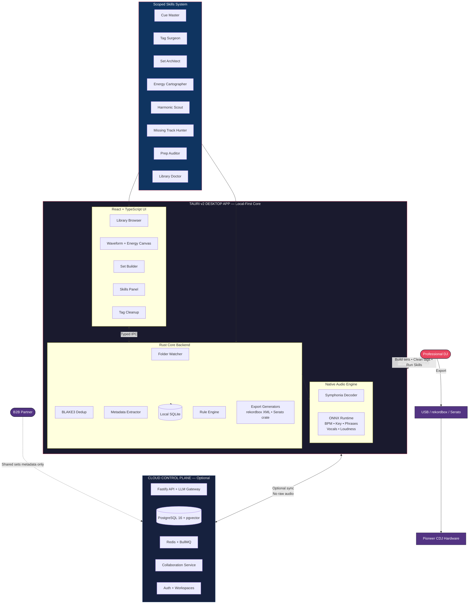
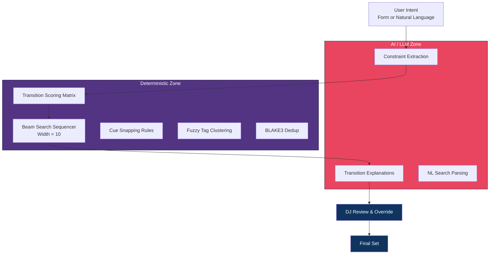
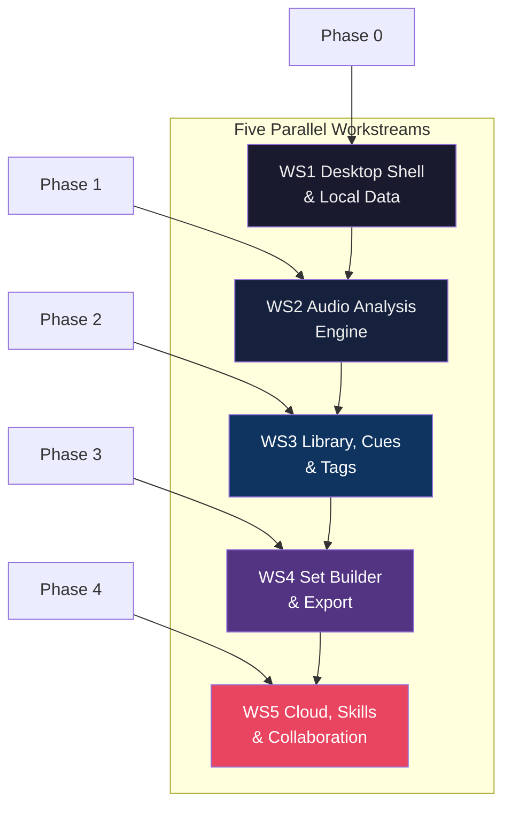
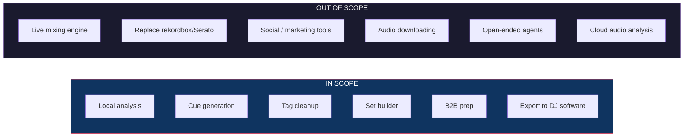
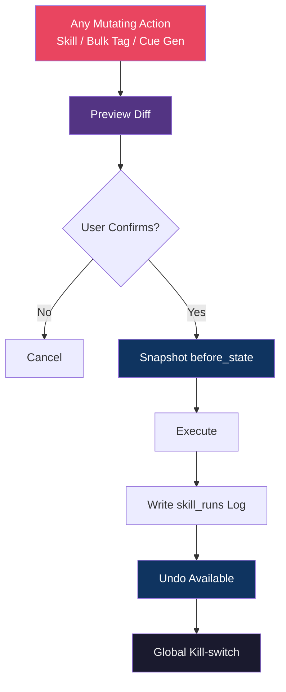
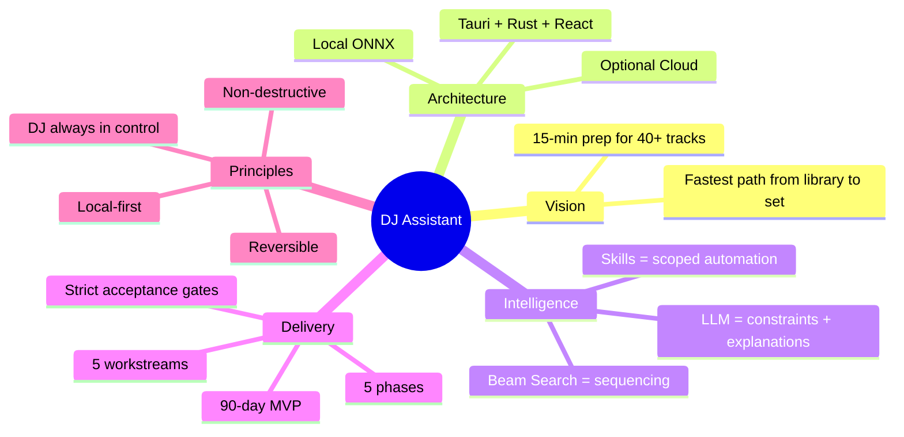

# DJ Assistant — Entire Project Overview

One-page Mermaid view of the full product, architecture, intelligence, delivery plan, and control model.

---

## 1. Full System Map

---

## 2. Core Value Pipeline (End-to-End)

**Target:** 40+ tracks → performance-ready set in **≤ 15 minutes**.

---

## 3. Hybrid Intelligence Boundary

**Rule:** LLM never chooses the final track order. Beam Search does.

---

## 4. 90-Day Delivery Plan

```mermaid
gantt
    title DJ Assistant MVP — 90 Days
    dateFormat X
    axisFormat %s

    section Phase 0
    Foundation (Shell, Scan, SQLite)          :0, 15

    section Phase 1
    Analysis Engine (ONNX)                    :15, 35

    section Phase 2
    Library + Tags + Cues                     :30, 55

    section Phase 3
    Set Builder + Export + CDJ Validation     :40, 70

    section Phase 4
    Skills + Gig Ready + Beta                 :60, 90
```

| Phase | Goal | Exit Gate |
|-------|------|-----------|
| 0 | Runnable shell + scan + local DB | 50–100 tracks listed with stable hashes |
| 1 | Local musical analysis | 50 tracks analyzed < 5 min; p50 < 3s/track |
| 2 | Pro library UX + Tag Surgeon | Messy 1k library cleaned in one pass |
| 3 | Sets + production exports | Coherent 90–120 min set; CDJ-validated |
| 4 | Automation + beta readiness | 40-track prep < 15 min; MVP criteria met |

---

## 5. Workstreams × Phases

---

## 6. Product Boundaries

---

## 7. Control & Safety Model

---

## 8. One-Line Summary

---

*This overview consolidates Canonical Spec v1.1, SDD set, Architecture, Skills, and the 90-day plan into a single project map.*
