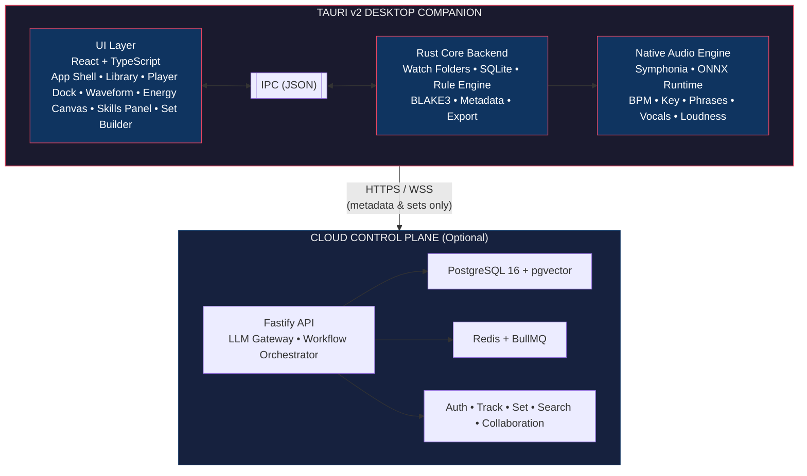

# System Architecture

High-level view of the Tauri desktop companion and optional cloud control plane.

## Key Principles Shown

- Audio analysis stays inside the desktop boundary
- Cloud receives only derived metadata, features, and set structures
- UI talks to Rust exclusively via typed IPC
