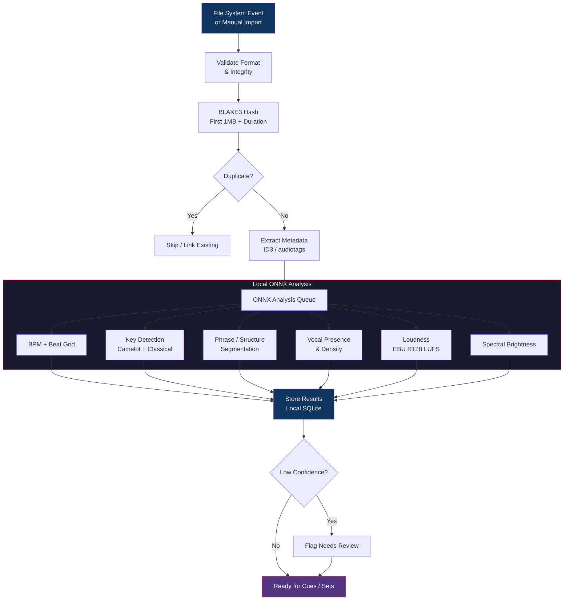

# Track Import & Analysis Pipeline

Local-first pipeline from filesystem event to stored musical features.

## Performance Target

- p50 analysis time **< 3 seconds per track** on mid-range laptop (CPU)
- 50-track folder fully analyzed in **< 5 minutes** wall time
