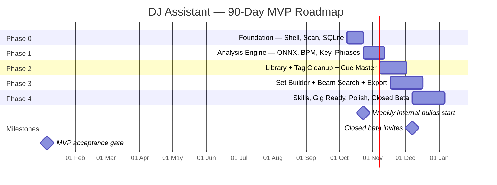
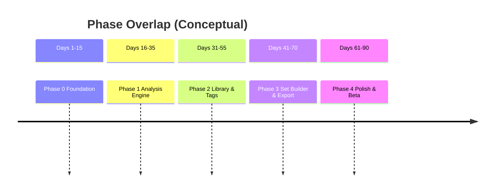

# 90-Day Phases Roadmap

## Phase Overlap View

## Exit Gates Summary

| Phase | Primary Exit Gate |
|-------|-------------------|
| 0 | Scan + list 50–100 tracks with stable hashes |
| 1 | 50 tracks analyzed < 5 min; p50 < 3s/track |
| 2 | Messy 1k library cleaned in one review pass |
| 3 | Coherent 90–120 min set + CDJ-validated export |
| 4 | 40-track prep < 15 min + MVP acceptance criteria |
