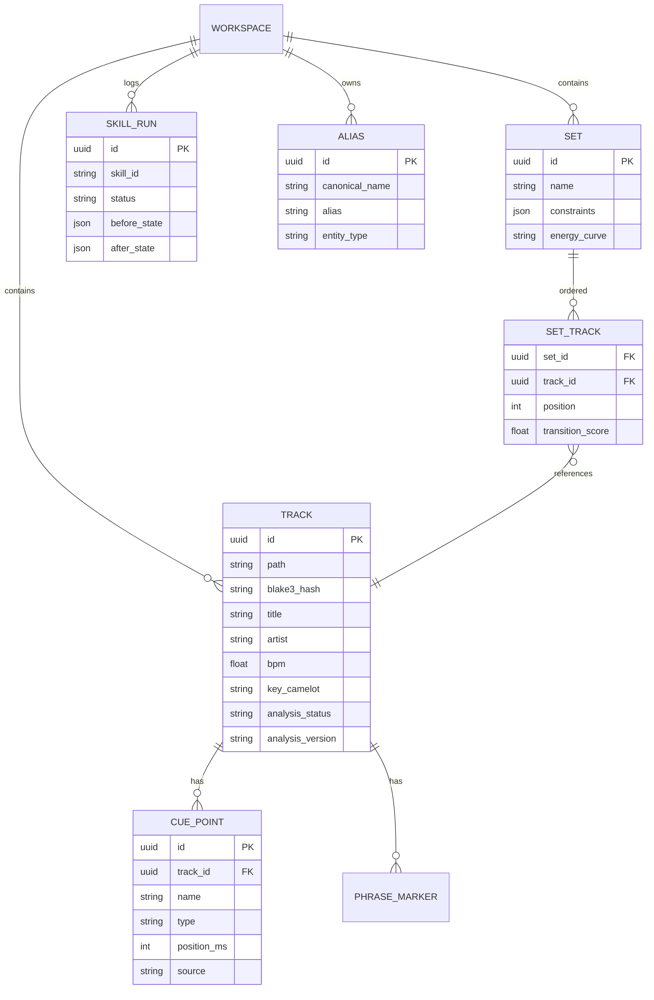
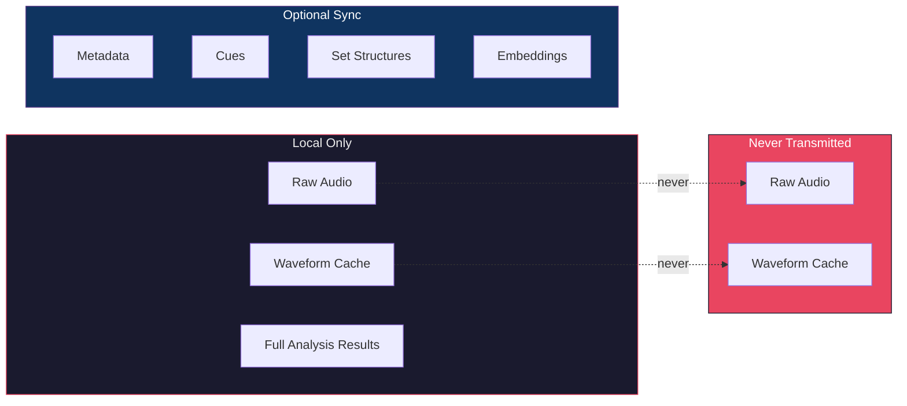

# Data Model (Conceptual)

> Conceptual only — `docs/architecture/DATA_MODEL.md` summarizes the schemas; authoritative SQL is in `docs/product/CANONICAL_DOCUMENTATION.md` §5, and shipped SQLite changes are in `apps/desktop/src-tauri/migrations/`. Shipped tables beyond this sketch: `external_ids`, `enrichment_runs`/`enrichment_candidates`, `streaming_*`, `chart_snapshots`, `tracks.isrc`/`artwork_*`.

## Local vs Cloud Boundary

