# Engineering Workstreams

Five parallel workstreams that run throughout the 90-day plan.

```mermaid
flowchart TB
    subgraph WS1["WS1 — Desktop Shell & Local Data"]
        A1[Tauri v2 Bootstrap]
        A2[Folder Scan + Watch]
        A3[BLAKE3 + Dedup]
        A4[SQLite Schema]
        A5[Metadata Extraction]
        A6[App Shell + Theming]
    end

    subgraph WS2["WS2 — Audio Analysis Engine"]
        B1[ONNX Runtime]
        B2[BPM + Beat Grid]
        B3[Key Detection]
        B4[Structure + Vocals]
        B5[Analysis Queue + UI]
    end

    subgraph WS3["WS3 — Library, Cues & Tags"]
        C1[Library Browser]
        C2[Cue Master]
        C3[Tag Surgeon]
        C4[Duplicates + Versions]
        C5[Health Score + Prep Auditor]
    end

    subgraph WS4["WS4 — Set Builder & Export"]
        D1[Constraints + UI]
        D2[Scoring Matrix]
        D3[Beam Search]
        D4[Energy Canvas + Templates]
        D5[rekordbox + Serato Export]
    end

    subgraph WS5["WS5 — Cloud, Collaboration & Skills"]
        E1[Skills Framework]
        E2[Automation + Gig Ready]
        E3[Fastify + Postgres]
        E4[LLM Gateway]
        E5[B2B Shared Sets]
    end

    WS1 --> WS2
    WS2 --> WS3
    WS3 --> WS4
    WS1 --> WS5
    WS4 --> WS5

    style WS1 fill:#1a1a2e,stroke:#e94560,color:#eee
    style WS2 fill:#16213e,stroke:#e94560,color:#eee
    style WS3 fill:#0f3460,stroke:#e94560,color:#eee
    style WS4 fill:#533483,stroke:#e94560,color:#eee
    style WS5 fill:#e94560,stroke:#1a1a2e,color:#fff
```

## Primary Phase Ownership

| Phase | Primary Workstreams |
|-------|---------------------|
| 0 | WS1 |
| 1 | WS2 (+ WS1 integration) |
| 2 | WS3 |
| 3 | WS4 |
| 4 | WS5 + polish across all |
