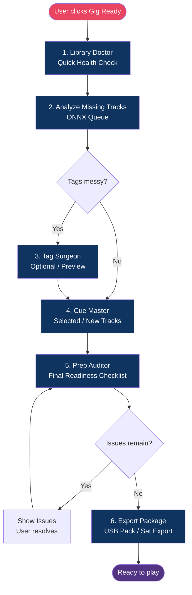

# Gig Ready One-Click Workflow

Curated sequence that turns a library into a performance-ready package.

## Design Notes

- Every step is a Skill (or composition of Skills)
- User can skip optional steps
- Full log + undo available after the run
- Works offline for the core path
