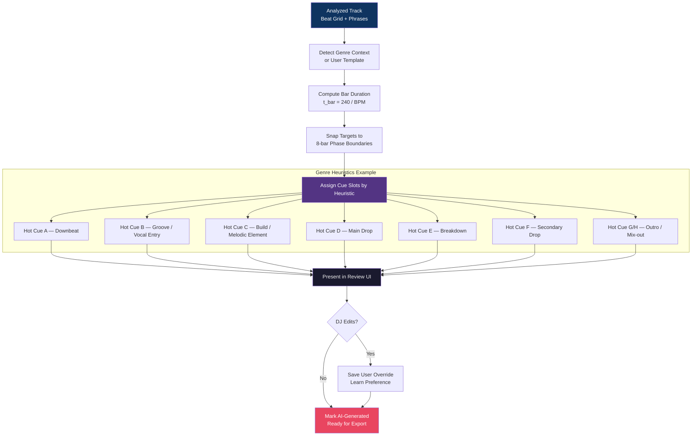

# Genre-Aware Cue Generation

How Cue Master places musically meaningful hot cues.

## Snapping Rule (Reference)

\[
T_{cue} = t_0 + (k \times 8 \times t_{bar}), \quad k \in \mathbb{N}
\]

Where \( t_{bar} = 240 / \text{BPM} \).
