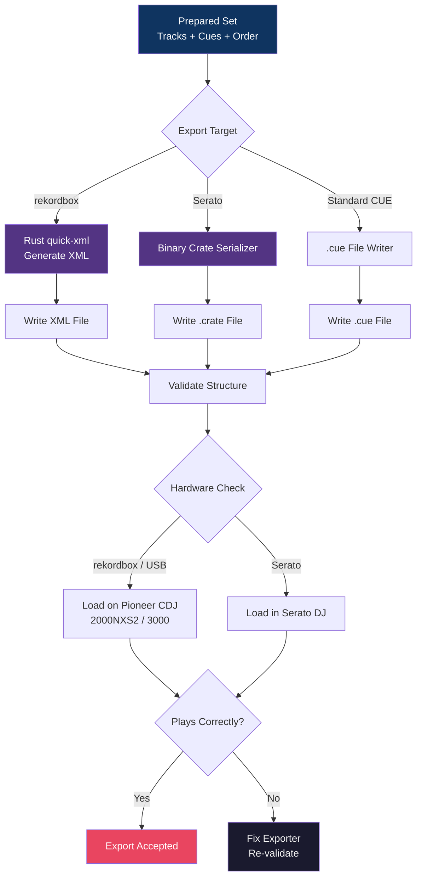

# Export Flow

From prepared set to performance software and hardware.

## Non-Negotiable

- Source audio files are **never** modified
- Exports are validated on real Pioneer CDJs before phase exit
