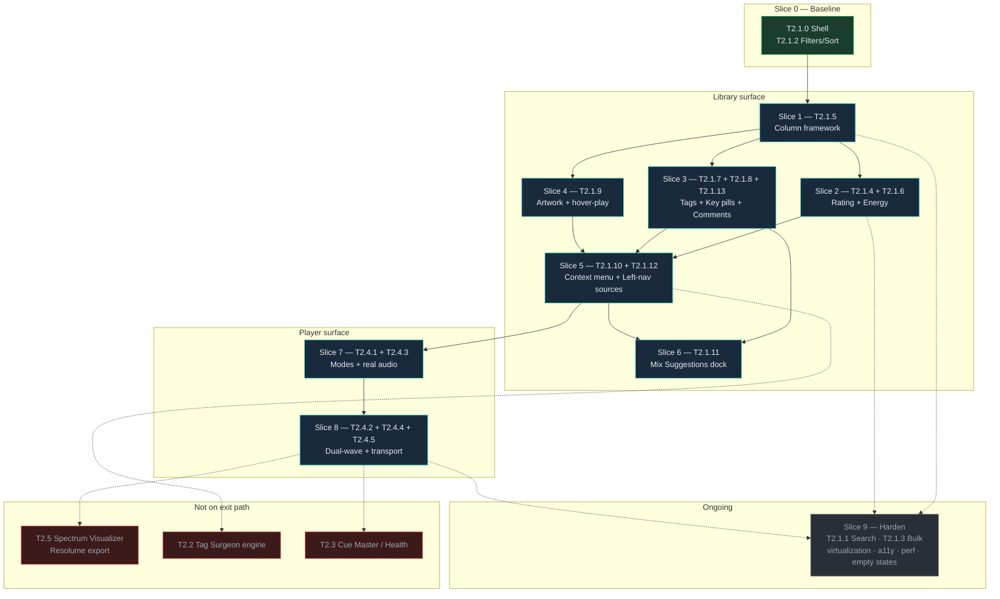
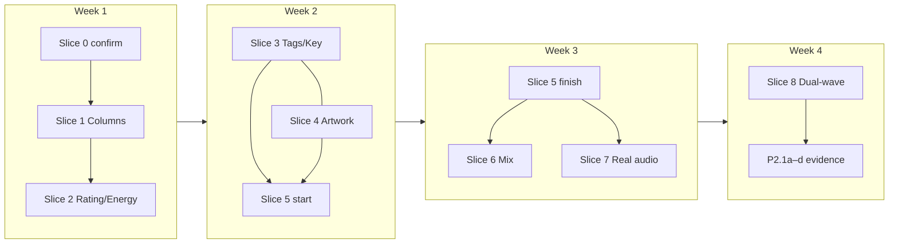
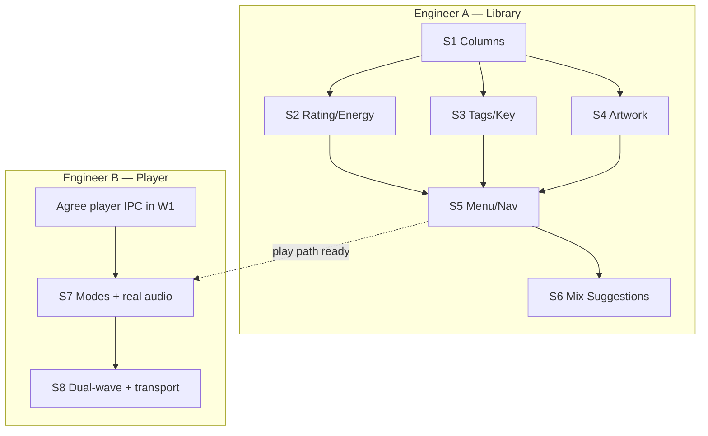
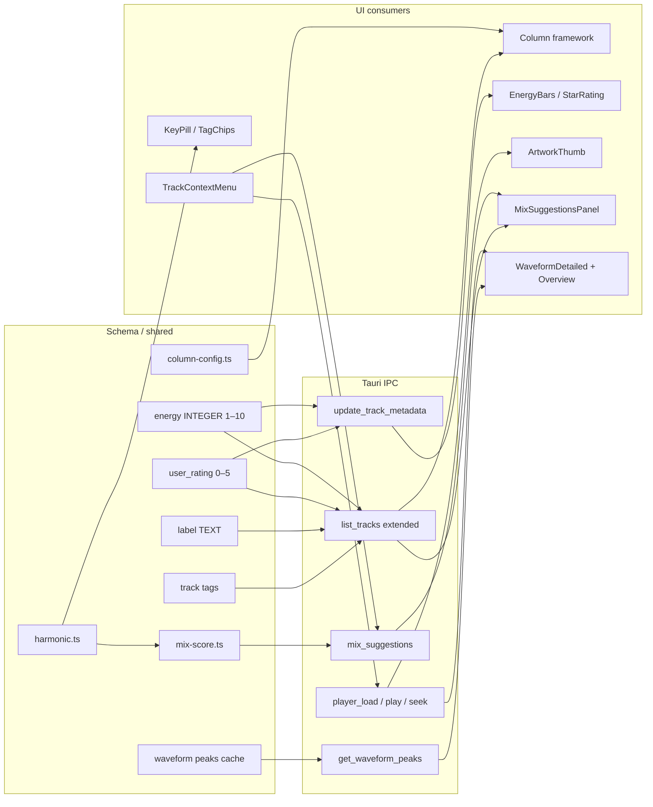
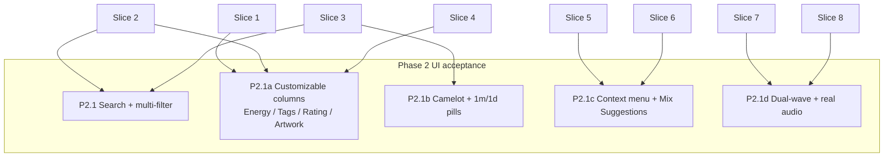
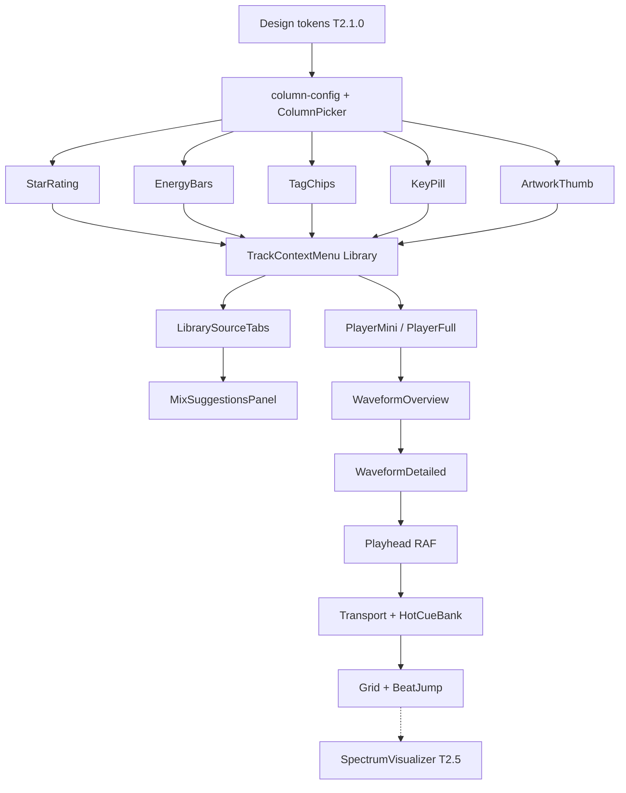
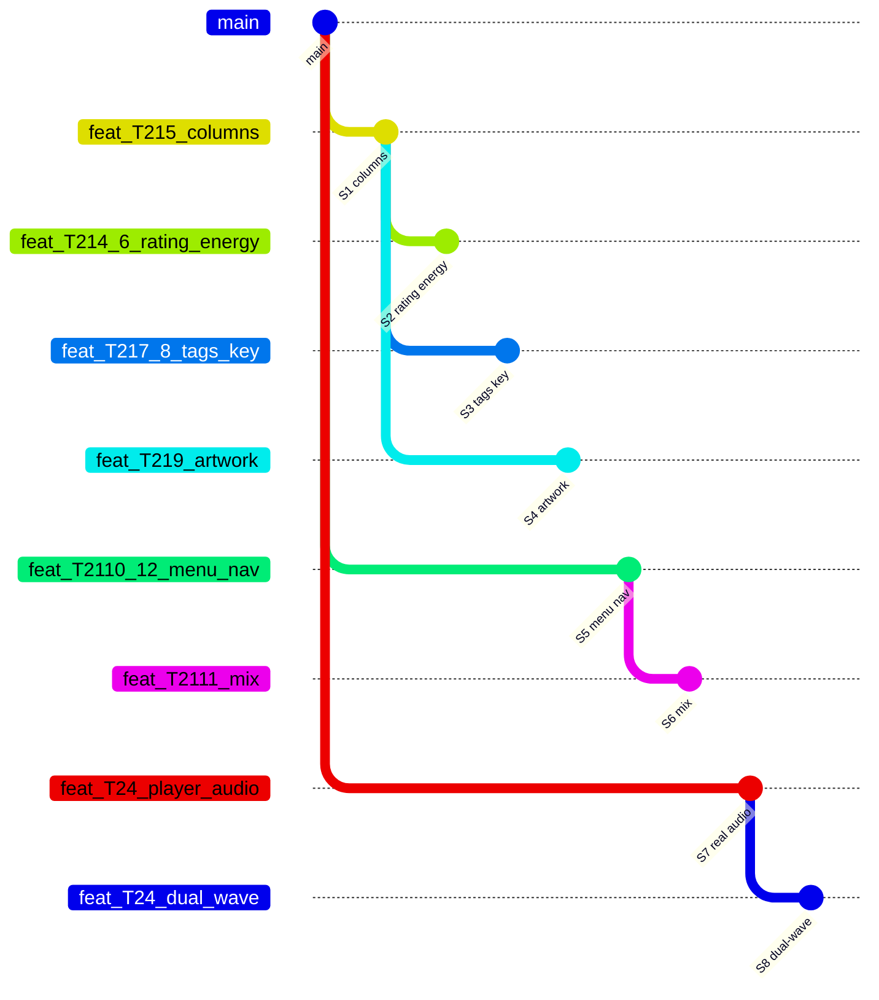
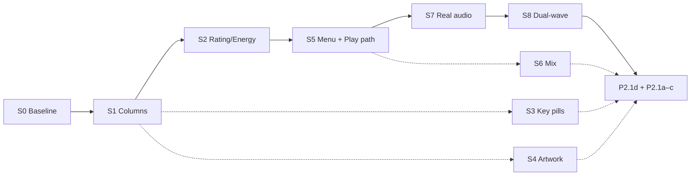

# Phase 2 — Library UX & Player Implementation Dependencies

**Scope:** T2.1.5 → T2.4 (Slices 0–9)  
**Plan:** [`docs/PHASE2_LIBRARY_PLAYER_IMPLEMENTATION_PLAN.md`](../PHASE2_LIBRARY_PLAYER_IMPLEMENTATION_PLAN.md)  
**Tasks:** [`docs/sdd/04-TASKS.md`](../sdd/04-TASKS.md) · **Acceptance:** P2.1 + P2.1a–d

Render in any Mermaid-compatible viewer (GitHub, VS Code, mermaid.live).

---

## 1. Slice dependency graph (critical path)

---

## 2. Parallelism map (what can run side-by-side)

**Two-engineer split**

---

## 3. Task → slice mapping

```mermaid
flowchart TB
  subgraph Tasks["SDD tasks"]
    T214[T2.1.4 Rating]
    T215[T2.1.5 Columns]
    T216[T2.1.6 Energy]
    T217[T2.1.7 Tags]
    T218[T2.1.8 Key pills]
    T219[T2.1.9 Artwork]
    T2110[T2.1.10 Context menu]
    T2111[T2.1.11 Mix Suggestions]
    T2112[T2.1.12 Left-nav sources]
    T2113[T2.1.13 Comments]
    T241[T2.4.1 Player modes]
    T242[T2.4.2 Dual-wave]
    T243[T2.4.3 Real audio/art]
    T244[T2.4.4 Transport/cues/grid]
    T245[T2.4.5 RAF playhead]
  end

  subgraph Slices["Implementation slices"]
    SL1[Slice 1]
    SL2[Slice 2]
    SL3[Slice 3]
    SL4[Slice 4]
    SL5[Slice 5]
    SL6[Slice 6]
    SL7[Slice 7]
    SL8[Slice 8]
  end

  T215 --> SL1
  T214 --> SL2
  T216 --> SL2
  T217 --> SL3
  T218 --> SL3
  T2113 --> SL3
  T219 --> SL4
  T2110 --> SL5
  T2112 --> SL5
  T2111 --> SL6
  T241 --> SL7
  T243 --> SL7
  T242 --> SL8
  T244 --> SL8
  T245 --> SL8
```

---

## 4. Data & IPC dependencies

---

## 5. Acceptance criteria coverage

---

## 6. Component build order

---

## 7. Branch topology

---

## 8. Critical path (shortest path to P2.1d)

**Critical path length:** S0 → S1 → (S2 ∥ S3 ∥ S4) → S5 → S7 → S8  
**Parallel off-path (still required for full P2.1a–c):** S6

---

## References

- Implementation plan: [`../PHASE2_LIBRARY_PLAYER_IMPLEMENTATION_PLAN.md`](../PHASE2_LIBRARY_PLAYER_IMPLEMENTATION_PLAN.md)
- UI checklist: [`../ui/11-IMPLEMENTATION-CHECKLIST.md`](../ui/11-IMPLEMENTATION-CHECKLIST.md)
- Player spec: [`../ui/06-PLAYER.md`](../ui/06-PLAYER.md)
- Library spec: [`../ui/03-LIBRARY-VIEW.md`](../ui/03-LIBRARY-VIEW.md)
- Acceptance: [`../sdd/05-ACCEPTANCE.md`](../sdd/05-ACCEPTANCE.md)

---

*Added 2026-10-21 with Phase 2 Library + Player implementation plan.*
