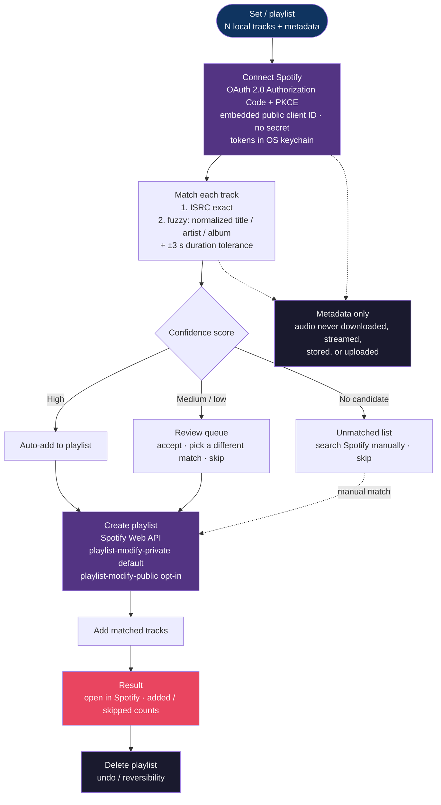

# Spotify Playlist Export (Post-MVP)

Publishes a built set (or any playlist) to the DJ's **own** Spotify account as a real Spotify
playlist — **metadata only**. It is the one export path that touches the network; audio never
leaves the device.

## Matching & confidence

| Step | Rule | Outcome |
|------|------|---------|
| 1. ISRC | Exact ISRC match wins outright | high confidence |
| 2. Fuzzy | Normalized title / artist / album vs. Spotify search | scored |
| 3. Duration | ±3 s tolerance filters fuzzy candidates | scored |
| 4. Confidence | Aggregated score → **high** / **medium** / **low** / none | high auto-adds; medium/low review; none unmatched |

## Auth & scopes

- **OAuth 2.0 Authorization Code with PKCE**, run entirely in the desktop app: an embedded
  public client ID, **no client secret**, tokens stored in the OS keychain.
- `playlist-modify-private` is the **default** (minimum) scope; `playlist-modify-public` is
  **opt-in**.
- **Disconnect** revokes access and removes tokens, with confirmation.

## Non-Negotiable

- **Metadata only** — only track metadata and search queries leave the device; audio is never
  downloaded, streamed, stored, or uploaded.
- **Reversible** — the created playlist can be deleted (undo); source files are never modified.
- **Post-MVP** — not part of the 90-day MVP; specified here so the Export surface is designed once.
