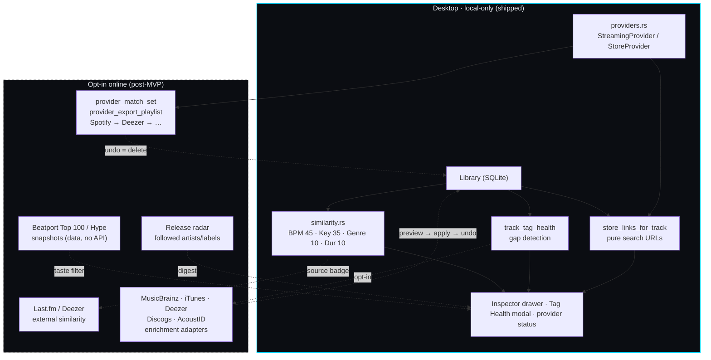

# 17 — Discovery, Enrichment & Providers

Shipped: local foundations (`TF`) + live opt-in enrichment (`TE.1–TE.4`) and
Deezer matching (`TM.2a`). Still post-MVP: external similarity/charts remainder (`TD.1–TD.2`, `TD.4–TD.6`),
adapter expansion (`TE.5`), provider connect/export (`TM.2b`/`TM.3`/`TM.4`, `TP.x`).
See ADR-0007, `API_CONTRACTS.md` §2.6–§2.7 and wireframe 12.

Rules drawn here:

- Solid lines run offline today. Dashed lines need explicit opt-in per provider.
- Only metadata, fingerprints and search queries cross the dashed boundary — never audio.
- Enrichment writes DB canonical fields, never source files; every run is undoable.
- New providers add matchers and rows, never schema (`provider` column) or IPC shape.
- Beatport has no public catalog API: charts/radar are versioned data + links (Tiers 0–2),
  partnership is Tier 3. Credential scraping is not a path.

---

*Derived from ADR-0007 and the shipped `TF` foundations.*
