# Mermaid Flows

Last updated: 2026-10-23  
Status: Reference

## 1. Information architecture

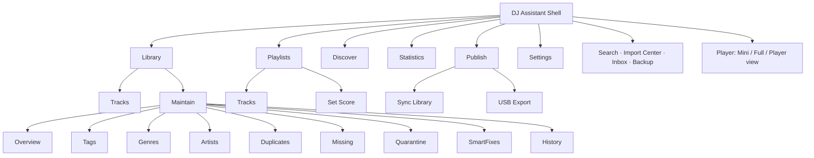

## 2. Track lifecycle

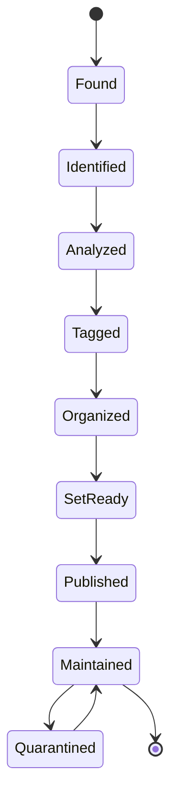

## 3. Import

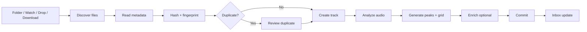

## 4. Sync

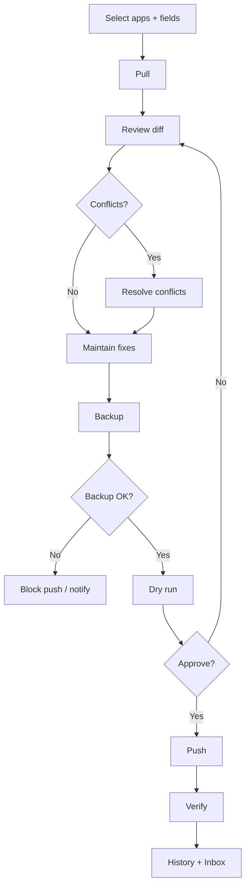

## 5. Backup

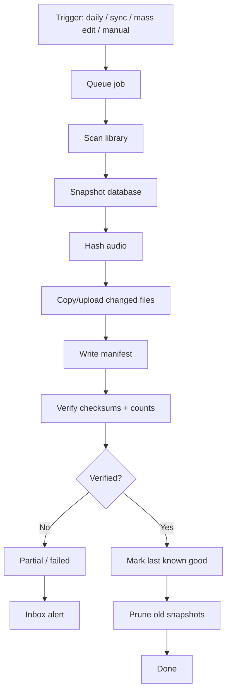

## 6. Restore

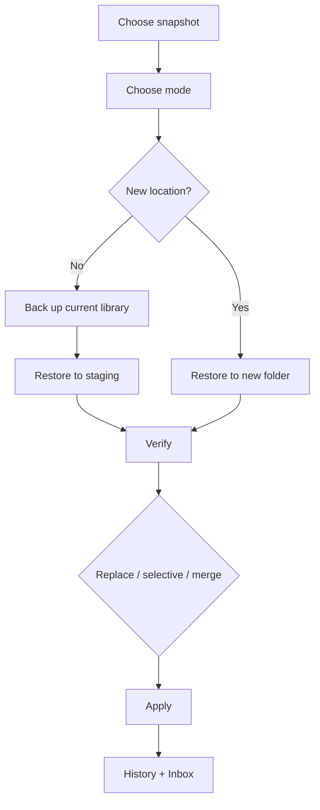

## 7. Inbox

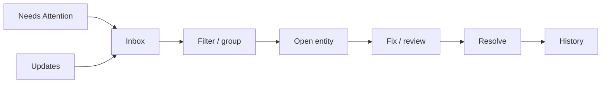

## 8. Discover

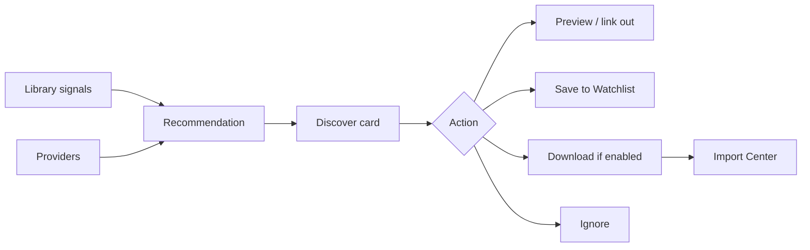

## 9. Playlist save and recovery

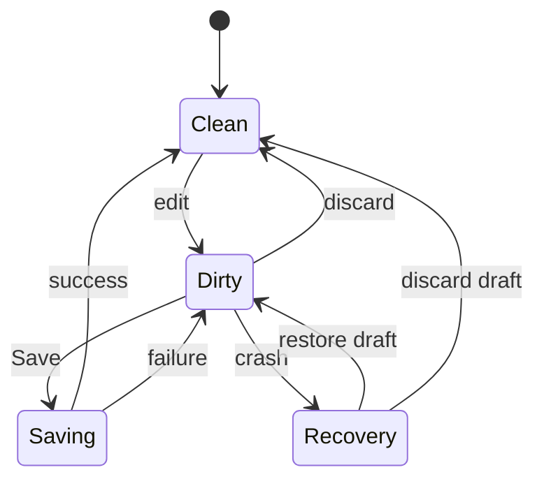

## 10. Set Score

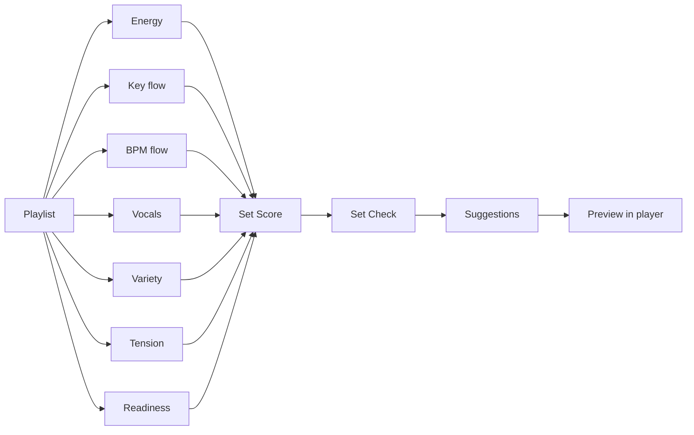

## 11. USB export

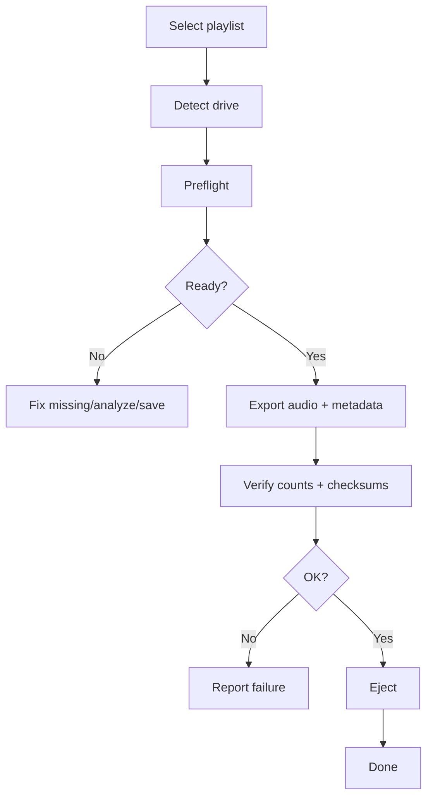

## 12. Backup job states

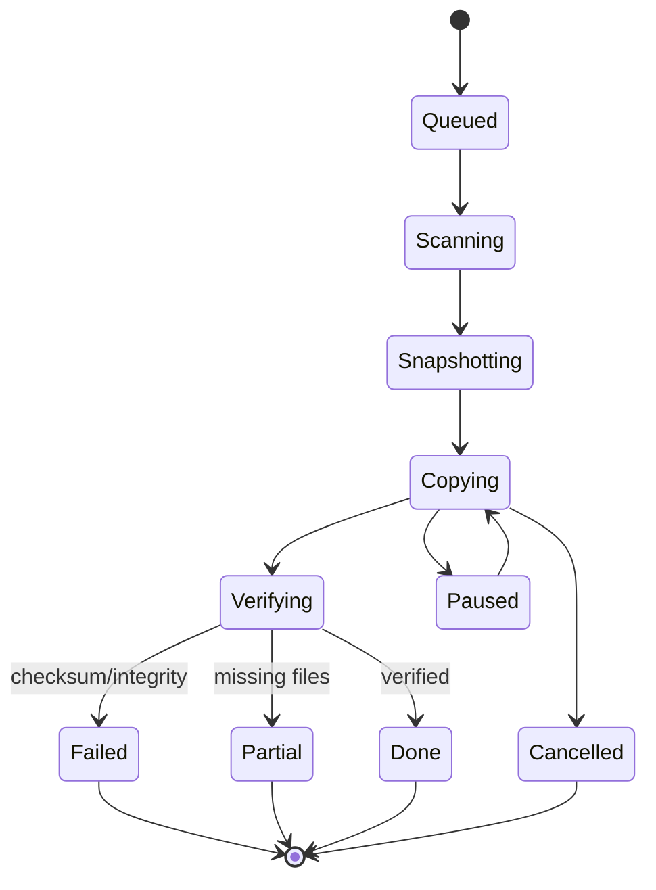
