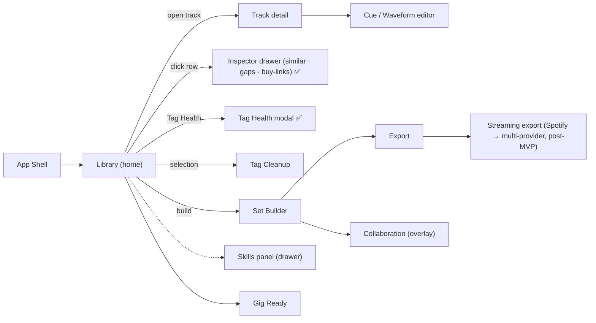

# DJ Assistant — Screens & Flows

**Status:** Living — 2026-10-14
**Companions:** [UX Principles](./UX_PRINCIPLES.md) · [Design System](./DESIGN_SYSTEM.md) · [Accessibility](./ACCESSIBILITY.md)
**Source of truth:** [Canonical Documentation](../product/CANONICAL_DOCUMENTATION.md) §7 (Workstation Interface Specifications)

This document inventories every screen, shows its layout, and traces the end-to-end user
flows. **Phase 0 screens are implemented**; later screens are specifications from the
canonical workstation design and are marked with their phase.

> Per-screen low-fidelity wireframes (with callouts and per-view accessibility notes) live in
> [`wireframes/`](./wireframes/README.md). This document covers the flows between them.

---

## 1. App shell

All screens live inside one desktop shell:

```
┌───────────────────────────────────────────────────────────────────────────┐
│ HEADER         brand · phase badge            [Scan]  [Gig Ready] [ ⟳ ]   │ 56px
├───────────────────────────────────────────────────────────────────────────┤
│ (scan / analysis progress strip — only while running)                      │ auto
├───────────────────────────────────────────────────────────────────────────┤
│ TOOLBAR        search …                       counts · local-first badge   │ 48px
├───────────────────────────────────────────────────────────────────────────┤
│                                                                           │
│ CONTENT        the active screen (library / cue editor / set builder …)    │ flex
│                                                                           │
├───────────────────────────────────────────────────────────────────────────┤
│ STATUS BAR     ● status message               mono tech tagline            │ 28px
└───────────────────────────────────────────────────────────────────────────┘
```

The shell is constant; only **CONTENT** changes. Header actions are global (Scan, and later
Gig Ready / Export / Skills); the status bar is the single ambient state readout.

---

## 2. Screen inventory

| # | Screen | Region | Phase | Status |
|---|--------|--------|-------|--------|
| 1 | Library | Content | 0 | ✅ Implemented |
| 2 | Scan progress | Strip | 0 | ✅ Implemented |
| 3 | Analysis progress & confidence | Strip + table | 1 | ⏳ Planned |
| 4 | Track detail / inspector | Drawer | 2 | 📋 Planned |
| 5 | Cue / waveform editor | Content | 2–3 | 📋 Planned |
| 6 | Tag Cleanup | Content | 2 | 📋 Planned |
| 7 | Set Builder (workstation) | Content | 3 | 📋 Planned |
| 8 | Export | Modal/dialog | 3 | 📋 Planned |
| 9 | Skills panel | Drawer | 3–4 | 📋 Planned |
| 10 | Gig Ready / Prep Auditor | Modal | 4 | 📋 Planned |
| 11 | Collaboration (B2B) | Overlay | 4 | 📋 Planned |
| 12 | Spotify Playlist Export | Modal/dialog | Post-MVP | 📋 Planned |
| 13 | Track inspector drawer (similar · gaps · buy-links · Deezer match) | Drawer (overlay) | 0 | ✅ Implemented |
| 14 | Tag Health modal (score · lookup · review · undo) | Modal/dialog | 0 | ✅ Implemented |
| 15 | Provider status (toolbar + status bar) | Ambient | 0 | ✅ Implemented |
| 16 | Charts modal (snapshots · owned · taste) | Modal/dialog | 0 | ✅ Implemented |

---

## 3. Library (Phase 0) — implemented

The home base. One dense, scrollable table of the imported library with live search.

```
┌───────────────────────────────────────────────────────────────────────────┐
│ ◉ DJ Assistant   [Phase 0 Foundation]              [📁 Scan Music Folder] ⟳│
├───────────────────────────────────────────────────────────────────────────┤
│ (while scanning) ⟳ Scanning: D:\Music\deep\track.flac    128 / 402 files  │
│ ▓▓▓▓▓▓▓▓▓▓▓▓▓▓▓▓▓▓▓▓░░░░░░░░░░░░░░░░░░░░░░░░░░░░░░░░░░░░░░░░░░░░░░░░░░░░░░  │
├───────────────────────────────────────────────────────────────────────────┤
│ 🔍 Search title, artist, album, path…          94 tracks  🛡 Local-first   │
├───────────────────────────────────────────────────────────────────────────┤
│ #  ART  TITLE             ARTIST        ALBUM   BPM  KEY  ★   ⏱  FMT  …    │
│ 1  [▣]  Deep Horizon      Kael          Drift   124  8A   ★★★  6:12 FLAC   │
│ 2  [▣]  Solar Wind        Nova          Orbit   125  8B   ★★   5:48 MP3    │
│ …                                                                          │
├───────────────────────────────────────────────────────────────────────────┤
│ ● Library loaded: 94 tracks          BLAKE3 Fingerprint · SQLite · Offline │
└───────────────────────────────────────────────────────────────────────────┘
```

**Regions**

- **Header:** brand + phase badge; Scan button (disabled + relabelled while scanning);
  refresh icon button.
- **Progress strip:** shown only while scanning; current path, `scanned / total`, fill bar.
  Total unknown → shows `?`.
- **Toolbar:** search input (filters client-side over title/artist/album/path); **Tag Health**
  button (opens the library-wide gap modal); live track count; provider summary
  (`N streaming · M stores · K connected`, tooltip lists the registries); "Local-first &
  Non-destructive" badge.
- **Table:** columns `# · Art · Title · Artist · Album · BPM · Key · Rating · Duration ·
  Format · Comments · Fingerprint · Status`. Sticky header, hover highlight, mono numerics.
  Rows are clickable → opens the track inspector drawer; the selected row is tinted.
- **Inspector drawer (right, overlay):** selected track identity + gap chips + **Similar
  tracks** (score % + reason chips, click a result to inspect it) + **Find to buy**
  (per-store copy-link rows). `✕` / `Esc` closes and returns focus to the row.
- **Tag Health modal:** per-field missing bars + track gap list; notes that online lookup
  (MusicBrainz / iTunes / Deezer) is planned and opt-in — nothing leaves the device today.
- **Status bar:** left = state dot + message; middle = provider status
  (`K connected · N streaming · M stores`, tooltip enumerates); right = tech tagline.

**Empty / loading / error states**

| State | What shows |
|-------|-----------|
| Empty | icon tile + "No tracks in library" + how to scan (+ current folder chip if chosen) |
| Scanning | progress strip, rows appear as tracks import |
| Loaded | table + "Library loaded: N tracks" in the status bar |
| Error | status bar "Error loading tracks" / "Scan failed: …" (no modal) |

**Interactions**

- Click **Scan Music Folder** → native folder picker → recursive scan → live rows → summary.
- Type in **search** → instant client-side filter (no refetch).
- Click **refresh** → reload the list (spinner while loading).
- Click a **row** → inspector drawer (similar tracks, gap chips, buy-links); click again
  or `Esc` to close; clicking a similar result inspects that track.
- Click **Tag Health** → modal with per-field bars + gap list; online lookup shown as
  planned/opt-in, never automatic.

---

## 4. Planned screens

### 4.1 Analysis progress & confidence (Phase 1)

Extends the existing progress strip for the analysis queue and adds per-track status:

- Strip: `Analyzing 37 / 94 · Deep Horizon — BPM, key, phrases…` with a fill bar.
- Table `Status` column gains states: `pending`, `analyzing`, `complete`, `needs_review`,
  `failed` (each with tint + icon + label per the design system).
- Low-confidence attributes are flagged; a manual correction overrides the AI value.
- Completion summary is shown in the status bar (no modal).

### 4.2 Track detail / inspector (Phase 2; discovery drawer shipped in Phase 0)

A right-hand drawer opened from a row: artwork, embedded tags vs analysed values, waveform
miniature, cue list, and provenance markers (AI vs user). Read-only unless editing tags.

**Already shipped (discovery slice):** the drawer shows the selected track's identity,
missing-tag chips, **Similar tracks** ranked by local mix-compatibility (score % + reason
chips; click a result to inspect it) and **Find to buy** per-store copy-link rows
(Beatport, Traxsource, Juno Download, Bandcamp, Discogs — outbound search URLs only,
no audio). Post-MVP this drawer gains source badges (Last.fm / provider), explanations,
add-to-set, and online enrichment proposals with before → after diffs.

### 4.3 Cue / waveform editor (Phase 2–3)

Full-width waveform with a beat grid, phrase bands, colour-coded cue markers, and an
editable hot-cue list (A–H + memory cues). AI cues are marked; dragging a cue records a
user override. Includes "Vocal Warning" and "Mix Out Deadline" memory cues.

### 4.4 Tag Cleanup (Phase 2)

Bulk, preview-first normalisation of messy metadata:

```
┌ Tag Cleanup ──────────────────────────────────────────────────────────────┐
│ The following 23 changes will be applied.           [ Cancel ] [ Apply ]  │
│  "DAFT PUNK" ×14   ──►  "Daft Punk"                                      │
│  "Daft Punks" ×3   ──►  "Daft Punk"                                      │
│  "daft punk " ×6   ──►  "Daft Punk"                                      │
│ ☑ Save as alias so future imports normalise automatically                  │
└───────────────────────────────────────────────────────────────────────────┘
```

Apply writes an undo record; aliases improve future imports. Nothing is modified until
**Apply** is pressed.

### 4.5 Set Builder — workstation (Phase 3)

The canonical workstation layout (§7), rendered in three stacked regions:

```
┌───────────────────────────────────────────────────────────────────────────┐
│ SET PROFILE: "Arena Club — Peak Hour" | Target: 120m | Key: Harmonic Ramp  │
├───────────────────────────────────────────────────────────────────────────┤
│ ENERGY CURVE CANVAS   (draggable bezier nodes → live re-optimisation)      │
│ 10 ┤                                          ╭──────╮                     │
│  8 ┤                                   ╭──────╯      ╰──────╮              │
│  6 ┤              ╭───────────────────╯                     ╰───           │
│  4 ┤  ╭───────────╯                                                        │
│  2 ┤──╯                                                                    │
│  0 ┴──┬──────┬──────┬──────┬──────┬──────┬──────┬──────┬──────┬──          │
├───────────────────────────────────────────────────────────────────────────┤
│ SET SEQUENCE + DUAL-WAVEFORM TRANSITION OVERLAY                            │
│ [04] Deep Horizon (124 BPM | 8A)                                           │
│ OUT ►|||||||||||||||||||||||||||||||||.................... [32 Bars Out]   │
│ IN  ►.................|||||||||||||||||||||||||||||||||||| [32 Bars In]    │
│ [05] Solar Wind (125 BPM | 8B)  Score: 98% | Risk: Low                     │
│ Alternatives: [Starlight 98%] [Eclipse 94%] [Swap Manual]                  │
└───────────────────────────────────────────────────────────────────────────┘
```

**Interactive nodes**

1. **Energy Curve Canvas** — multi-point editing; dragging a node triggers re-optimisation.
2. **Dual-Waveform Transition Inspector** — outgoing/incoming tracks overlaid at phase
   boundaries (16/32 bars) with colour-coded cues.
3. **Alternative Transition Drawer** — top-3 swaps per slot that respect global constraints.
4. **Lock & Fill** — lock hero tracks in place; the system fills the rest.
5. **Set Templates** — save/reuse an energy curve + BPM ramp + genre bias.

Every generated order is deterministic and always explainable ("why this track here?") with
a transition score and a Low/Medium/High risk flag.

### 4.6 Export (Phase 3)

A dialog with presets: **Rekordbox + Serato + CSV** in one action, plus dual-crate export
for B2B. Shows what will be written and where; never writes to a DJ app's live database.
A **post-MVP Streaming** section adds a metadata-only Spotify playlist export (§4.10).

### 4.7 Skills panel (Phase 3–4)

A drawer listing the v1 Skills (Cue Master, Tag Surgeon, Set Architect, Prep Auditor, …)
with per-Skill enable/disable, last-run results, and a global **kill-switch**. Every
mutating run shows its diff and an **Undo**.

### 4.8 Gig Ready / Prep Auditor (Phase 4)

One-click pre-gig workflow: health check → analyze → optional tag cleanup → cues → Prep
Auditor → export/USB pack. Presents a checklist with pass/warn/fail items and clear next
actions for anything that fails.

### 4.9 Collaboration (Phase 4)

Overlay on shared sets: presence and cursors, "my tracks vs partner tracks", roles
(Owner / Co-DJ / Viewer), a change log with diff, a pre-gig sync check, and a USB Pack
Generator. **No audio is ever transferred** the UI must make this explicit.

### 4.10 Streaming Playlist Export (Post-MVP — Spotify reference, multi-provider)

A **metadata-only** export: publish a built set (or any playlist) to the DJ's **own**
provider account as a real playlist. Spotify is the reference implementation; Deezer is
second, then Apple Music / YouTube Music / SoundCloud / TIDAL behind the generic provider
contract. It appears as a **Streaming** section inside the Export dialog and is the one
export path that touches the network. In-app streaming playback is out of scope for every
provider.

```
Export → Streaming → [Connect Spotify] (browser OAuth 2.0 + PKCE, returns to app)
   → [Publish to Spotify] → matching (ISRC → fuzzy title/artist/album ±3 s → confidence)
   → auto-add high confidence · review medium/low (accept / pick another / skip)
   → unmatched list (search Spotify manually / skip)
   → playlist created → success: open in Spotify · [Delete playlist] (undo)
   → (failures / rate limits surfaced with a retry)
```

### 4.11 Tag Health Modal (shipped; enrichment review live)

Opened from the toolbar. Shows library-wide missing-tag/artwork bars per field plus the
track gap list. The **Look up online** flow is live and opt-in per provider (MusicBrainz,
iTunes, Deezer — no keys needed): per-track before → after diffs with tier badges
(`high` / `review` / `low`), checkbox selection, bulk apply with confirmation, and undo
per run. Artwork downloads fill empty slots only. `enrichment:progress` reports
per-track status. Nothing is applied without the review step.

### 4.12 Charts & Release Radar (snapshots shipped; radar post-MVP)

Versioned Beatport Top 100 / Hype snapshots (Charts modal: Top 100 / Hype × genre
picker, taste-match toggle vs the selected track, owned badges, sample-data loader)
filtered locally by taste (60% tempo / 40% key) and ISRC-exact ownership. A release-radar
digest over followed artists/labels (opt-in, cached, rate-limited) plus pre-order/
exclusive badges and a budgeted buy-list stay post-MVP (TD.4). Unofficial feeds are
labelled as such. No public Beatport catalog API exists — snapshots are data, not live
calls (ADR-0007).

- **Status: Post-MVP** — not in the 90-day MVP; the export surface is designed once, here.
- **Matching:** each local track is matched to a Spotify track by ISRC first, falling back to a
  fuzzy match on normalized title/artist/album plus a ±3 s duration tolerance, producing a
  confidence score. High-confidence matches are added automatically; medium/low go to a review
  queue; unmatched tracks are listed with a "search Spotify manually" / "skip" option.
- **Auth:** OAuth 2.0 Authorization Code with PKCE, run entirely in the desktop app (embedded
  public client ID; no client secret; tokens in the OS keychain).
- **Scopes:** `playlist-modify-private` (default) · `playlist-modify-public` (opt-in).
- **Reversibility:** the created playlist can be **deleted** (undo); **Disconnect** in settings
  revokes access and removes tokens, with confirmation.
- **Privacy:** only track metadata and search queries leave the device. Audio is never
  downloaded, streamed, stored, or uploaded.

See the [Spotify export wireframe](./wireframes/11-spotify-export.md) and the
[Spotify playlist export diagram](../diagrams/16-spotify-playlist-export.md).

---

## 5. End-to-end flows

### 5.1 Import & scan (Phase 0)

```
Launch → Library (empty) → [Scan Music Folder] → native picker → choose folder
   → recursive scan runs in background → progress strip + rows appear live
   → [Scan complete] → status bar: Imported N · Duplicates N · Errors N
```

### 5.2 Analyze (Phase 1)

```
Library → [Analyze] (all or selection) → version-aware queue runs in background
   → per-track status cycles pending → analyzing → complete
   → low-confidence tracks flagged needs_review → DJ reviews/overrides
```

### 5.3 Cue (Phase 2–3)

```
Open a track → waveform + beat grid + phrase bands → [Generate Cues]
   → 8 hot cues + memory cues placed on 8-bar boundaries → AI cues marked
   → drag to adjust (records override) → Save
```

### 5.4 Clean tags (Phase 2)

```
Select tracks (or library) → [Tag Cleanup] → preview diff → (optional) save alias
   → [Apply] → undo record written → status bar confirms → [Undo] available
```

### 5.5 Build a set (Phase 3)

```
Set Builder → set profile (duration, BPM ramp, energy curve, genre/mood, locks/excludes)
   → [Build] (deterministic Beam Search) → energy canvas + ordered sequence
   → inspect transitions (score + risk + explanation) → swap via alternatives
   → Lock & Fill / iterate → Save as Set (optionally a Template)
```

### 5.6 Export (Phase 3)

```
Set → [Export] → choose preset (Rekordbox XML / Serato crate / CSV / USB pack)
   → confirm destination → files written → success summary in status bar
   → (later) validate on CDJ hardware — a phase gate, not a UI concern
   └─ post-MVP branch → Streaming → [Connect Spotify] → [Publish to Spotify]
        → match review → playlist created → open in Spotify / [Delete playlist] (undo)
```

### 5.7 Gig Ready (Phase 4)

```
Library/Set → [Gig Ready] → health check → analyze → optional cleanup → cues
   → Prep Auditor checklist → export / USB pack → "You're ready" (or a fix list)
```

### 5.8 Spotify playlist export (Post-MVP)

```
Export → Streaming → [Connect Spotify] → browser opens OAuth 2.0 + PKCE → returns to app
   → [Publish to Spotify] → matching: ISRC → fuzzy title/artist/album ±3 s → confidence
   → high confidence auto-added · medium/low reviewed (accept / pick another / skip)
   → unmatched listed (search Spotify manually / skip)
   → playlist created → result: open in Spotify + [Delete playlist] (undo)
   → failures / rate limits surfaced with a retry
```

Only track metadata and search queries leave the device; audio is never downloaded, streamed,
stored, or uploaded. `playlist-modify-private` is the default scope; `playlist-modify-public`
is opt-in. Connecting and disconnecting live in the Export dialog and in settings.
Post-MVP the same flow repeats per provider (Deezer second) behind the generic
`provider_match_set` / `provider_export_playlist` contract.

### 5.9 Inspect a track: similar, gaps, buy-links (shipped)

```
Library row → click → inspector drawer → Similar tracks (score % + reasons)
   → click a result → drawer re-targets to that track
   → missing-tag chips (local gaps; online lookup shown as planned/opt-in)
   → Find to buy → [Copy link] per store (Beatport / Traxsource / Juno / Bandcamp / Discogs)
   → ✕ / Esc → back to the row (focus restored)
```

### 5.10 Tag Health (read half shipped; enrichment review live)

```
Toolbar [Tag Health] → modal → per-field missing bars + track gap list
   → pick source [MusicBrainz / iTunes / Deezer] → [Look up online]
   → per-track before → after diffs + tier badges → check selection
   → [Apply] (confirmation; DB fields only, artwork fills empty slots)
   → undo record in enrichment_runs → [Undo] per run restores exact values
```

---

## 6. Navigation map



Library is the root. Everything else is reached from it or from a track within it. Skills
and Collaboration are overlays/drawers that never replace the workspace. The inspector
drawer and Tag Health modal are shipped discovery surfaces; online enrichment and chart snapshots are live.
Release Radar and additional export providers remain post-MVP.

---

## 7. Window sizing

| Constraint | Value / rule |
|------------|--------------|
| Minimum supported window | The library table shows all columns at ≥ 1280px; below that, horizontal scroll |
| Table minimum width | 1200px (`min-w-[1200px]`) |
| Target density | Rows ~36–40px; chrome heights 56 / 48 / 28px |
| Scaling | Layout tolerates OS font scaling up to 150% without clipping |

---

*New screens must be added to §2 and specified here before implementation, and they must
reuse the shell, tokens, and components from the [Design System](./DESIGN_SYSTEM.md).*
