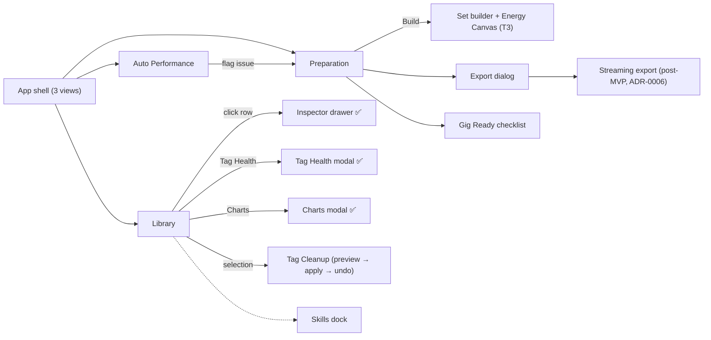

# 12 — Screens & Flows

**Version:** 1.0 · **Date:** 2026-10-19

Screen inventory, end-to-end flows, navigation map, and window sizing rules.
Per-screen structure and states are specified in the view docs ([03](03-LIBRARY-VIEW.md),
[04](04-PREPARATION-VIEW.md), [05](05-AUTO-PERFORMANCE-VIEW.md)) — this document covers the
space *between* screens and links to each canonical home. Historical low-fidelity
wireframes live in [wireframes/](wireframes/README.md).

---

## 1. Screen inventory

| # | Screen | Region | Phase | Status |
|---|--------|--------|-------|--------|
| 1 | Library view | Main canvas | 0/2 | ✅ Shell + search/filters shipped (T2.1.x); multi-select, column picker open |
| 2 | Scan / analysis progress | Options bar + header status | 0/1 | ✅ Events live |
| 3 | Preparation view | Main canvas | 2–3 | ✅ Shell placeholder; set builder per T3.x |
| 4 | Auto Performance view | Main canvas | 4 | ✅ Shell placeholder |
| 5 | Player dock (Mini / Full / Hidden) | Bottom dock | 2.4 | ✅ Layout shipped; playback/waveform per T2.4 |
| 6 | Settings window | Overlay | 4 | 📋 Spec: [07](07-SETTINGS.md) |
| 7 | Dialogs / toasts / command palette | Overlays | 2–4 | 📋 Spec: [08](08-DIALOGS-AND-PATTERNS.md) |
| 8 | Track inspector drawer (similar · gaps · buy-links · Deezer match) | Drawer | 0 | ✅ Shipped |
| 9 | Tag Health modal (score · lookup · review · undo) | Modal | 0 | ✅ Shipped |
| 10 | Charts modal (snapshots · owned · taste) | Modal | 0 | ✅ Shipped |
| 11 | Export dialog (+ preview tree, streaming post-MVP) | Modal | 3 | 📋 Spec: [08 §8](08-DIALOGS-AND-PATTERNS.md); flow §2.6 below |
| 12 | Gig Ready checklist | Modal | 4 | 📋 Spec: [04 §6](04-PREPARATION-VIEW.md) |
| 13 | Skills dock | Right dock (Preparation) | 4 | 📋 Spec: [04 §3](04-PREPARATION-VIEW.md) |
| 14 | Energy Canvas + transition inspector | Preparation canvas | 3 | 📋 T3.1.10–T3.1.12; flows §2.5 below |

---

## 2. End-to-end flows

### 2.1 Import & scan

```
Launch → Library (empty) → [Add music folder] → native picker → choose folder
   → recursive scan runs in background → options-bar progress + rows appear live
   → complete → header status: Imported N · Duplicates N · Errors N
```

### 2.2 Analyze

```
Library → [Analyze] (all or selection) → version-aware queue runs in background
   → per-track status cycles pending → analyzing → complete
   → low-confidence tracks flagged needs_review → DJ reviews/overrides
```

### 2.3 Cue

```
Preparation → open track in Full player (Prep view) → waveform + beat grid + phrase bands
   → [Generate Cues] (Cue Master) → 8 hot cues + memory cues on phrase boundaries
   → AI cues marked → drag to adjust (records override) → review → apply
```

### 2.4 Clean tags

```
Library → select tracks → [Tag Cleanup] → preview diff → (optional) save alias
   → [Apply] → undo record written → toast confirms → [Undo] available
```

### 2.5 Build a set

```
Preparation → set profile (duration, BPM ramp, energy curve, genre/mood, locks/excludes)
   → [Build] (deterministic Beam Search) → set list ordered + Energy Canvas
   → inspect transitions (score + risk + explanation) → swap via alternatives
   → Lock & Fill / iterate → Save as Set (optionally a Template)
```

### 2.6 Export

```
Set → [Export] → choose preset (rekordbox XML / Serato crate / USB pack)
   → preview tree of what will be written → confirm destination → files written
   → success toast with summary
   └─ post-MVP branch → Streaming → connect provider → match review → publish
```

### 2.7 Gig Ready

```
Library/Set → [Gig Ready] → health check → analyze → optional cleanup → cues
   → Prep Auditor checklist → export / USB pack → "You're ready" (or a fix list)
```

### 2.8 Validate (Auto Performance)

```
Preparation → [Validate set] → Auto Performance → AUTO on → listen through in order
   → flag issues (deep link back to Preparation on that track) → fix → re-validate
```

### 2.9 Inspect a track: similar, gaps, buy-links

```
Library row → click → inspector drawer → Similar tracks (score % + reasons)
   → click a result → drawer re-targets to that track
   → missing-tag chips → per-store buy links (copy)
   → ✕ / Esc → back to the row (focus restored)
```

### 2.10 Tag Health & enrichment

```
Library → [Tag Health] → modal → per-field missing bars + track gap list
   → pick source [MusicBrainz / iTunes / Deezer] → [Look up online] (opt-in)
   → per-track before → after diffs + tier badges → check selection
   → [Apply] (confirmation; DB fields only, artwork fills empty slots)
   → undo record per run → [Undo]
```

---

## 3. Navigation map



The three views are the primary navigation (header switcher, `Ctrl/Cmd+1–3`).
Everything else is an overlay, drawer, or dock that never replaces the workspace;
switching views preserves set, selection, and player state where sensible.

---

## 4. Window sizing

| Constraint | Value / rule |
|------------|--------------|
| Minimum supported window | 1280px — table shows default columns; below that, horizontal scroll |
| Table minimum width | 1200px (`min-w-[1200px]`) |
| Chrome heights (v1.1) | Header 40px · options bar 36px · menu ~28px · player Mini 88px / Full 256px |
| Row heights | 28px Compact · 32–34px Standard (default) · 36px Comfortable |
| Scaling | Layout tolerates OS font scaling up to 150% without clipping |

---

*New screens are added to §1 and specified in their canonical view doc before
implementation — one home per fact; do not duplicate screen specs here.*
